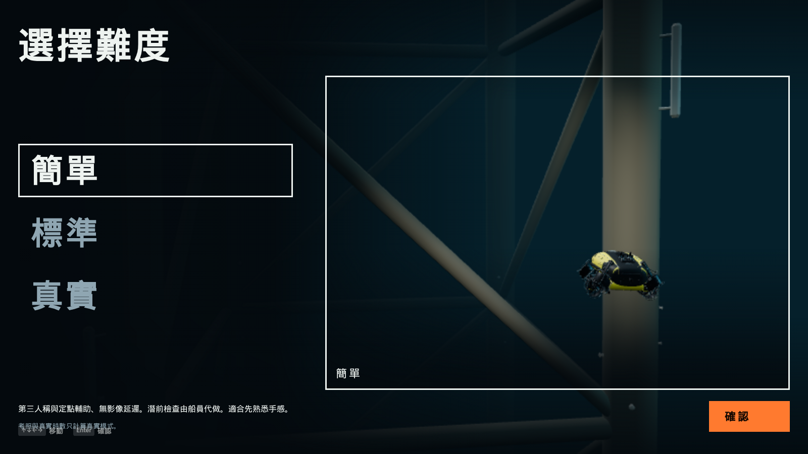
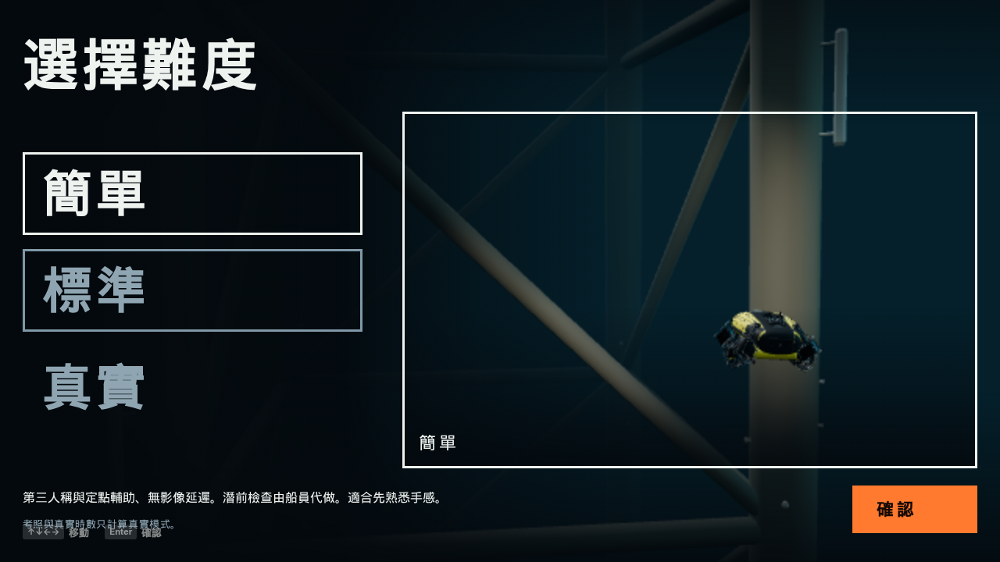
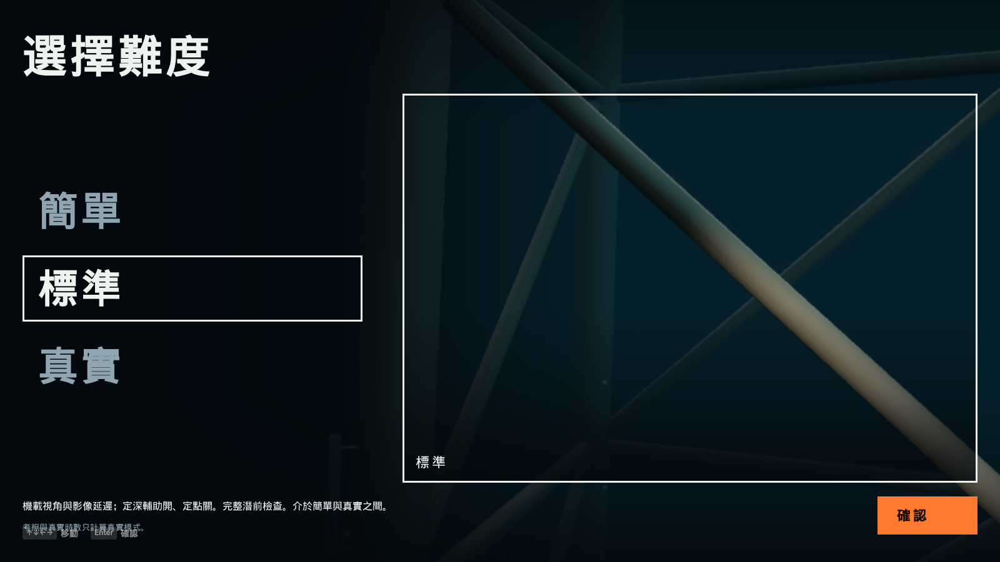
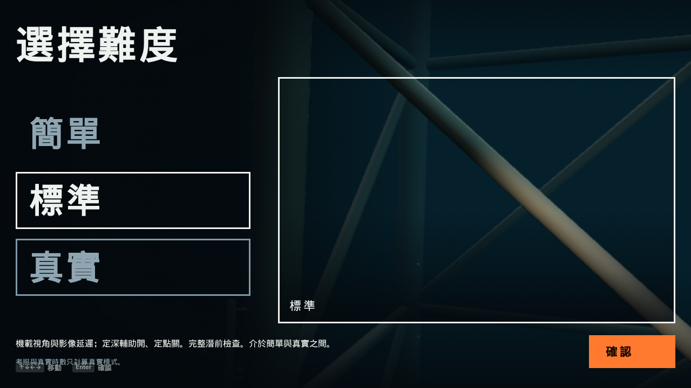
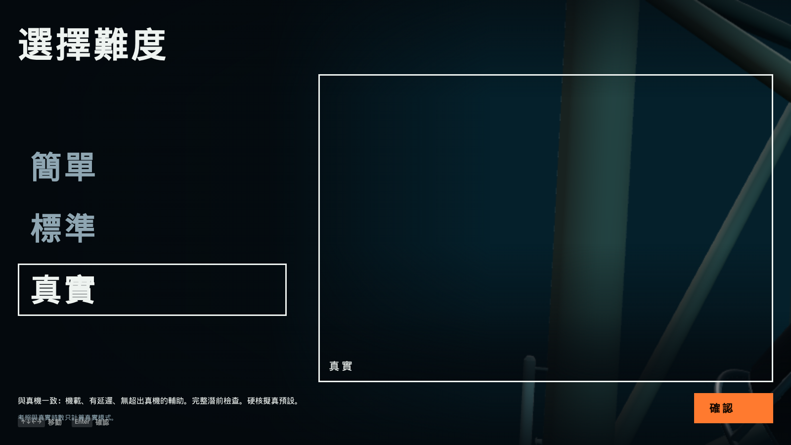
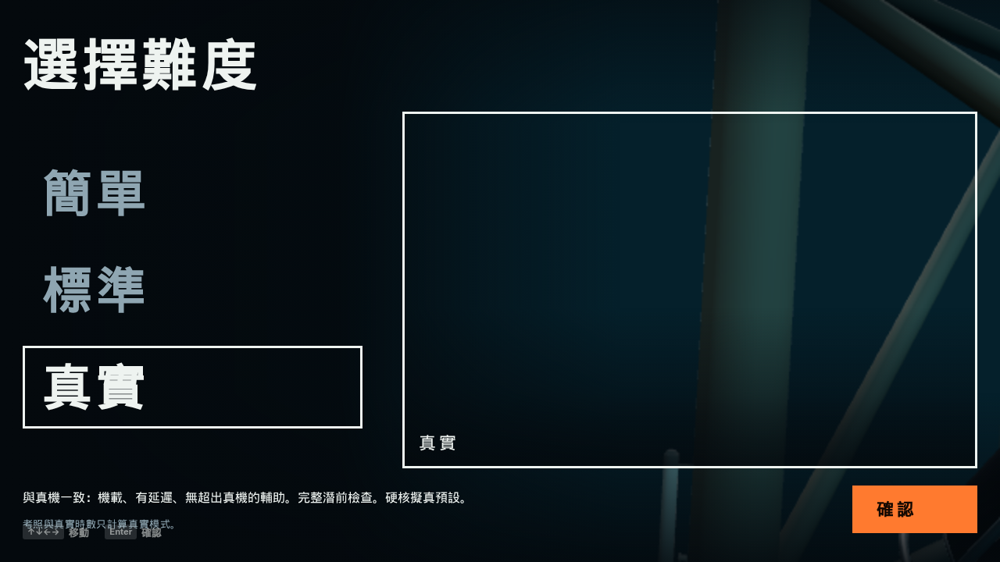

# P1：難度三檔與開新遊戲畫面

開新遊戲時的全螢幕難度選擇（簡單／標準／真實）。版面依 `docs/design/big-picture/`：全螢幕實景、大字選項、粗框標示、僅「確認」用安全橘。

| 選項 | 1600×900 | 1280×720 |
|---|---|---|
| 簡單 |  |  |
| 標準 |  |  |
| 真實 |  |  |

重新截圖：`python tools/run_browser_checks.py browser_new_game_smoke`（會寫入本目錄）。
