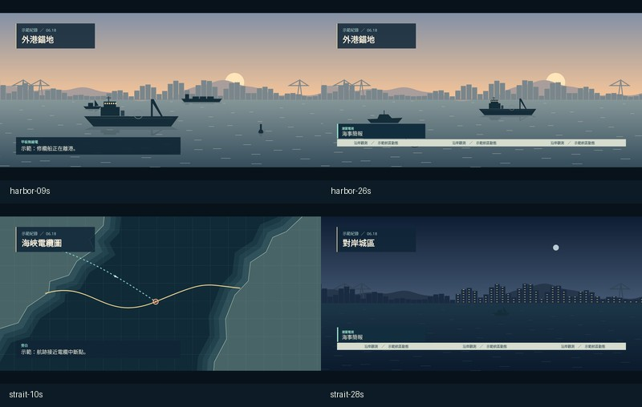

# K2 分鏡與審查畫面

劇情與教學選單提供《清晨出港》（34 秒）與《海峽航圖》（36 秒）。每格取自對應鏡頭的中段，原圖皆為 1600 × 900。



| 示範 | 第一鏡 | 第二鏡 |
| --- | --- | --- |
| 清晨出港 | [09 秒 · 外港錨地](harbor-09s.jpg) | [26 秒 · 海事簡報](harbor-26s.jpg) |
| 海峽航圖 | [10 秒 · 航跡與中斷點](strait-10s.jpg) | [28 秒 · 對岸城區](strait-28s.jpg) |

## 接到章節

在 campaign JSON 的 `beats` 加入獨立節拍，將前一節拍的 `next` 指向它。以下片段會在播完或跳過後接到 `briefing`。
`limit` 沿用 beat schema 的必填格式，過場的實際長度由分鏡決定。暫停時主機會等待玩家。
舊章節沿用原有節拍。多人以主機的播放進度決定何時交棒。

```json
{"id":"departure","storyboard":"harbor","next":"briefing","limit":34,"hud":[]}
```

## 分鏡座標與聲音

每支片放在 `simulator/viewer/story/cinematic/<id>.json`，依序播放 `shots`。時間單位為秒，每鏡重新起算。

| 欄位 | 用法 |
| --- | --- |
| scene、duration | 選 harbor、night 或 chart，並給正的鏡長。night 的 blackout 可啟用逐區熄燈。 |
| camera | path 以遞增的 t 與 position [x,y] 描述取景中心，使用預告工具的 Catmull–Rom。畫幅 1600 × 900，原點在左上。焦距 focalLength 以 36 mm 為基準；focus 指定清晰的景層。 |
| actors | kind 選 repair、fishing、cargo、patrol、buoy、rov 或 tether。path 與鏡頭使用相同座標；scale、depth、color 和出現區間 start、end 可選。 |
| map | cable 是 SVG 路徑。track 是起點、控制點、終點三組座標；arrival 決定標記抵達時間。breakPoint 與 breakAt 決定中斷標記的位置與出現時間。 |
| location、date、news、subtitle | 填 story.cinematic 的 i18n 鍵。news 依序為台標、主播字卡、跑馬燈；subtitle 依序為說話者與台詞。可用四語字典擴充。 |
| bars、fade | 上下黑邊像素數，每鏡首尾淡入淡出的秒數。 |
| cue、ambient | 使用 music.js 的過場 cue；ambient 為環境噪聲低通截止頻率（Hz）。兩者分別走既有音樂和環境音量。 |

這些畫面是虛構港區的分層插畫。船型比例、焦距效果與海岸線供敘事構圖使用。玩家可用空白鍵或按鈕暫停，
Esc、跳過按鈕或按住 ○ 約 0.8 秒結束。

## 錄製

在儲存庫根目錄執行 `python simulator/tools/trailer/cinematic.py`，會以固定 24 fps 產生畫面、
依分鏡混合配樂和環境聲，輸出 `output/trailer/harbor.mp4` 與 `strait.mp4`。
`--stills-only` 只更新審查圖，`--fps 30` 可更改影片幀率。
