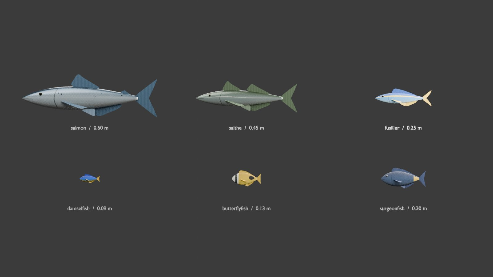

# N1 寫實魚模型

六種魚的原創幾何與程序貼圖；只交付資產，未修改遊戲程式。單位為公尺，鼻尖 +Z、背部 +Y，
原點位於鼻尖與尾端的中點及身體高度中線。體長為任務指定的展示個體全長，不代表物種最大體長。

## 重建與驗證

```sh
blender -b -P cad/build_fish_models.py
python cad/validate_fish_models.py
```

使用 Blender 4.3.2、內建 NumPy 與 Cycles CPU。無下載、外掛或額外 Python 套件；
程序貼圖固定 seed 71。完整命令同時重建六個 GLB、12 張 PNG、18 張棚拍、總覽及 validation.json。
驗證器直接讀取 GLB 二進位：三角形、尺寸、網格名稱、第二組 UV、法線、退化三角形、內嵌 PNG 與檔案上限。

每個 GLB 含三個獨立 mesh／node：`<id>_lod0`、`<id>_lod1`、`<id>_lod2`。
三層均位於原點；匯入端須選擇一層顯示，不能同時疊畫。未加入動畫、骨架或自動 LOD 選擇邏輯。
`TEXCOORD_0` 為貼圖 UV，`TEXCOORD_1.x = 0.5 - POSITION.z / 體長`，鼻尖為 0、尾端為 1；y 為 0。

## 材質與形態

每種各一張 512×256 RGB PNG base color（sRGB）與 512×256 ORM（線性資料），均內嵌 GLB，
外部 PNG 便於檢視。ORM 的 R=255（中性 AO）、G=粗糙度、B=金屬度。
鮭魚／青鱈身體金屬度 0.502，粗糙度約 0.30；礁魚金屬度為 0、粗糙度約 0.67。
鱗片僅用微弱色素差與粗糙度變化，不將光源、高光、環境遮蔽畫進 base color。
鰭為雙面單片，背鰭輪廓在近中 LOD 細分，叉尾保留實際凹口；眼睛為小型虹膜環及瞳孔。

## 文字參考與取捨

- [NOAA Fisheries：Atlantic salmon](https://www.fisheries.noaa.gov/species/atlantic-salmon)，
  查閱 Appearance 段落（2026-11-16）：紡錘形、略側扁、小頭，海洋期銀側、深背及淡腹。
  沒有下載或使用頁面照片。
- [任務規格](../../prompts/N1-fish.md)：六種體長、配色、脂鰭、黃色縱帶、眼帶與尾柄斑塊。
  其餘類群沒有指定學名；本作採一般外觀，不宣稱可供物種鑑定或精密生物量測。
- `saithe` 依任務要求做兩個背鰭。真實 Pollachius virens 常見三背鰭；此處是明確的規格取捨。
- 魚身比例、斑點排列、鰭展與眼睛大小為本次原創造型假設；未套用網路照片或他人模型。
  未取得可核實的其他類群公開文字頁面，因此不將它們列為已查閱來源。

## 棚拍

每種提供 `*_side.jpg`（側面）、`*_top.jpg`（正上方）、`*_front34.jpg`（3/4 前方）。
皆為 1600×900 JPEG、每張不超過 300,000 bytes，正交鏡頭與中性灰背景、三盞面光源。
單魚圖為各自取景；只有下方總覽在同一鏡頭中使用完全相同的公尺比例。
棚拍使用最高細節層；輪廓與材質仍需由美術審查者確認是否符合近距離品質期待。



## 交付數據

| id | 體長 m | LOD0 / 1 / 2 三角形 | GLB bytes | 棚拍 |
|---|---:|---|---:|---|
| salmon | 0.6 | 2276 / 700 / 236 | 133,144 | [側面](salmon_side.jpg) · [俯視](salmon_top.jpg) · [3/4](salmon_front34.jpg) |
| saithe | 0.45 | 2276 / 700 / 236 | 132,628 | [側面](saithe_side.jpg) · [俯視](saithe_top.jpg) · [3/4](saithe_front34.jpg) |
| fusilier | 0.25 | 2258 / 692 / 233 | 129,488 | [側面](fusilier_side.jpg) · [俯視](fusilier_top.jpg) · [3/4](fusilier_front34.jpg) |
| damselfish | 0.09 | 2258 / 692 / 233 | 131,336 | [側面](damselfish_side.jpg) · [俯視](damselfish_top.jpg) · [3/4](damselfish_front34.jpg) |
| butterflyfish | 0.13 | 2258 / 692 / 233 | 186,376 | [側面](butterflyfish_side.jpg) · [俯視](butterflyfish_top.jpg) · [3/4](butterflyfish_front34.jpg) |
| surgeonfish | 0.2 | 2258 / 692 / 233 | 130,000 | [側面](surgeonfish_side.jpg) · [俯視](surgeonfish_top.jpg) · [3/4](surgeonfish_front34.jpg) |

所有數值亦記錄於 [validation.json](validation.json)。GLB、貼圖與棚拍均為任務要求的必要交付產生物；單檔不超過 2 MB。

## 本機資產驗證結果

- Blender 4.3.2 完整重建命令 exit 0。
- 獨立 GLB／JPEG 驗證器通過六種魚與 19 張圖片；所有三角形非退化、法線有限且正規化。
- 再次執行幾何與貼圖生成後，六個 GLB、12 張 PNG 的 SHA-256 全部相同。
- 六個 GLB 均經 Blender glTF importer 重新載入，並重新渲染同比例總覽確認材質、方向與尺寸。
- 沒有改動遊戲程式；完整倉庫回歸測試結果列於 PR 描述。
