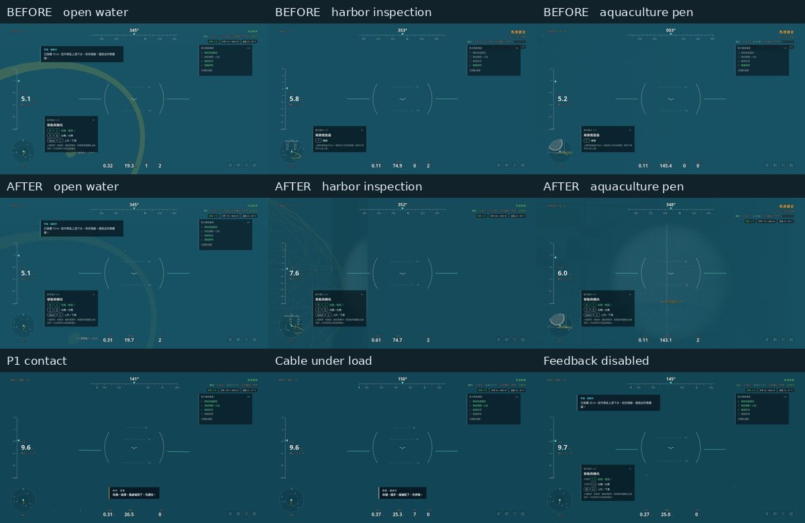

# R7 潛航回饋量測



基準為 `7dc785a`。每場從獨立房間進入場景訓練，種子 42、機載相機、assisted、performance。用相同腳本以 Chromium 軟體繪圖錄下 60 秒操作。量測視窗 800 × 450，結束後另拍 1600 × 900 JPEG。錄影包含載入和收尾，表格僅採計中間 60 秒。

延遲從腳本寫入駕駛輸入層開始，以瀏覽器的單調時鐘量測。解鎖、燈及定深採計相符狀態首次排程的控制台聲音。前推與回中採計延遲顯示狀態送入推進器混音的時間，前推另要求載具解鎖且已有非零推力。這些數字包含取樣、網路回送與頁面更新，耳機端延遲需用硬體量測。逐項等待回應，超過 6.5 秒標示「逾時」。

空白秒數以互不重疊的一秒格計數。格內若有音效起音、操作回應、船員字幕、新碰撞或纜線告警，即計為有事件。持續底噪、既有字幕和連續水流不會把整段都算成有事件。船員的 45 秒計時以目前任務內最近的新事件／既有角色通話為準。隨機水生聲、物理軌跡及軟體繪圖負載都會影響單趟計數。

## 現況

| 場景 | 解鎖 ms | 燈 ms | 定深切換 ms | 前推 ms | 回中 ms | 空白秒數 / 60 | 船員通話 |
|---|---:|---:|---:|---:|---:|---:|---:|
| [開放水域](before-open_water.json) | 935 | 1496 | 1585 | 801 | 1565 | 54 | 0 |
| [港口](before-harbor_inspection.json) | 逾時 | 1493 | 2594 | 逾時 | 2106 | 53 | 0 |
| [網箱](before-aquaculture_pen.json) | 逾時 | 4512 | 2624 | 逾時 | 3645 | 54 | 0 |

## 之後

| 場景 | 解鎖 ms | 燈 ms | 定深切換 ms | 前推 ms | 回中 ms | 空白秒數 / 60 | 船員通話 |
|---|---:|---:|---:|---:|---:|---:|---:|
| [開放水域](after-open_water.json) | 1496 | 2843 | 720 | 1095 | 2591 | 52 | 1 |
| [港口](after-harbor_inspection.json) | 3501 | 1711 | 1654 | 790 | 1629 | 53 | 1 |
| [網箱](after-aquaculture_pen.json) | 1565 | 1530 | 1943 | 2798 | 533 | 49 | 1 |

## 撞樁與受力

另在 `tether_untangle` 側推靠上 P1，接著收纜、反向側推。使用主機碰撞事件與纜端實際張力，瀏覽器只替換手把裝置。下表為其中一次有回饋航程與關閉航程的觀測。

| 事件 | main | R7 開啟 | R7 關閉 |
|---|---|---|---|
| 樁體接觸 | 0.66 m/s、通用 hard 聲，250 ms 震動 | 0.67 m/s、鋼材聲包絡，250 ms 震動；短暫影像干擾，指揮報機身接觸 | 主機仍有接觸；撞擊聲、影像干擾、通話與震動皆為零 |
| 主機 `tether.warn` | 既有絞盤機械聲及讀數；本趟未到額定警戒，沒有張力震動或通話 | 拉扯音隨載重升高；180 ms 震動與纜手通報皆跟 `tether.warn` | 主機仍可 warn；撞擊聲、影像干擾、通話與震動皆為零 |

[撞樁畫面](pile-contact.jpg) · [拉纜畫面](pull-muted-False.jpg) · [關閉回饋](pull-muted-True.jpg)

張力震動與纜手通報只跟主機的 `tether.warn`（額定工作負荷）。拉扯聲連續增益仍依兩端張力正規化，讓未到警戒前也聽得到受力。每種材質的頻譜、聲像比例、影像干擾強度與震動包絡皆為呈現假設；目前自有參考目錄僅有合成資料。鋼、混凝土與網依世界障礙物類別判別，海床用沙地音色。轉速音高由各馬達已實現推力的平方根估計。

## 重現

在對應的基準與修改版本各啟動 `python -m qysim.server`。以下指令自儲存庫根目錄執行，將環境變數指向正在量測的主機。量測工具使用 R7 版本，兩次僅更換伺服器及輸出標記。

```sh
export ROV_HTTP_PORT=8080 ROV_WS_PORT=8765
python simulator/tools/browser_feel_measure.py before
python simulator/tools/browser_feel_smoke.py --baseline
# 將上方環境變數改指 R7 主機
python simulator/tools/browser_feel_measure.py after
python simulator/tools/run_browser_checks.py browser_feel_smoke
```

逐事件時間在表內的 JSON 連結；六段 WebM 由腳本存至 `simulator/output/feel-measure/`。手把實體機構與揚聲器音色仍需硬體試駕。船員優先播放已安裝的配音片段，缺片時採用符合語言的系統本機語音，無相符語音時保留字幕。
