# 港口樁身與遺落物近景

遊戲內使用種子 42、真實模式、中畫質、機載鏡頭與一級燈光。每張原圖均為 1600 × 900。左右使用相同回放姿態，樁身三張均對準 Harbor pile A 朝港外的一面，瞄準點位於水下 2.6 m。距離從鏡頭光心量至樁面或指定道具瞄準點。

| 距離與目標 | 修改前（PR #141 合併 main 後） | 修改後 |
|---|---|---|
| 樁身 1 m | [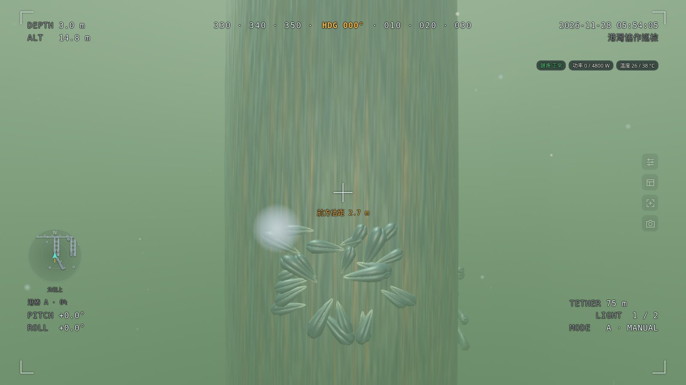](./before/pile-1m.jpg) | [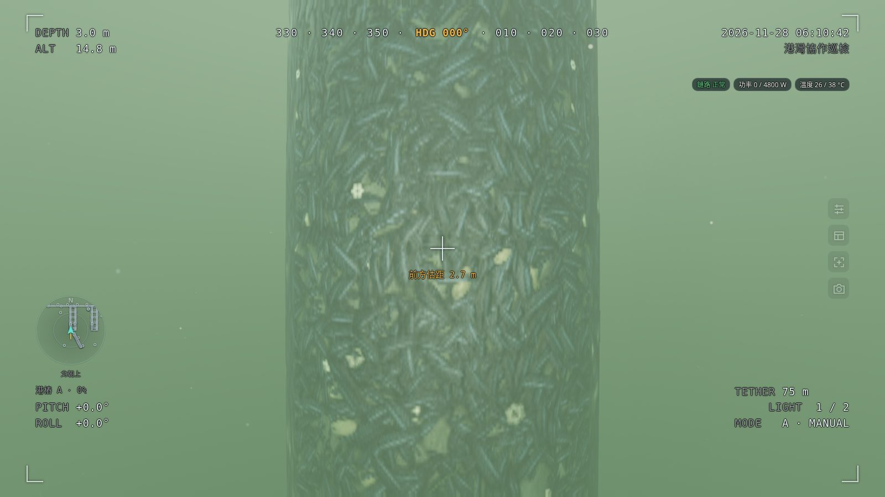](./after/pile-1m.jpg) |
| 樁身 3 m | [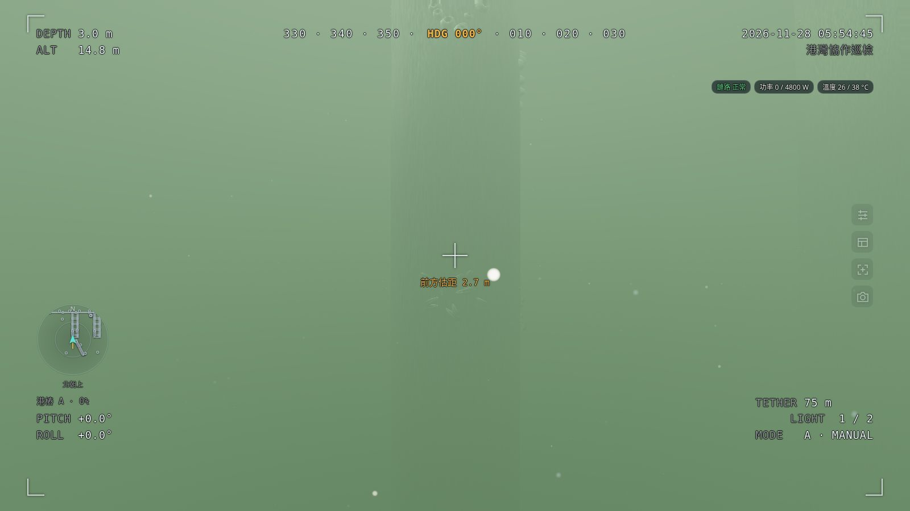](./before/pile-3m.jpg) | [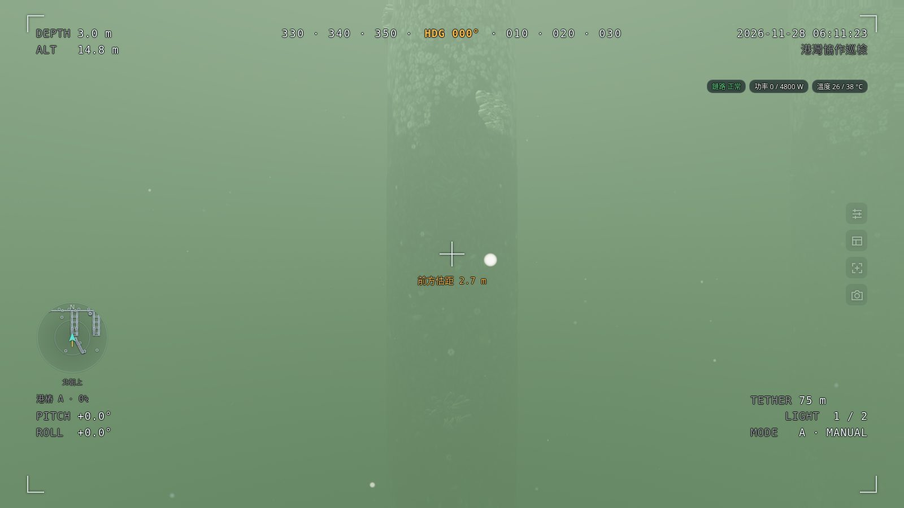](./after/pile-3m.jpg) |
| 樁身 6 m | [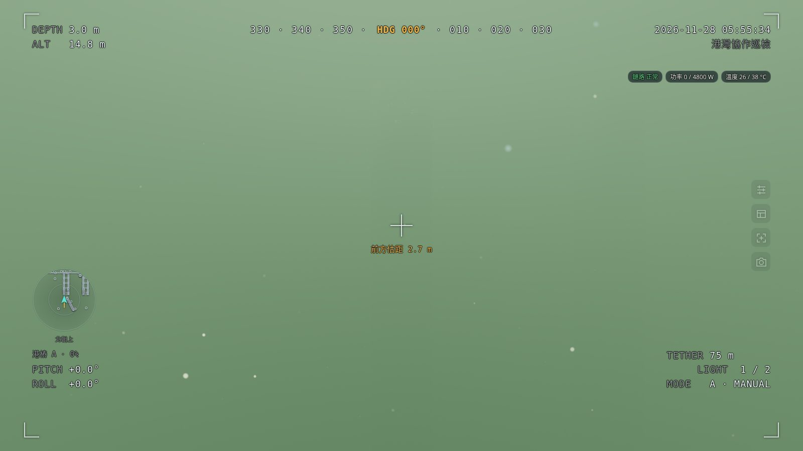](./before/pile-6m.jpg) | [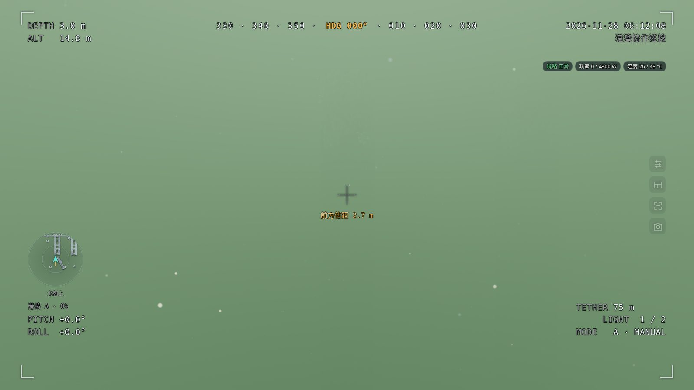](./after/pile-6m.jpg) |
| 蟹籠 1 m | [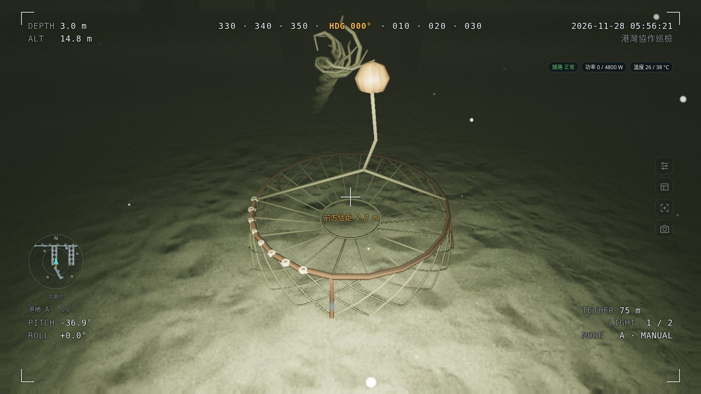](./before/crab-pot.jpg) | [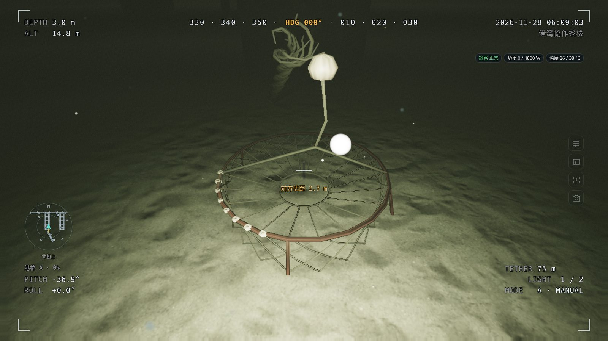](./after/crab-pot.jpg) |
| 卸扣 1 m | [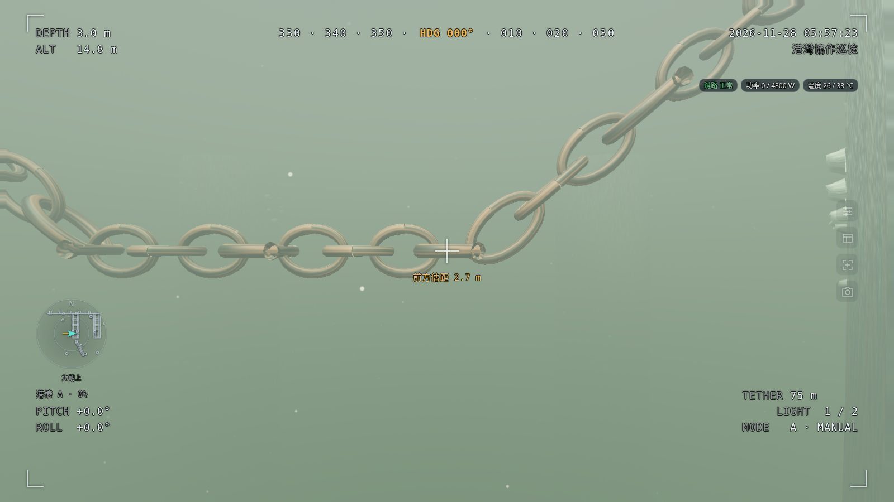](./before/shackle.jpg) | [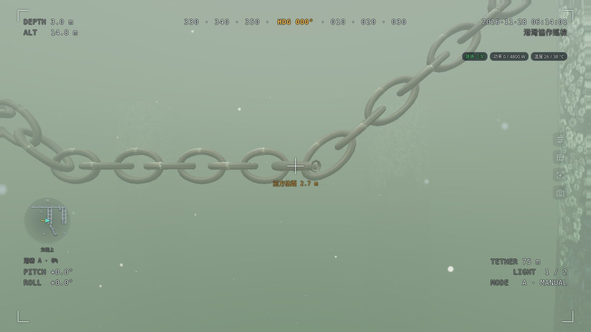](./after/shackle.jpg) |
| 輪胎 1 m | [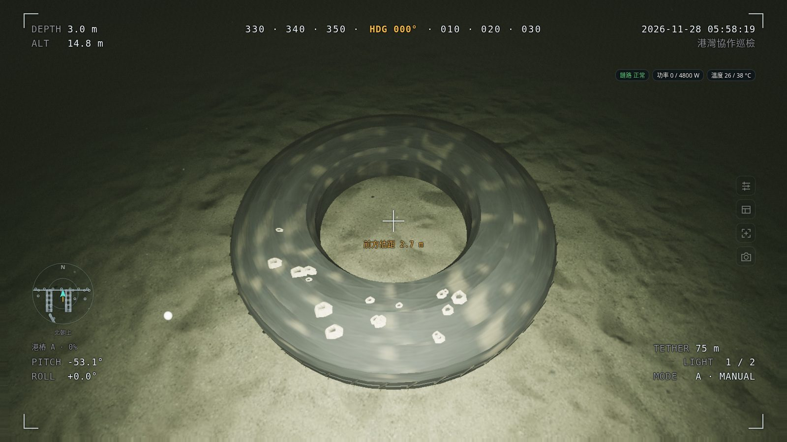](./before/tyre.jpg) | [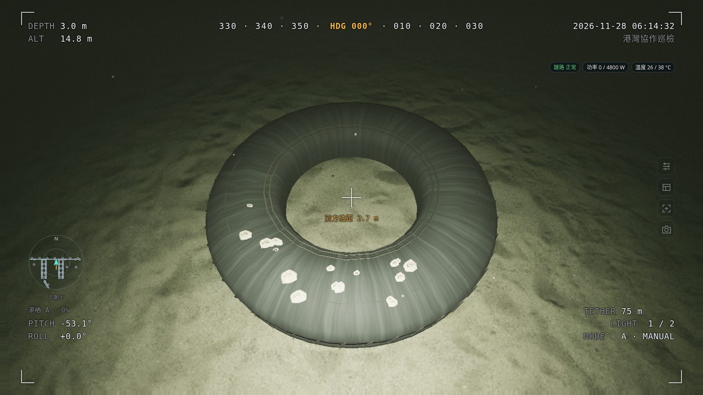](./after/tyre.jpg) |

## 分帶與輪廓

混凝土樁共用沿深度展開的外殼。色圖、法線、高度及粗糙度取樣同一批程序殼體。水線處以藤壺為主，向下過渡至貽貝床、絲藻與海鞘，再到海床附近較稀疏的混合附著。樁面隨水體能見度衰減，輪廓模型在 4–5、6–7、7.5–8.5 m 漸變。分帶與個體尺寸是美術設定。

[分帶棚拍](pile-bands.jpg) · [色圖](../../../simulator/viewer/models/harbor/pile-color.jpg) · [法線](../../../simulator/viewer/models/harbor/pile-normal.jpg) · [高度](../../../simulator/viewer/models/harbor/pile-height.jpg)

## 模型規格

| 模型棚拍 | LOD0 三角形 | LOD1 | LOD2 | GLB 位元組 |
|---|---:|---:|---:|---:|
| [barnacles-100](barnacles-100.jpg) | 2998 | 998 | 298 | 191,540 |
| [barnacles-30](barnacles-30.jpg) | 2997 | 998 | 298 | 191,612 |
| [barnacles-60](barnacles-60.jpg) | 2998 | 998 | 298 | 191,392 |
| [chain-links](chain-links.jpg) | 1816 | 752 | 272 | 171,752 |
| [crab-pot](crab-pot.jpg) | 2676 | 998 | 298 | 188,364 |
| [discarded-tyre](discarded-tyre.jpg) | 2998 | 997 | 298 | 239,996 |
| [filaments-ascidians](filaments-ascidians.jpg) | 2997 | 997 | 297 | 206,484 |
| [mussels-100](mussels-100.jpg) | 2998 | 998 | 298 | 186,268 |
| [mussels-30](mussels-30.jpg) | 2998 | 998 | 298 | 186,336 |
| [mussels-60](mussels-60.jpg) | 2998 | 997 | 298 | 186,172 |
| [parted-hawser](parted-hawser.jpg) | 2784 | 960 | 234 | 159,768 |
| [shackle-chain](shackle-chain.jpg) | 1928 | 822 | 298 | 178,728 |

兩版的拍攝程序見 [capture_harbor_props.py](../../../simulator/tools/capture_harbor_props.py)。[第一輪審查紀錄](https://github.com/jekaihsu/rov/tree/a6a6053a3dff9cea1b4f7d81f02346749e5f9433/docs/design/harbor-props-v2)。
