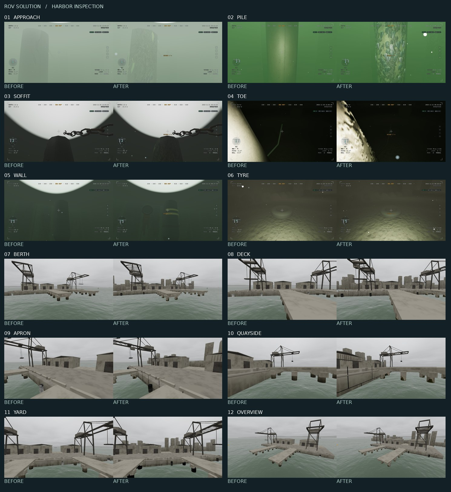
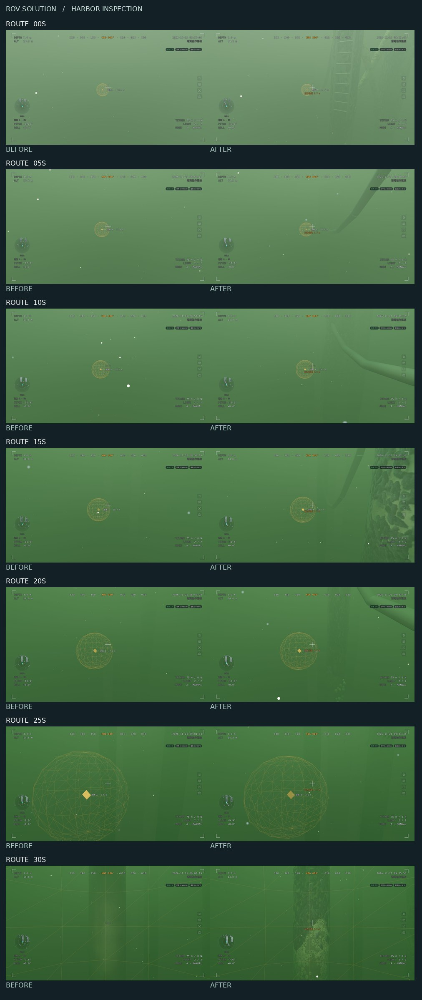

# 青嶼港雙棧橋



兩條棧橋從岸壁往港池延伸。ROV 可沿外排巡樁、穿越排架，或沿中央航道接近岸壁。水線附近可見海藻帶，中層有深色貽貝團塊，更深處可見淺色鈣質附著。近底有輪胎、斷纜、塊體及碎石。既有港水光學、懸浮粒子及淤泥再懸浮模型決定燈光能照多遠。

## 尺寸依據

UFC 4-152-01《Piers and Wharves》（2017 年版，2024 年修訂）§4-1.3.1 記錄過直徑 48 英寸（約 1.2 m）及以上的預製空心混凝土圓樁。本場景採 1.2 m 外徑。其餘尺寸為虛構青嶼港的配置假設，保留第一章的巡檢點與進場空間。[公開設計文件（PDF）](https://www.wbdg.org/FFC/DOD/UFC/ufc_4_152_01_2017_c1.pdf)

| 構件 | 遊戲尺寸 |
| --- | --- |
| 棧橋排架 | 每座五組排架、每組兩樁，沿棧橋間距 5 m，橫向間距 4 m |
| 樁帽橫梁 | 長 5.7 m、寬 1.16 m、高 0.90 m |
| 縱梁及橋面 | 縱梁寬 0.64 m、高 0.56 m，橋面寬 6.2 m、厚 0.44 m |
| 岸壁、港池 | 岸壁長 70 m，壁頂高出水面 2 m，港池名義水深 18 m |
| 水下光學 | 中層能見度參數 7 m，距底 2 m 內受既有底部混濁層影響 |

樁、梁板、岸壁、防舷材、懸鏈及海床雜物由伺服器障礙物生成。鏈段以膠囊體近似整段鏈環的包絡面。樁身按上下端深度分組實例化，每根依碰撞半徑與長度縮放。近距離可見實例化的殼與葉；遠處收起附著幾何，保留共用的彩色與法線貼圖。岸上車擋、吊機與倉庫位於水下載具的作業範圍外。

材質沿用已入庫的 CC0 掃描及原創幾何。[素材清單及授權證明](../../../simulator/viewer/models/CREDITS.md)

## 重拍

由對應版本的伺服器提供 viewer。水下使用固定 NED 位姿的 replay、機載攝影機和二級燈；水面使用固定相機與運行中的日照系統。取景表在拍攝腳本內。比較不同版本時，為腳本提供相應版本的 qysim 及 viewer。

```bash
cd simulator
python -m qysim.server
# 另一個終端於 simulator/ 執行
ROV_HTTP_PORT=8080 ROV_WS_PORT=8765 python tools/capture_harbor_r5.py after
```

## 審查退回後的進場線

重拍的基準為 PR #123 的 d6a28e2。固定視角有水下與水面各六張。進場線從 NED (0, 0, 3) 到 (18, −10, 8)，朝第一個巡檢點前方的外排樁，以 30 秒回放路徑每 5 秒取一個等距機載位姿。兩版都用種子 42、中畫質、二級燈。此取樣衡量路線的構圖，時間來自預設航速。空鏡定義為只有水體或平坦泥底；HUD、工程標記與懸浮粒子皆不計作主體。

基準版空鏡為 5/7（71.4%），出現在 0、5、10、15、20 秒；返工後為 0/7（0%）。0 秒可辨登乘梯，5 與 10 秒有下垂繫纜，15 秒能看見繫纜旁的附著帶，20 秒有前方老樁與右上方纜線。25 秒是最弱的一張，巡檢樁的剪影在目標標記後方，30 秒才能看出樁面的凹凸。



近岸的三個辨識點為帶登乘梯與交叉斜撐的外側繫泊墩、截斷的雙樁、帶懸鏈的巡檢棧橋。老樁的尺寸、位置、遺落物位置與附著深度為虛構港區配置。港泥起伏採既有地形模型，最大高差參數為 0.18 m。探勘模式有 16 個定點海星或藻叢、6 件掉落的梅開扳手、折疊錨或索眼，以及 4 群魚。拍照沿用機載取景、遮蔽、混濁度與伺服器身分檢查，成功時可以從圖鑑回看原圖。
