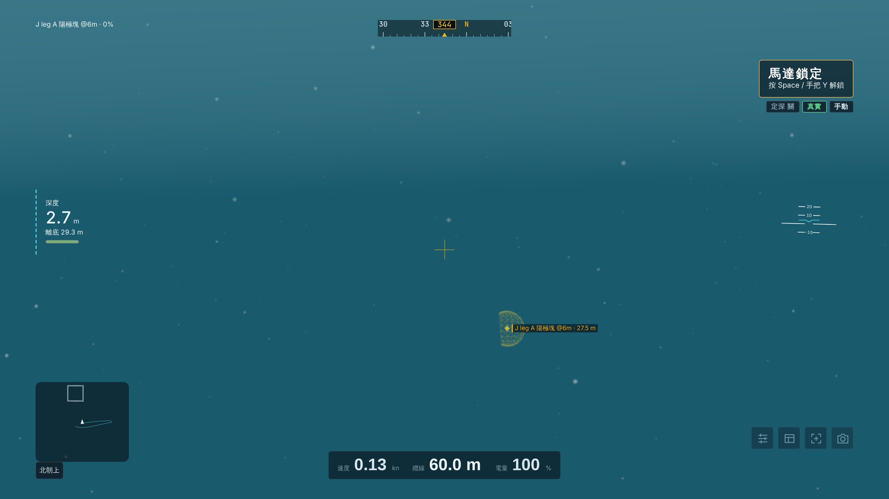
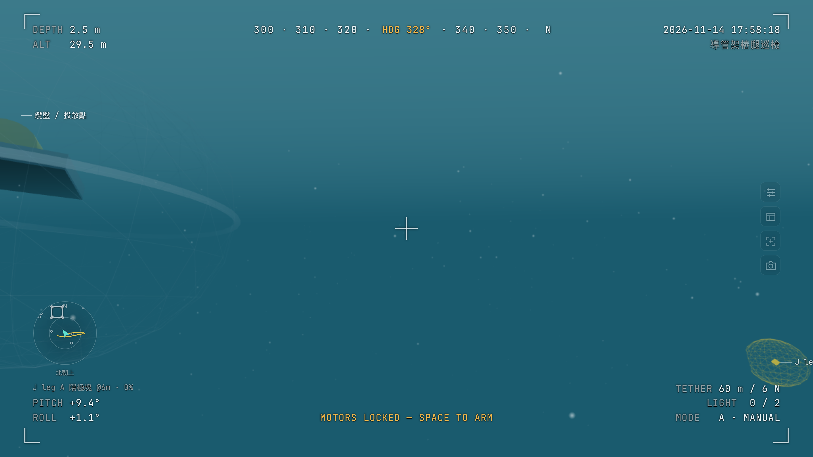
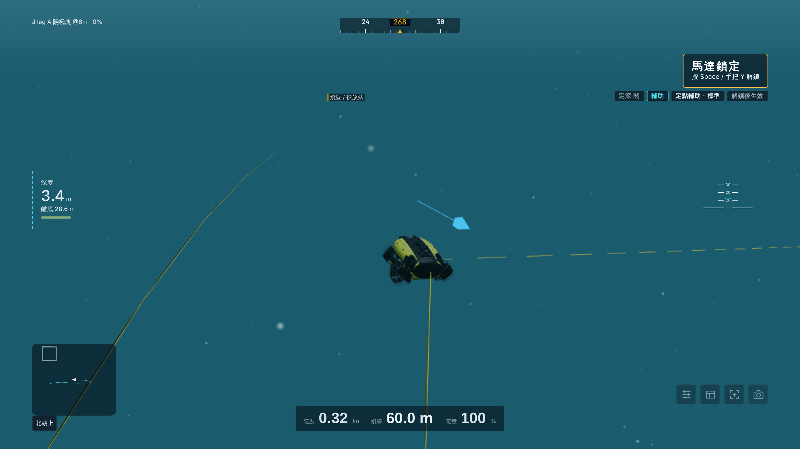
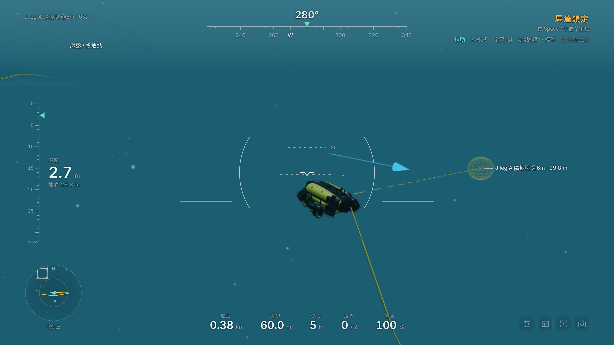
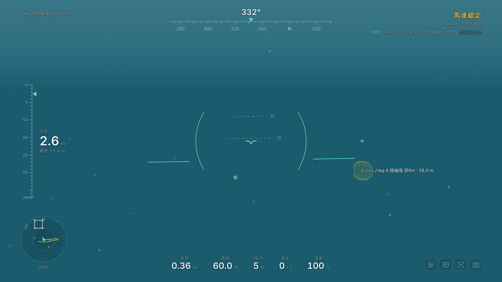
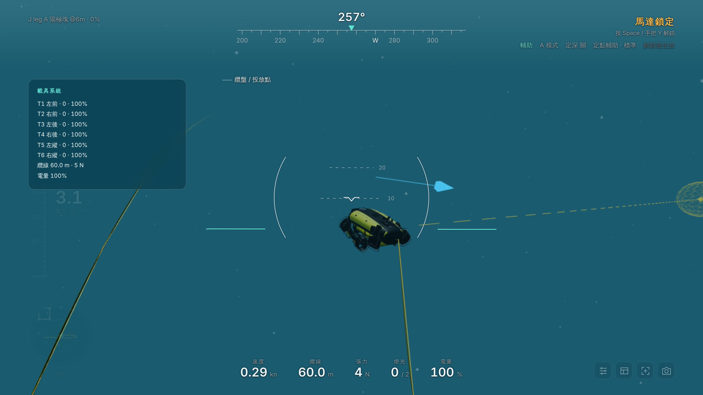
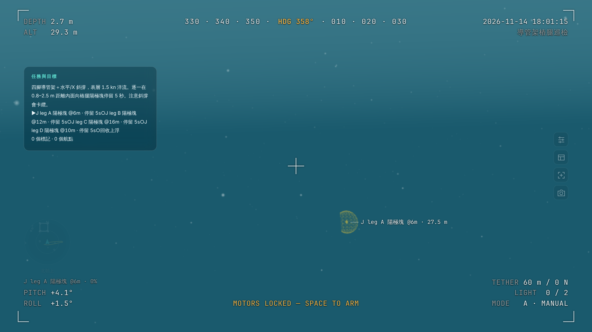
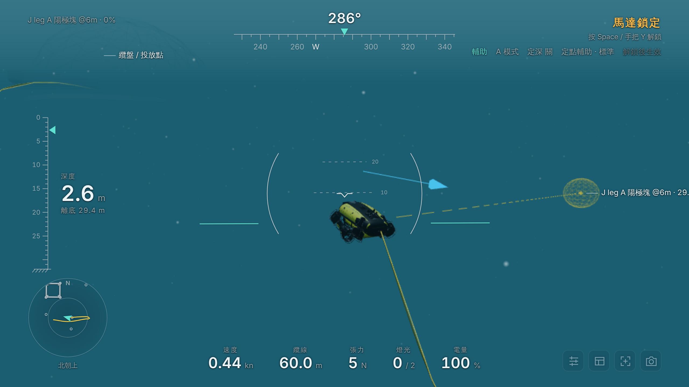
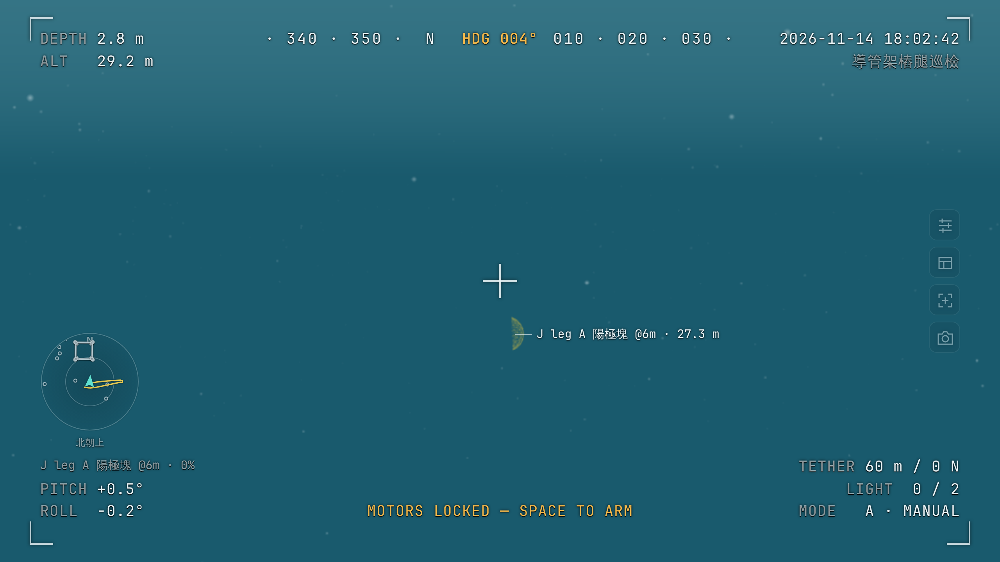

# 飛行 HUD 改版（線條儀表／影像疊字）

依 `docs/design/mockups/hud-directions.html` 的方向 A（線條儀表）與 B（影像疊字）實作。截圖為 1600×900（另附 1280×720），
deviceScaleFactor 2，`jacket_inspection` 情境、馬達鎖定、剛下水（深度約 3 m）。

## 切換規則

擬真設定新增 `hudStyle`（HUD 樣式）：`auto`（預設）、`line`、`osd`。純呈現偏好（`presetNeutral`），不超出真機。

- `auto`：真實預設組 + 機載視角 → 影像疊字（B）；其他情況（輔助、自訂、第三人稱）→ 線條儀表（A）。
- 可用 URL `?hudStyle=line|osd` 或擬真設定面板強制指定。

## 前後對照

| | 改版前 | 改版後 |
|---|---|---|
| 真實／機載 |  |  |
| 輔助／追蹤 |  |  |

改版前：每個讀數各自一塊深色實心底板（航向帶、底部讀數條、鎖定框、膠囊、小地圖），畫面沒有中心。
改版後：線條儀表沒有實心面板，中央是姿態參考（側弧、隨橫滾旋轉並隨俯仰平移的水平線、±10／±20 俯仰梯、固定機體符號）；
真實模式機載畫面改為檢測影片式的四角等寬疊字。

## 其他截圖

- 輔助／機載（線條儀表）：
- 速覽卡（載具系統，線條儀表）：
- 速覽卡（任務與目標，影像疊字）：
- 1280×720 線條儀表：
- 1280×720 影像疊字：

## 欄位說明

影像疊字只顯示 state 有的資料：深度、離底、航向、俯仰、橫滾、纜線長度／張力、燈光檔位、控制模式與輔助、定深設定點、
錄影計時（`recording` 由 false 轉 true 時以模擬時間起算）、日期時間（本機時鐘）、情境名稱與探勘潛次編號（有才顯示）。
mockup 中的水溫（TEMP）與鏡頭俯仰（TILT）目前 state 沒有提供，因此不顯示，不造假。
