# 效能：哪裡花時間、改了什麼（perf/smooth）

業主試玩回饋「不錯但是太卡」。本輪目標：一般遊戲電腦與筆電上順暢，**最低規格**為業主的筆電：
ASUSPRO P2540UB、Intel Core i5-8250U（4C/8T、15 W）、8 GB、Intel UHD 620（Chrome 走這顆；MX110 存在但
Chrome 不用）、1366×768 @60 Hz、伺服器同機執行。要求：auto 畫質在開放水域、港區樁群、魚網箱穩定 ≥30 fps
（低檔最好 45–60），沒有數百毫秒的卡頓；主選單與下水動畫不得比潛航重。

**不動的東西**：物理、協定、SDK 語意、伺服器輸出（伺服器只做了逐位元相同的重構）。畫面只在「看不出來」的
範圍內變，前後截圖在本目錄 `shots/`。

## 1. 量測方法

這台機器沒有實體 GPU（SwiftShader 軟體算圖），所以毫秒數不代表玩家機器。主要證據是**和解析度、GPU 無關的
計數**；SwiftShader 幀率只拿來同機前後對照（而且這台機器同時被其他代理使用，幀率雜訊很大）。

| 工具 | 量什麼 |
|---|---|
| `simulator/tools/perf_probe.js`（注入頁面） | 每個 rAF 幀：draw call、三角形、instance、render pass 與其目標尺寸、全螢幕 pass、上傳位元組、程式切換、shader 編譯、同步讀回（readPixels／getError…）、GPU 貼圖／緩衝記憶體、該幀 JS 毫秒 |
| `_perf_scenes.py` + CDP | 每幀主執行緒 script／layout／style 毫秒（`Performance.getMetrics`）、取樣 profiler 依模組分組與前 15 名函式 |
| `browser_gpu_bench.py --profile` | 上述資料：主選單（各畫質）、下水動畫甲板、每個場址機載與第三人稱（各畫質） |
| `browser_gpu_bench.py --check` | 依 `tools/perf_budgets.json` 的計數預算檢查，超出即失敗（見 §6） |
| `tools/server_step_bench.py` | 伺服器每場址 100 Hz 步進耗時（中位數、p95、p99、最大）、狀態訊息大小、編碼時間 |
| `tools/server_cpu_share.py` | 伺服器行程在一位觀看者連線時佔用的 CPU（100 % = 一顆核心） |

畫面一律 1280×720（計數表）或 1600×900（截圖），`seed=1` 起始姿態，機載與第三人稱在同一頁切換。

## 2. 成本排名（改動前，由大到小）

1. **水下光學的逐像素成本（medium 以上）。** 同一場址機載畫面，performance（舊式外觀、無後製）與 medium（光學）
   的 SwiftShader 幀率比約 2.8 倍（全表平均 5.1 vs 1.8 fps），三角形與 draw call 幾乎相同，差的全是像素：
   每個材質的 `waterApply`（燈光後向散射 8 步 × 2 盞燈）、整張螢幕先畫一次的水色背景（同一個積分，之後大半被
   海床與結構蓋掉）、以及 **3 道全解析度後製**（曝光套用、機載鏡頭、輸出；第三人稱 2 道），每道讀寫一張
   半浮點全螢幕影像。在 UHD 620 這類共用記憶體頻寬的晶片上這是最大的固定成本。
2. **第三人稱、主選單、下水動畫的 X1 LOD0（48.6 萬三角形）。** 追蹤鏡頭距離約 2.7 m，舊的 LOD 切換距離是 12 m，
   所以第三人稱一律畫 LOD0：三角形 82–136k（機載）→ 568–645k（第三人稱），performance 檔 fps 5.1 → 1.6。主選單
   標題畫面 525k、下水動畫 600–700k 也是同一個原因（主選單比潛航重）。旋轉中的推進器永遠是 LOD0（6 × 9k）。
3. **潛航中途的 shader 編譯卡頓。** 機載視角隱藏機體，第一次切到第三人稱時才編譯機體材質；支援船與船員在載入後
   數秒才出現；high 檔大貼圖船更晚。量測視窗內 6–8 次編譯、`getProgramInfoLog` 平均 28–52 ms／幀，實際是數百
   毫秒的單次停頓。
4. **自動畫質的降級順序與起點。** 第一個慢的 1.5 s 視窗就直接關掉光學（舊式外觀），而這一步要重新編譯所有材質
   ——在弱 GPU 上正好是一次長卡頓；整合式 GPU（UHD 620）一開始仍是光學、medium 場景細節；每次啟動都從頭再
   卡一次。
5. **主執行緒 DOM 版面強制重算。** 第一名 JS 函式是 `fitCanvas`（每幀 1.5–3 ms）：HUD 每幀先寫文字，四個儀表
   canvas 再讀 `clientWidth`，強迫同步 layout；`getBoundingClientRect`（標籤）、`getPropertyValue`（UI 顏色）、
   搖桿指示的 `clientWidth` 同理。HUD／DOM 是最大的 JS 群組（2–5 ms／幀），另有 layout 1.5–2.5 ms、style
   2–3.5 ms／幀；HUD 每幀無條件重寫 `textContent`、`title`、`aria-label`、`dataset`，小地圖每幀重畫。
6. **畫布 MSAA 白費。** 光學檔把場景畫到半浮點目標，畫布只收一張全螢幕四邊形，但 WebGL context 仍以
   `antialias: true` 建立：1366×768 4× MSAA 約 33 MB 顯示記憶體加每幀 resolve；Intel 驅動在 Chrome 還標記
   `msaa_is_slow`。
7. **伺服器。** 100 Hz 步進中位數 1.7–3.1 ms（本機），但每 0.2 s 一次的回聲／聲納射線追蹤（船殼 SDF 純 numpy）與魚群
   更新同一拍，`hull_inspection` p99 16–27 ms；一位觀看者時伺服器佔一顆核心 29–51 %（open_water 最低、港區與船殼
   最高），狀態訊息約 8 KB、約 25–27 則／秒。在 4 核 15 W 筆電上它與 Chrome 搶 CPU。**魚網箱（aquaculture_pen）
   最重**：70 個網片 Box 與 236 條纜繩 capsule，每次最近表面查詢都逐一走過 70 個 Box（Python 迴圈），回聲射線追蹤
   每次 48–87 ms、魚群更新每次約 84 ms，兩者同拍時單一步進 200 ms 以上；一位觀看者時佔 70 % 核心、狀態只送出
   約 11 則／秒（本機高負載下量測）。
8. **潛航全程留在水面的支援船與船員。** 41 個 draw call（LOD0）加一個骨架動畫船員（每幀上傳骨架貼圖、每幀
   動畫更新），在 20 m 深、能見度 10 m 時完全看不到，仍然每幀處理。
9. 其餘量過但不是瓶頸：draw call 26–173（結構、護坡岩、風機、魚都已 instanced；最多的是韓國城沉船）、曝光測光沒有任何 GPU 讀回
   （`readPixels` 每幀 0 次）、水下不更新陰影圖、`scene.traverse` 每幀一次約 0.1 ms、每幀 165 KB 上傳主要是
   instance 矩陣與纜線頂點（合理）。貼圖記憶體 performance 7–59 MB、medium 38–94 MB、high 50–145 MB（韓國城沉船最高）。

## 3. 各場景 × 畫質（改動前完整表）

| 場景 | draw calls | 三角形 k | pass | 全螢幕 pass | 貼圖 MB | 程式數 | 主執行緒 script ms/幀 | layout ms/幀 | SwiftShader fps |
|---|---:|---:|---:|---:|---:|---:|---:|---:|---:|
| `menu:performance` | 55 | 525 | 1 | 0 | 30.5 | 16 | 2.6 | 0.0 | 2.05 |
| `menu:medium` | 55 | 525 | 1 | 0 | 30.5 | 16 | 3.34 | 0.0 | 1.63 |
| `menu:high` | 55 | 525 | 1 | 0 | 30.5 | 16 | 3.46 | 0.0 | 1.45 |
| `intro:jacket_inspection:performance` | 136 | 607 | 1 | 0 | 43.5 | 43 | 8.47 | 0.75 | 1.16 |
| `intro:jacket_inspection:medium` | 219 | 703 | 9 | 7 | 97.9 | 67 | 8.41 | 0.75 | 1.2 |
| `intro:harbor_inspection:medium` | 140 | 621 | 8 | 7 | 83.2 | 56 | 12.05 | 0.9 | 1.22 |
| `dive:jacket_inspection:performance:onboard` | 57 | 64 | 1 | 0 | 19.9 | 28 | 8.6 | 1.51 | 5.6 |
| `dive:jacket_inspection:performance:third` | 95 | 550 | 1 | 0 | 19.9 | 32 | 9.53 | 2.45 | 1.72 |
| `dive:jacket_inspection:medium:onboard` | 66 | 84 | 7 | 6 | 80.9 | 43 | 26.53 | 1.92 | 1.99 |
| `dive:jacket_inspection:medium:third` | 101 | 570 | 6 | 5 | 80.9 | 47 | 12.16 | 1.81 | 1.83 |
| `dive:jacket_inspection:high:onboard` | 86 | 116 | 7 | 6 | 93 | 46 | 64.84 | 2.06 | 1.22 |
| `dive:jacket_inspection:high:third` | 125 | 603 | 6 | 5 | 107 | 51 | 9.1 | 1.61 | 1.49 |
| `dive:monopile_current:performance:onboard` | 51 | 58 | 1 | 0 | 19.9 | 28 | 8.25 | 1.46 | 6.43 |
| `dive:monopile_current:performance:third` | 89 | 546 | 1 | 0 | 19.9 | 32 | 10.16 | 1.54 | 1.83 |
| `dive:monopile_current:medium:onboard` | 59 | 76 | 7 | 6 | 64.9 | 43 | 10.61 | 2.25 | 2.0 |
| `dive:monopile_current:medium:third` | 96 | 564 | 6 | 5 | 64.9 | 47 | 10.53 | 1.88 | 1.9 |
| `dive:monopile_current:high:onboard` | 62 | 97 | 7 | 6 | 82.6 | 45 | 74.2 | 1.95 | 1.15 |
| `dive:monopile_current:high:third` | 98 | 585 | 6 | 5 | 82.6 | 49 | 9.06 | 1.53 | 1.34 |
| `dive:tether_untangle:performance:onboard` | 49 | 64 | 1 | 0 | 41.2 | 29 | 9.85 | 2.07 | 6.81 |
| `dive:tether_untangle:performance:third` | 72 | 513 | 1 | 0 | 44.5 | 33 | 8.22 | 1.74 | 1.85 |
| `dive:tether_untangle:medium:onboard` | 44 | 53 | 7 | 6 | 79.8 | 40 | 9.76 | 1.69 | 2.49 |
| `dive:tether_untangle:medium:third` | 78 | 522 | 6 | 5 | 79.9 | 44 | 8.25 | 1.39 | 2.15 |
| `dive:tether_untangle:high:onboard` | 45 | 85 | 7 | 6 | 78.1 | 41 | 60.95 | 3.3 | 1.44 |
| `dive:tether_untangle:high:third` | 80 | 568 | 6 | 5 | 78.3 | 45 | 8.15 | 1.36 | 1.52 |
| `dive:hull_inspection:performance:onboard` | 60 | 62 | 1 | 0 | 14.5 | 28 | 9.89 | 1.52 | 5.48 |
| `dive:hull_inspection:performance:third` | 95 | 549 | 1 | 0 | 14.5 | 31 | 11.01 | 1.72 | 1.68 |
| `dive:hull_inspection:medium:onboard` | 67 | 68 | 7 | 6 | 52.9 | 40 | 32.44 | 2.15 | 1.74 |
| `dive:hull_inspection:medium:third` | 101 | 555 | 6 | 5 | 52.9 | 44 | 9.15 | 1.88 | 1.84 |
| `dive:hull_inspection:high:onboard` | 68 | 103 | 7 | 6 | 72 | 44 | 50.38 | 1.91 | 1.44 |
| `dive:hull_inspection:high:third` | 102 | 589 | 6 | 5 | 72 | 48 | 11.71 | 2.24 | 1.32 |
| `dive:wreck_survey:performance:onboard` | 48 | 117 | 1 | 0 | 25 | 28 | 10.64 | 1.65 | 5.55 |
| `dive:wreck_survey:performance:third` | 99 | 614 | 1 | 0 | 57.7 | 33 | 11.25 | 1.65 | 1.63 |
| `dive:wreck_survey:medium:onboard` | 56 | 108 | 7 | 6 | 89.4 | 40 | 19.47 | 1.87 | 1.97 |
| `dive:wreck_survey:medium:third` | 116 | 633 | 6 | 5 | 89.4 | 44 | 9.66 | 1.59 | 1.79 |
| `dive:wreck_survey:high:onboard` | 61 | 141 | 7 | 6 | 129.8 | 43 | 75.02 | 1.83 | 1.41 |
| `dive:wreck_survey:high:third` | 116 | 651 | 6 | 5 | 129.8 | 47 | 10.51 | 1.84 | 1.43 |
| `dive:korean_castle:performance:onboard` | 108 | 361 | 1 | 0 | 59.2 | 32 | 13.89 | 2.42 | 2.07 |
| `dive:korean_castle:performance:third` | 164 | 859 | 1 | 0 | 59.2 | 35 | 9.25 | 1.87 | 1.2 |
| `dive:korean_castle:medium:onboard` | 129 | 382 | 7 | 6 | 94.3 | 43 | 48.51 | 1.76 | 1.32 |
| `dive:korean_castle:medium:third` | 171 | 865 | 6 | 5 | 94.3 | 46 | 9.81 | 1.62 | 1.36 |
| `dive:korean_castle:high:onboard` | 118 | 413 | 7 | 6 | 144.7 | 45 | 344.9 | 2.22 | 0.54 |
| `dive:korean_castle:high:third` | 173 | 883 | 6 | 5 | 144.7 | 48 | 11.66 | 1.61 | 1.01 |
| `dive:harbor_inspection:performance:onboard` | 58 | 35 | 1 | 0 | 14.5 | 26 | 9.12 | 1.64 | 5.68 |
| `dive:harbor_inspection:performance:third` | 93 | 521 | 1 | 0 | 14.5 | 30 | 10.63 | 1.6 | 1.58 |
| `dive:harbor_inspection:medium:onboard` | 65 | 83 | 7 | 6 | 59.6 | 41 | 39.56 | 2.26 | 1.5 |
| `dive:harbor_inspection:medium:third` | 99 | 569 | 6 | 5 | 59.6 | 45 | 7.99 | 1.49 | 1.6 |
| `dive:harbor_inspection:high:onboard` | 77 | 164 | 7 | 6 | 100 | 46 | 88.41 | 2.03 | 0.91 |
| `dive:harbor_inspection:high:third` | 109 | 643 | 7 | 6 | 100 | 50 | 10.83 | 1.73 | 0.89 |
| `dive:tutorial_pool:performance:onboard` | 26 | 14 | 1 | 0 | 7.5 | 20 | 14.78 | 2.2 | 4.22 |
| `dive:tutorial_pool:performance:third` | 60 | 500 | 1 | 0 | 7.5 | 24 | 9.57 | 1.64 | 1.18 |
| `dive:tutorial_pool:medium:onboard` | 33 | 20 | 7 | 6 | 37.9 | 31 | 17.9 | 1.75 | 1.57 |
| `dive:tutorial_pool:medium:third` | 66 | 506 | 6 | 5 | 37.9 | 35 | 11.41 | 3.1 | 1.58 |
| `dive:tutorial_pool:high:onboard` | 40 | 57 | 7 | 6 | 50.3 | 34 | 43.47 | 1.74 | 1.06 |
| `dive:tutorial_pool:high:third` | 72 | 521 | 7 | 6 | 50.3 | 38 | 8.16 | 1.91 | 1.09 |
| `dive:coral_reef:performance:onboard` | 57 | 46 | 1 | 0 | 14.7 | 29 | 16.3 | 3.54 | 3.73 |
| `dive:coral_reef:performance:third` | 90 | 532 | 1 | 0 | 14.7 | 33 | 10.2 | 1.77 | 1.64 |
| `dive:coral_reef:medium:onboard` | 69 | 90 | 7 | 6 | 51.1 | 40 | 96.26 | 2.92 | 0.92 |
| `dive:coral_reef:medium:third` | 101 | 594 | 6 | 5 | 54.4 | 49 | 12.22 | 1.29 | 1.49 |
| `dive:coral_reef:high:onboard` | 69 | 180 | 7 | 6 | 74.1 | 42 | 106.7 | 2.78 | 1.06 |
| `dive:coral_reef:high:third` | 162 | 760 | 8 | 6 | 81.1 | 51 | 24.64 | 1.64 | 0.75 |
| `dive:seagrass_meadow:performance:onboard` | 48 | 29 | 1 | 0 | 14.5 | 26 | 14.88 | 3.27 | 4.13 |
| `dive:seagrass_meadow:performance:third` | 85 | 525 | 1 | 0 | 36.5 | 31 | 9.43 | 1.78 | 0.98 |
| `dive:seagrass_meadow:medium:onboard` | 55 | 36 | 7 | 6 | 46.3 | 36 | 11.84 | 1.86 | 2.17 |
| `dive:seagrass_meadow:medium:third` | 146 | 592 | 8 | 6 | 65.9 | 45 | 9.98 | 1.66 | 1.74 |
| `dive:seagrass_meadow:high:onboard` | 55 | 53 | 7 | 6 | 60.6 | 38 | 43.73 | 1.78 | 1.65 |
| `dive:seagrass_meadow:high:third` | 146 | 623 | 8 | 6 | 108.3 | 47 | 11.4 | 1.74 | 1.37 |
| `dive:open_water:performance:onboard` | 48 | 51 | 1 | 0 | 14.5 | 27 | 9.68 | 1.8 | 6.66 |
| `dive:open_water:performance:third` | 84 | 538 | 1 | 0 | 16.5 | 32 | 9.01 | 1.51 | 1.71 |
| `dive:open_water:medium:onboard` | 53 | 56 | 7 | 6 | 46.3 | 37 | 10.75 | 1.46 | 2.47 |
| `dive:open_water:medium:third` | 145 | 613 | 8 | 6 | 49.3 | 45 | 15.6 | 1.7 | 1.78 |
| `dive:open_water:high:onboard` | 54 | 92 | 7 | 6 | 64 | 40 | 44.2 | 1.82 | 1.91 |
| `dive:open_water:high:third` | 145 | 669 | 8 | 6 | 71 | 48 | 12.84 | 1.76 | 1.53 |

主執行緒 JS 依模組分組（改動前，ms／幀，取樣 profiler；SwiftShader 下 GL 呼叫本身多半算在「(program)」裡，不在下表）：

| 場景 | three.js | HUD/DOM | app.js | 纜線 | 環境 | 魚 | 狀態/插值 | 後製 | 下水/上部 | 其他 |
|---|---:|---:|---:|---:|---:|---:|---:|---:|---:|---:|
| `menu:performance` | 1.01 | 0 | 0 | 0 | 0 | 0.16 | 0 | 0 | 0 | 0.05 |
| `menu:medium` | 1.27 | 0 | 0 | 0 | 0 | 0 | 0 | 0 | 0 | 0.11 |
| `menu:high` | 1.23 | 0.06 | 0 | 0 | 0 | 0.16 | 0 | 0 | 0 | 0.2 |
| `intro:jacket_inspection:performance` | 2.55 | 1.23 | 0.46 | 0.07 | 0 | 0.3 | 0.16 | 0 | 0.08 | 0.34 |
| `intro:jacket_inspection:medium` | 1.81 | 1.17 | 0.35 | 0.24 | 0 | 0.16 | 0.15 | 0 | 0.45 | 0.64 |
| `intro:harbor_inspection:medium` | 2.88 | 1.56 | 0.79 | 0 | 0.08 | 0.34 | 0.42 | 0.09 | 0.12 | 0.65 |
| `dive:jacket_inspection:performance:onboard` | 2.49 | 2.99 | 1.33 | 0.26 | 0.24 | 0.19 | 0.45 | 0 | 0 | 1.22 |
| `dive:jacket_inspection:performance:third` | 1.89 | 4.03 | 0.92 | 0.46 | 0.51 | 0.27 | 0.33 | 0.06 | 0 | 0.55 |
| `dive:jacket_inspection:medium:onboard` | 2.51 | 3.19 | 1.02 | 0.84 | 0.21 | 0.2 | 0.11 | 0.05 | 0 | 0.89 |
| `dive:jacket_inspection:medium:third` | 2.85 | 4.81 | 0.96 | 0.49 | 0.2 | 0.2 | 0.55 | 0.17 | 0 | 0.45 |
| `dive:jacket_inspection:high:onboard` | 7.99 | 3.43 | 1.52 | 1.23 | 0.38 | 0.16 | 0.46 | 0 | 1.28 | 0.65 |
| `dive:jacket_inspection:high:third` | 2.43 | 2.02 | 0.65 | 0.3 | 0.38 | 0.37 | 0.31 | 0 | 0 | 0.46 |
| `dive:monopile_current:performance:onboard` | 2.2 | 2.61 | 1.61 | 0.4 | 0.39 | 0.13 | 0.51 | 0.02 | 0 | 0.56 |
| `dive:monopile_current:performance:third` | 1.79 | 2.26 | 0.96 | 0.52 | 0.22 | 0.07 | 0.13 | 0 | 0 | 0.98 |
| `dive:monopile_current:medium:onboard` | 2.87 | 2.59 | 0.8 | 0.48 | 0.25 | 0.43 | 0.75 | 0 | 0 | 1.06 |
| `dive:monopile_current:medium:third` | 3.19 | 3.05 | 0.73 | 0.34 | 0.27 | 0.2 | 0.47 | 0.07 | 0 | 1.06 |
| `dive:monopile_current:high:onboard` | 8.84 | 3.14 | 1.26 | 0.57 | 0.31 | 0.21 | 0.47 | 0.11 | 2.11 | 2.05 |
| `dive:monopile_current:high:third` | 2.65 | 3.77 | 0.63 | 0.22 | 0.24 | 0.3 | 0.29 | 0.08 | 0 | 0.41 |
| `dive:tether_untangle:performance:onboard` | 3.11 | 3.73 | 1.73 | 0.31 | 0.25 | 0.15 | 0.44 | 0.11 | 0 | 0.31 |
| `dive:tether_untangle:performance:third` | 2.58 | 3.14 | 1.38 | 0.52 | 0.17 | 0.13 | 0.34 | 0 | 0 | 0.39 |
| `dive:tether_untangle:medium:onboard` | 2.11 | 2.75 | 1.24 | 0.89 | 0.18 | 0.04 | 0.43 | 0.29 | 0 | 0.68 |
| `dive:tether_untangle:medium:third` | 2.14 | 2.15 | 1.32 | 0.58 | 0.18 | 0.18 | 0.37 | 0 | 0 | 0.48 |
| `dive:tether_untangle:high:onboard` | 11.76 | 3.36 | 1.91 | 0.56 | 0.28 | 0.08 | 0.63 | 0.29 | 1.68 | 1.68 |
| `dive:tether_untangle:high:third` | 1.71 | 1.81 | 1.1 | 0.21 | 0.14 | 0.25 | 0.13 | 0 | 0 | 0.42 |
| `dive:hull_inspection:performance:onboard` | 2.03 | 2.52 | 1.29 | 0.46 | 0.19 | 0.38 | 0.72 | 0.03 | 0 | 0.62 |
| `dive:hull_inspection:performance:third` | 1.99 | 2.78 | 1.21 | 0.42 | 0.2 | 0.24 | 0.36 | 0 | 0 | 1.9 |
| `dive:hull_inspection:medium:onboard` | 3.57 | 3.69 | 2.1 | 0.57 | 0.4 | 0.33 | 0.6 | 0.19 | 0 | 1.0 |
| `dive:hull_inspection:medium:third` | 2.7 | 2.45 | 0.81 | 0.14 | 0.21 | 0.57 | 0.14 | 0 | 0 | 0.61 |
| `dive:hull_inspection:high:onboard` | 13.08 | 3.68 | 1.06 | 0.62 | 0.24 | 0.16 | 0.43 | 0 | 1.15 | 0.88 |
| `dive:hull_inspection:high:third` | 2.81 | 3.02 | 0.51 | 0.43 | 0.34 | 0.17 | 0.2 | 0 | 0 | 1.09 |
| `dive:wreck_survey:performance:onboard` | 2.46 | 3.29 | 1.37 | 0.38 | 0.42 | 0.47 | 0.3 | 0.02 | 0 | 0.36 |
| `dive:wreck_survey:performance:third` | 2.52 | 3.03 | 1.24 | 0.75 | 0.2 | 0.13 | 0.3 | 0.13 | 0 | 0.28 |
| `dive:wreck_survey:medium:onboard` | 5.99 | 3.65 | 1.08 | 0.29 | 0.62 | 0.25 | 0.25 | 0 | 0 | 0.56 |
| `dive:wreck_survey:medium:third` | 3.27 | 2.57 | 1.88 | 0.06 | 0.06 | 0.07 | 0.18 | 0.06 | 0 | 0.63 |
| `dive:wreck_survey:high:onboard` | 2.72 | 2.24 | 1.64 | 0.33 | 0.08 | 0.21 | 0.28 | 0 | 0 | 0.66 |
| `dive:wreck_survey:high:third` | 2.68 | 3.16 | 1.24 | 0.35 | 0.16 | 0.07 | 0.31 | 0.15 | 0 | 0.38 |
| `dive:korean_castle:performance:onboard` | 3.26 | 3.58 | 1.12 | 0.65 | 0.35 | 0.34 | 0.65 | 0.24 | 0 | 1.82 |
| `dive:korean_castle:performance:third` | 2.52 | 3.27 | 0.62 | 0.28 | 0.36 | 0.17 | 0.08 | 0 | 0 | 1.85 |
| `dive:korean_castle:medium:onboard` | 7.58 | 2.27 | 2.19 | 0.24 | 0.18 | 0.35 | 0.17 | 0 | 0 | 1.4 |
| `dive:korean_castle:medium:third` | 2.22 | 2.08 | 1.22 | 0.25 | 0.24 | 0.57 | 0.08 | 0 | 0 | 0.55 |
| `dive:korean_castle:high:onboard` | 20.12 | 3.09 | 1.32 | 0.45 | 1.12 | 0.76 | 0.17 | 0.14 | 2.84 | 1.0 |
| `dive:korean_castle:high:third` | 2.74 | 2.35 | 1.38 | 0.9 | 0.3 | 0.28 | 0.17 | 0.08 | 0 | 1.36 |
| `dive:harbor_inspection:performance:onboard` | 2.78 | 3.07 | 1.41 | 0.57 | 0.32 | 0.29 | 0.21 | 0.1 | 0 | 0.74 |
| `dive:harbor_inspection:performance:third` | 2.43 | 3.65 | 0.7 | 1.21 | 0.13 | 0.06 | 0.09 | 0 | 0 | 0.35 |
| `dive:harbor_inspection:medium:onboard` | 9.07 | 3.83 | 1.07 | 0.43 | 0 | 0.63 | 0.4 | 0.2 | 1.3 | 1.53 |
| `dive:harbor_inspection:medium:third` | 2.82 | 2.22 | 0.8 | 0.17 | 0.24 | 0.25 | 0.49 | 0 | 0 | 0.33 |
| `dive:harbor_inspection:high:onboard` | 10.17 | 3.34 | 0.93 | 0.67 | 0.2 | 1.96 | 0.3 | 0.2 | 2.07 | 1.31 |
| `dive:harbor_inspection:high:third` | 3.03 | 5.18 | 1.35 | 0.45 | 0.09 | 0.53 | 0 | 0.09 | 0 | 0.44 |
| `dive:tutorial_pool:performance:onboard` | 1.78 | 3.34 | 1.99 | 1.05 | 0.13 | 0.5 | 0.75 | 0 | 0 | 3.18 |
| `dive:tutorial_pool:performance:third` | 1.24 | 1.89 | 1.26 | 0.29 | 0.07 | 0.24 | 0.15 | 0.07 | 0 | 0.07 |
| `dive:tutorial_pool:medium:onboard` | 7.07 | 7.83 | 2.19 | 0.23 | 0.02 | 0.36 | 1.0 | 0.06 | 0 | 0.54 |
| `dive:tutorial_pool:medium:third` | 1.72 | 3.28 | 3.95 | 0.77 | 0.37 | 0.07 | 0.18 | 0 | 0 | 0.6 |
| `dive:tutorial_pool:high:onboard` | 6.35 | 3.6 | 1.55 | 0.35 | 0 | 1.75 | 0.08 | 0 | 0 | 1.35 |
| `dive:tutorial_pool:high:third` | 1.37 | 1.4 | 1.08 | 0.16 | 0.03 | 0.09 | 0 | 0 | 0 | 0.31 |
| `dive:coral_reef:performance:onboard` | 4.23 | 5.32 | 0.91 | 0.72 | 0.24 | 0.17 | 0.48 | 0.07 | 0 | 1.32 |
| `dive:coral_reef:performance:third` | 2.31 | 2.76 | 1.85 | 0.31 | 0.12 | 0.25 | 0.13 | 0 | 0 | 0.85 |
| `dive:coral_reef:medium:onboard` | 19.72 | 7.1 | 2.29 | 1.69 | 0.46 | 0.93 | 0 | 0 | 1.49 | 1.45 |
| `dive:coral_reef:medium:third` | 2.87 | 1.69 | 1.13 | 0.67 | 0.17 | 0.64 | 0.64 | 0.06 | 0 | 1.2 |
| `dive:coral_reef:high:onboard` | 14.16 | 7.19 | 2.36 | 0.59 | 0.88 | 0.9 | 0.44 | 0.1 | 1.87 | 1.43 |
| `dive:coral_reef:high:third` | 4.76 | 2.2 | 1.49 | 0.61 | 0.11 | 1.37 | 0 | 0.38 | 0 | 0.39 |
| `dive:seagrass_meadow:performance:onboard` | 4.81 | 6.57 | 1.83 | 0.56 | 0.5 | 0.34 | 1.16 | 0.04 | 0 | 1.64 |
| `dive:seagrass_meadow:performance:third` | 1.75 | 1.99 | 0.41 | 0.25 | 2.24 | 0.24 | 0.17 | 0.09 | 0 | 0.17 |
| `dive:seagrass_meadow:medium:onboard` | 3.32 | 2.6 | 1.23 | 0.42 | 1.1 | 0.42 | 0.24 | 0.17 | 0 | 0.63 |
| `dive:seagrass_meadow:medium:third` | 2.64 | 2.11 | 0.85 | 0.56 | 0.25 | 0.12 | 0.19 | 0.13 | 0.06 | 0.7 |
| `dive:seagrass_meadow:high:onboard` | 5.57 | 2.83 | 1.19 | 0.53 | 0.25 | 0.22 | 0.18 | 0 | 0 | 0.75 |
| `dive:seagrass_meadow:high:third` | 4.07 | 2.79 | 0.41 | 0.34 | 0.35 | 0.09 | 0.09 | 0 | 0.09 | 1.44 |
| `dive:open_water:performance:onboard` | 2.98 | 3.12 | 1.75 | 0.45 | 0.2 | 0.33 | 0.47 | 0.09 | 0 | 0.51 |
| `dive:open_water:performance:third` | 3.29 | 2.39 | 1.98 | 0.34 | 0.26 | 0.18 | 0.07 | 0 | 0 | 0.33 |
| `dive:open_water:medium:onboard` | 3.32 | 2.24 | 0.93 | 1.35 | 0.35 | 0.2 | 0.05 | 0.15 | 0 | 1.18 |
| `dive:open_water:medium:third` | 3.76 | 3.15 | 1.84 | 0.44 | 0.2 | 0.14 | 0.35 | 0.09 | 0 | 1.41 |
| `dive:open_water:high:onboard` | 4.12 | 3.8 | 1.57 | 0.39 | 0.13 | 0.47 | 0.27 | 0.07 | 0 | 0.5 |
| `dive:open_water:high:third` | 4.06 | 2.66 | 0.99 | 0.23 | 0.17 | 0.31 | 0.08 | 0.08 | 0 | 1.36 |

## 4. 改了什麼（依影響排序）

| # | 改動 | 檔案 | 證據（前 → 後） | 畫面 |
|---|---|---|---|---|
| 1 | 曝光套用、機載鏡頭特性、暗角、色調映射合成**一道**全螢幕 pass；曝光 pass 只跑三個極小的測光 pass（`deferApply`）。非內建的 camera pass 照舊單獨執行 | `fx/camera_output.js`（新）、`fx/pipeline.js`、`fx/exposure.js`、`onboard/camera_look.js` | 機載 medium 全解析度後製 3 → 1、第三人稱 2 → 1；render pass 7 → 5 | 同一組運算同樣順序，只差中間不再存成半浮點（差異 < 半浮點捨入） |
| 2 | 水色背景改在所有不透明物件**之後**畫、深度測試在遠平面，只有沒被擋住的像素算積分；水面（不寫深度）緊接其後 | `fx/water_optics.js`、`fx/surface.js` | 每像素少一次背景積分（被海床、結構蓋住的部分，機載畫面通常過半） | 相同（背景本來就被覆蓋） |
| 3 | 光學檔與 Intel HD/UHD 不建立 MSAA 畫布 | `render_quality.js canvasAntialias`、`app.js` 一行 | 1366×768 省約 33 MB 與每幀 resolve | 光學檔本來就沒有用到 MSAA；低檔在 Intel 上少了 MSAA |
| 4 | X1 LOD1 從 2.2 m 起（原 12 m）；推進器跟著 LOD 換成 LOD1 幾何 | `vehicle_models.js` | 第三人稱三角形 537–634k → 115–228k；主選單 525k → 94–119k；下水動畫 704k → 298k | 見截圖：追蹤距離看不出差別，機庫特寫（< 2.2 m）仍是 LOD0 |
| 5 | 自動畫質：先降解析度（每 1.5 s −10 %，到下限）、仍慢兩個視窗才關光學；記住本 GPU 上的結果（`rov.quality.learned.v1`，只有遊戲畫面寫入）；Intel HD/UHD 與 MX1xx 直接以低檔外觀＋低細節場景開始 | `render_quality.js`、`structures.js`、`cockpit.js` | 不再在第一個慢視窗觸發全材質重編；最低規格第一次啟動就落在低檔 | 主流 GPU 不變；最低規格看到的是 performance 外觀 |
| 6 | Shader 預熱：場景物件數變動時把所有材質（含隱藏的機體、LOD、船員）交給 `renderer.compile`，用該幀的 render target；只在有 `KHR_parallel_shader_compile`（背景編譯）時做 | `shader_warmup.js`（新）、`app.js` 一行 | 第一次切第三人稱、支援船出現時不再在幀內同步編譯（需實機確認，見 §9） | 無 |
| 7 | HUD 只在值改變時寫 DOM；儀表 canvas 尺寸改由 ResizeObserver 提供（不再每幀強制 layout）；標籤用 transform 定位、視窗尺寸用 resize 時的快取；UI 顏色變數快取；小地圖 15 Hz | `hud/canvas.js`、`hud/flight_hud.js`、`hud/world_labels.js`（新）、`hud/css_variables.js`（新）、`app.js` 少量 | `fitCanvas` 1.5–3 ms／幀 → 不再出現；layout ms／幀下降（見 §5） | 相同（小地圖 15 Hz） |
| 8 | 支援船與船員在水把它完全吃掉時（未衰減殘量 < 0.1 %，或舊式外觀的霧之外）不畫、不跑動畫 | `water_cull.js`（新）、`spool_station.js` | 深處少約 50 個 draw call 與每幀骨架上傳 | 相同（那裡本來就是純水色） |
| 9 | 主選單背景細節跟畫質走：performance／低規格 auto → 低細節 | `menu/stage.js` | 主選單 performance 貼圖 30.5 → 3.2 MB | performance 下的選單背景是低細節場景 |
| 10 | 伺服器：最近表面查詢（`World.sdf`、`World.sdf_many`）以包圍盒／包圍球距離跳過不可能更近的 Box 與 capsule（順序不變、結果逐位元相同，新單元測試與未剪枝版本比對）；船殼 SDF 的深度相關項共用 | `qysim/world.py`、`tests/test_world_sdf_pruning.py` | 網箱 1500 步 39 s → 25 s（同機、PYTHONHASHSEED=0、狀態雜湊與 `origin/main` 相同）；`ship_hull_local_sdf` 快 22 % | — |
| 11 | 桌面版要求獨立顯卡：`force-high-performance-gpu`（Chromium `gpu/config/gpu_switches.cc` 的拼法）與 `force_high_performance_gpu`（Electron 文件的拼法）都附加；`ROV_LOW_POWER_GPU=1` 可關 | `desktop/gpu_preference.cjs`（新）、`main.cjs` | 雙顯卡筆電上應改用 MX110（需實機確認） | — |
| 12 | 量測工具與預算檢查 | `tools/perf_probe.js`、`_perf_scenes.py`、`_perf_profile.py`、`perf_budgets.json`、`browser_gpu_bench.py --profile/--check`、`server_step_bench.py`、`server_cpu_share.py` | — | — |

評估過但沒有做（證據不支持）：護坡岩、風機、魚、海床點綴的 instancing／裁切（已 instanced，draw call 只有
44–125）；半解析度 bloom（沒有 bloom）；測光改半解析度（已是 32×18，無讀回）；水下陰影（已停在世界外、不重畫）；
工作船合併 mesh（已依材質合併，每個 LOD 約 28–41 個）；減少低檔魚數與護坡岩（低檔已是 8 面岩、魚三角形很少，
計數上不是熱點）。

## 5. 前後對照（同機交錯量測）

前（`origin/main`）與後（本分支）每個場景輪流量，機器負載相同（但整體負載很高，loadavg 約 20）。計數是決定性的；
fps 與毫秒只看方向。重點：第三人稱三角形 −70 ~ −80 %、主選單 −80 %、下水動畫 −58 ~ −70 %；medium 的 render pass
7 → 5、全解析度後製 3 → 1（機載）／2 → 1（第三人稱）；layout ms／幀在多數場景下降（例如網箱機載 12.7 → 1.5、
沉船機載 16.4 → 1.0、韓國城 10.6 → 1.7）；程式數在下水動畫增加（預熱把隱藏的 LOD、船員材質先編好）。少數機載
場景 draw call +11（支援船船員在量測時已載入；計數隨非同步載入時間浮動）。

| 場景 | draw calls | 三角形 k | pass | 全螢幕 pass | 貼圖 MB | 程式數 | 主執行緒 script ms/幀 | layout ms/幀 | SwiftShader fps |
|---|---:|---:|---:|---:|---:|---:|---:|---:|---:|
| `menu:performance` | 55 → 53 | 525 → 94 | 1 → 1 | 0 → 0 | 30.5 → 3.2 | 16 → 16 | 19.78 → 4.78 | 0.0 → 0.0 | 0.56 → 1.78 |
| `menu:medium` | 55 → 53 | 525 → 98 | 1 → 1 | 0 → 0 | 30.5 → 16.8 | 15 → 16 | 6.39 → 6.47 | 0.0 → 0.0 | 0.49 → 0.85 |
| `intro:jacket_inspection:medium` | 221 → 218 | 704 → 298 | 9 → 7 | 7 → 5 | 97.9 → 104.5 | 69 → 95 | 41.5 → 29.92 | 1.07 → 3.03 | 0.3 → 0.28 |
| `intro:harbor_inspection:performance` | 133 → 133 | 577 → 171 | 1 → 1 | 0 → 0 | 38.1 → 38.1 | 38 → 38 | 27.39 → 14.38 | 4.38 → 0.81 | 0.46 → 0.68 |
| `dive:open_water:performance:onboard` | 46 → 46 | 50 → 50 | 1 → 1 | 0 → 0 | 14.5 → 14.5 | 31 → 31 | 21.61 → 16.98 | 1.85 → 6.98 | 3.57 → 2.67 |
| `dive:open_water:performance:third` | 81 → 81 | 537 → 131 | 1 → 1 | 0 → 0 | 14.5 → 14.5 | 31 → 31 | 9.61 → 20.1 | 2.97 → 1.09 | 0.8 → 1.71 |
| `dive:open_water:medium:onboard` | 53 → 51 | 56 → 58 | 7 → 5 | 6 → 4 | 49.6 → 49.6 | 38 → 36 | 92.79 → 70.92 | 2.36 → 1.32 | 0.74 → 1.3 |
| `dive:open_water:medium:third` | 144 → 143 | 634 → 228 | 8 → 7 | 6 → 5 | 52.6 → 52.6 | 46 → 44 | 17.46 → 14.17 | 2.1 → 1.65 | 0.87 → 1.09 |
| `dive:harbor_inspection:performance:onboard` | 58 → 58 | 35 → 35 | 1 → 1 | 0 → 0 | 14.5 → 14.5 | 26 → 26 | 16.16 → 24.41 | 1.38 → 1.7 | 2.8 → 2.75 |
| `dive:harbor_inspection:performance:third` | 93 → 93 | 521 → 115 | 1 → 1 | 0 → 0 | 14.5 → 14.5 | 30 → 30 | 11.27 → 11.44 | 3.89 → 0.94 | 1.02 → 1.47 |
| `dive:harbor_inspection:medium:onboard` | 53 → 64 | 79 → 105 | 7 → 5 | 6 → 4 | 62.9 → 62.9 | 42 → 40 | 96.41 → 22.43 | 1.8 → 0.68 | 1.02 → 0.83 |
| `dive:harbor_inspection:medium:third` | 97 → 97 | 568 → 162 | 7 → 6 | 6 → 5 | 62.9 → 62.9 | 46 → 44 | 11.99 → 16.75 | 1.89 → 0.8 | 0.66 → 0.81 |
| `dive:aquaculture_pen:performance:onboard` | 44 → 44 | 104 → 104 | 1 → 1 | 0 → 0 | 16.5 → 16.5 | 25 → 29 | 22.61 → 27.63 | 4.4 → 0.86 | 1.43 → 1.18 |
| `dive:aquaculture_pen:performance:third` | 89 → 88 | 592 → 186 | 1 → 1 | 0 → 0 | 16.5 → 16.5 | 30 → 30 | 29.64 → 43.57 | 1.49 → 1.11 | 0.76 → 1.06 |
| `dive:aquaculture_pen:medium:onboard` | 36 → 34 | 152 → 152 | 7 → 5 | 6 → 4 | 42.9 → 42.9 | 36 → 35 | 99.98 → 169.06 | 12.72 → 1.46 | 0.67 → 0.6 |
| `dive:aquaculture_pen:medium:third` | 91 → 90 | 617 → 211 | 6 → 5 | 5 → 4 | 42.9 → 42.9 | 40 → 39 | 57.1 → 59.16 | 1.58 → 0.99 | 0.49 → 0.59 |
| `dive:jacket_inspection:performance:onboard` | 57 → 57 | 64 → 64 | 1 → 1 | 0 → 0 | 19.9 → 19.9 | 28 → 28 | 30.0 → 14.94 | 2.04 → 0.73 | 2.44 → 2.43 |
| `dive:jacket_inspection:performance:third` | 93 → 94 | 550 → 144 | 1 → 1 | 0 → 0 | 19.9 → 19.9 | 32 → 32 | 10.56 → 16.2 | 1.93 → 0.77 | 1.27 → 1.89 |
| `dive:jacket_inspection:medium:onboard` | 53 → 64 | 80 → 84 | 7 → 5 | 6 → 4 | 80.9 → 80.9 | 43 → 41 | 71.32 → 52.7 | 1.64 → 9.21 | 1.16 → 1.15 |
| `dive:jacket_inspection:medium:third` | 130 → 136 | 604 → 200 | 8 → 7 | 6 → 5 | 80.9 → 80.9 | 50 → 48 | 43.07 → 19.56 | 5.97 → 0.87 | 0.78 → 0.72 |
| `dive:coral_reef:performance:onboard` | 57 → 57 | 46 → 46 | 1 → 1 | 0 → 0 | 14.7 → 14.7 | 29 → 29 | 14.32 → 32.9 | 3.08 → 0.93 | 3.12 → 2.45 |
| `dive:coral_reef:performance:third` | 90 → 91 | 532 → 126 | 1 → 1 | 0 → 0 | 14.7 → 14.7 | 33 → 33 | 11.77 → 26.38 | 1.37 → 2.95 | 1.09 → 1.91 |
| `dive:coral_reef:medium:onboard` | 66 → 66 | 111 → 103 | 7 → 5 | 6 → 4 | 51.1 → 54.4 | 40 → 38 | 81.38 → 85.64 | 2.25 → 1.0 | 0.99 → 1.06 |
| `dive:coral_reef:medium:third` | 164 → 162 | 669 → 285 | 8 → 7 | 6 → 5 | 54.1 → 57.4 | 49 → 47 | 17.11 → 14.68 | 1.37 → 0.91 | 0.78 → 0.86 |
| `dive:wreck_survey:performance:onboard` | 54 → 55 | 117 → 117 | 1 → 1 | 0 → 0 | 57.7 → 47 | 29 → 29 | 13.13 → 25.46 | 1.37 → 1.59 | 3.26 → 2.6 |
| `dive:wreck_survey:performance:third` | 116 → 109 | 628 → 220 | 1 → 1 | 0 → 0 | 57.7 → 47 | 33 → 33 | 30.11 → 10.96 | 2.38 → 0.86 | 0.8 → 1.69 |
| `dive:wreck_survey:medium:onboard` | 67 → 40 | 132 → 53 | 7 → 5 | 6 → 4 | 78.8 → 78.8 | 40 → 38 | 171.83 → 149.66 | 16.41 → 1.02 | 1.11 → 1.01 |
| `dive:wreck_survey:medium:third` | 159 → 154 | 686 → 274 | 8 → 7 | 6 → 5 | 85.8 → 85.8 | 49 → 47 | 23.65 → 17.71 | 3.5 → 0.97 | 0.87 → 0.46 |
| `dive:jacket_inspection:high:onboard` | 63 → 73 | 102 → 116 | 7 → 5 | 6 → 4 | 103.6 → 96.3 | 46 → 45 | 131.42 → 77.22 | 1.86 → 2.01 | 0.46 → 0.71 |
| `dive:jacket_inspection:high:third` | 137 → 155 | 632 → 246 | 8 → 7 | 6 → 5 | 103.6 → 107 | 53 → 52 | 17.24 → 33.03 | 1.42 → 0.78 | 0.56 → 0.51 |
| `dive:korean_castle:medium:onboard` | 101 → 99 | 105 → 105 | 7 → 5 | 6 → 4 | 91 → 91 | 42 → 43 | 188.7 → 146.93 | 10.55 → 1.73 | 0.63 → 0.78 |
| `dive:korean_castle:medium:third` | 232 → 231 | 876 → 470 | 8 → 7 | 6 → 5 | 91 → 91 | 49 → 47 | 14.92 → 19.18 | 1.34 → 1.09 | 0.41 → 0.47 |

伺服器：

| 場址 | 步進中位數 ms 前 → 後 | p95 | p99 | 平均佔 10 ms 預算 | 全量狀態 B | static_once 差量 B | 編碼 ms |
|---|---:|---:|---:|---:|---:|---:|---:|
| jacket_inspection | 3.71 → 2.797 | 23.306 → 10.957 | 52.041 → 18.94 | 75.1 % → 41.2 % | 18320 | 9840 | 1.063 |
| monopile_current | 3.344 → 2.33 | 12.404 → 10.627 | 30.407 → 56.48 | 50.4 % → 52.2 % | 17213 | 8521 | 0.944 |
| tether_untangle | 3.318 → 2.221 | 14.155 → 11.365 | 61.827 → 54.958 | 57.5 % → 50.7 % | 17603 | 9071 | 0.909 |
| hull_inspection | 5.415 → 3.532 | 30.365 → 18.407 | 92.355 → 37.892 | 105.3 % → 64.6 % | 18008 | 9614 | 0.943 |
| wreck_survey | 5.287 → 3.943 | 21.764 → 14.37 | 51.335 → 47.904 | 93.0 % → 60.7 % | 18166 | 9596 | 1.248 |
| korean_castle | 3.24 → 2.422 | 15.467 → 10.084 | 39.479 → 39.956 | 55.6 % → 45.8 % | 18664 | 10116 | 1.064 |
| harbor_inspection | 6.21 → 4.118 | 23.077 → 19.475 | 45.334 → 57.844 | 87.9 % → 76.0 % | 17943 | 9383 | 1.271 |
| tutorial_pool | 3.136 → 3.131 | 12.735 → 10.384 | 41.009 → 31.314 | 52.7 % → 48.9 % | 16610 | 8084 | 0.966 |
| coral_reef | 3.371 → 2.926 | 15.714 → 14.562 | 79.796 → 56.99 | 67.7 % → 61.0 % | 17692 | 9168 | 1.03 |
| seagrass_meadow | 3.151 → 2.897 | 10.82 → 11.724 | 35.467 → 57.201 | 50.2 % → 59.0 % | 17626 | 9081 | 0.978 |
| open_water | 1.604 → 1.634 | 6.055 → 7.737 | 14.117 → 60.191 | 31.2 % → 42.6 % | 17989 | 9572 | 0.877 |
| aquaculture_pen | 8.207 → 7.252 | 143.186 → 119.241 | 284.282 → 222.548 | 301.1 % → 260.8 % | 19977 | 11310 | 1.156 |

一位觀看者連線時伺服器行程的 CPU（`tools/server_cpu_share.py`，本分支，每場址單獨啟動伺服器）：

```
{"site": "open_water", "cpu_share_pct": 22.1, "states_per_s": 25.3, "state_bytes_mean": 7937}
{"site": "harbor_inspection", "cpu_share_pct": 40.6, "states_per_s": 19.1, "state_bytes_mean": 7849}
{"site": "aquaculture_pen", "cpu_share_pct": 70.4, "states_per_s": 11.2, "state_bytes_mean": 8779}
{"site": "hull_inspection", "cpu_share_pct": 44.8, "states_per_s": 18.0, "state_bytes_mean": 8024}
```

注意：上表與 CPU 量測是在機器負載 20 以上（4 核，其他代理同時執行）時量的，前後依序執行，雜訊很大；「後」
只含船殼 SDF 的共用，不含之後加入的最近表面剪枝。剪枝的效果用決定性重播量：同一場址 1500 步、
`PYTHONHASHSEED=0`，網箱 39 s → 25 s、船殼與港區持平，三者的狀態雜湊（位置、姿態、纜線節點、5000 點 SDF）
與 `origin/main` 完全相同。伺服器在沒有任何人連線的預設房間不步進（閒置約 1 % 核心）。

## 6. 回歸檢查

```bash
cd simulator
python tools/browser_gpu_bench.py --check             # 依 tools/perf_budgets.json，超出就 exit 1
python tools/browser_gpu_bench.py --profile --sites open_water --tiers performance,medium --attribute
python tools/server_step_bench.py --sites hull_inspection
python tools/server_cpu_share.py --sites open_water
```

預算是計數（draw call、三角形、pass、全螢幕 pass、貼圖 MB），在軟體 GL 與實體 GPU 上意義相同；本分支量到的值
加約 15 % 寬限。`browser_gpu_bench` 仍是「只在點名時執行」的腳本，CI 不跑。

## 7. 最低規格（UHD 620、1366×768）上的預期行為

依據：裝置字串 `ANGLE (Intel, Intel(R) UHD Graphics 620 … Direct3D11 …)`（Chrome 走 iGPU）。

- **第一次啟動（auto）**：`chooseHardwareProfile` 判為 Intel HD/UHD → `startsLow`。主選單背景用低細節場景，
  機體在標題畫面是 LOD1；進入潛航時直接是 performance 外觀（舊式水下光照、無後製）、低細節場景（8 面護坡岩、
  海床單張 512 px 底圖、結構不載掃描貼圖）、無 MSAA、渲染比例 0.85（1366×768 → 1161×653），之後依實測 fps
  在 0.6–0.9 之間調整（>58 fps 穩定 8 s 才升 5 %，<50 fps 每 1.5 s 降 10 %）。
- **預期幀率**（推估，未在該機實測）：這一檔每幀約 50–60 個 draw call、機載 3.5–6 萬三角形、第三人稱 12–16 萬，
  沒有全螢幕後製；UHD 620 在 1161×653 應可 45–60 fps（開放水域、港區樁群、網箱）。若實際低於 50 fps，解析度會
  在數秒內降到 0.6（820×461），不會再觸發材質重編。
- **不會發生的卡頓**：不會因 auto 降級而重編所有材質（低階機一開始就在低檔）；第三人稱與支援船的 shader 在
  背景預先編譯（ANGLE D3D11 有 `KHR_parallel_shader_compile`）；沒有任何 GPU 讀回。仍會有的一次性成本：
  進入場址時的初次編譯（載入時間內）。
- **學習**：若主流 GPU 的機器在潛航中被迫降到光學關閉，下次啟動直接從那裡開始（同一 GPU 字串才套用）。
- **伺服器**：開放水域、港區約 0.2–0.5 顆核心（本機量測；i5-8250U 單核較慢，估 0.3–0.8 顆），4C/8T 足以與
  Chrome 並存；p99 尖峰只延遲單一步進，伺服器會追上，不影響畫面幀率。**網箱是例外**：剪枝後步進快約三分之一，
  但在 15 W 筆電上仍可能接近一顆核心、偶發 100–200 ms 的步進（回聲＋魚群同拍）；畫面不受影響（前端插值），
  但狀態更新率可能低於 30 Hz。這是最低規格上剩下最大的風險，需在實機用 `tools/server_cpu_share.py` 確認。
- **想要更好看**：玩家可在設定選 medium（光學）；在 UHD 620 上預期 25–35 fps，不建議。

## 8. 截圖（1600×900，同一機位前後）

| 畫面 | 前 | 後 |
|---|---|---|
| chase-medium-harbour | 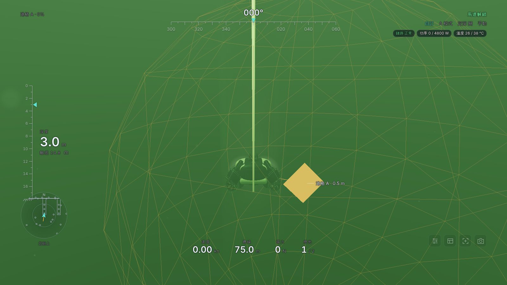 | 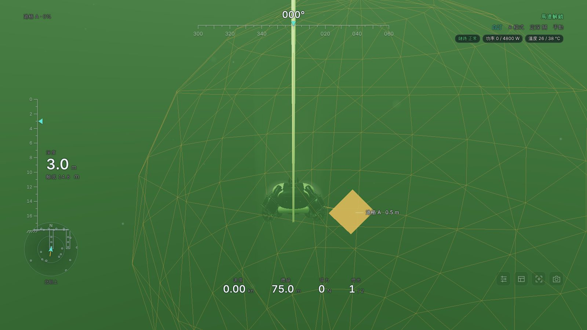 |
| chase-medium-reef | 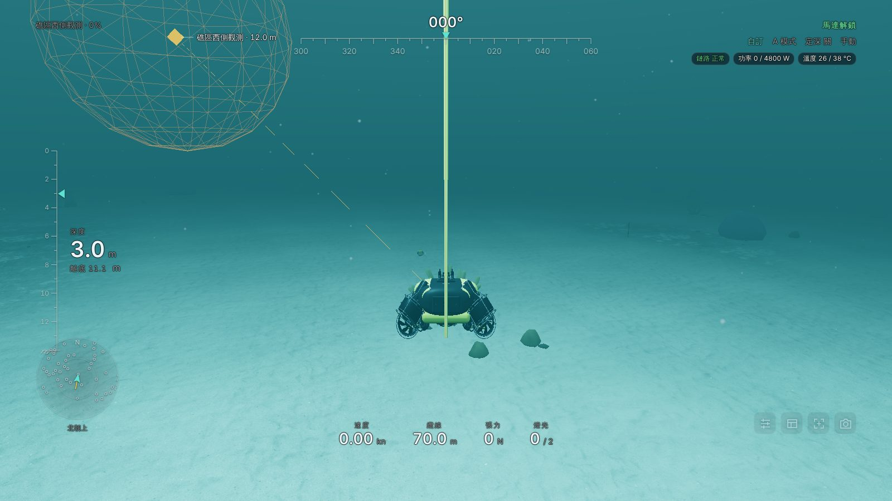 | 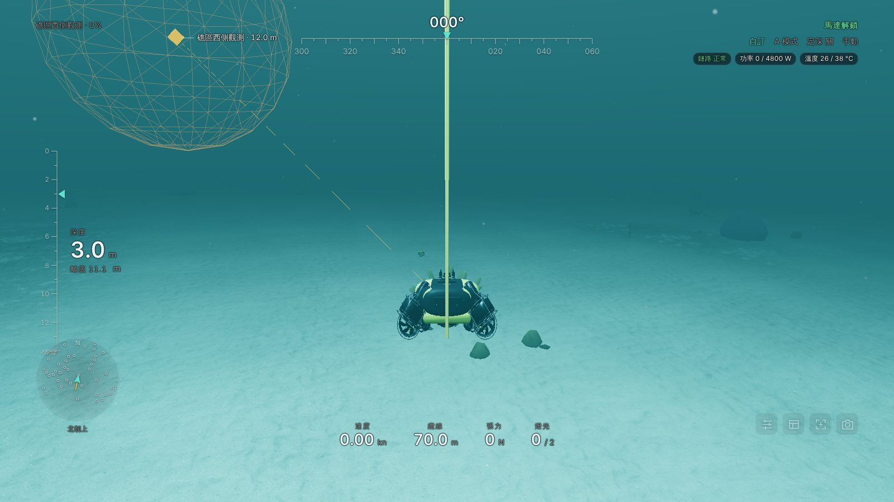 |
| chase-performance-harbour | 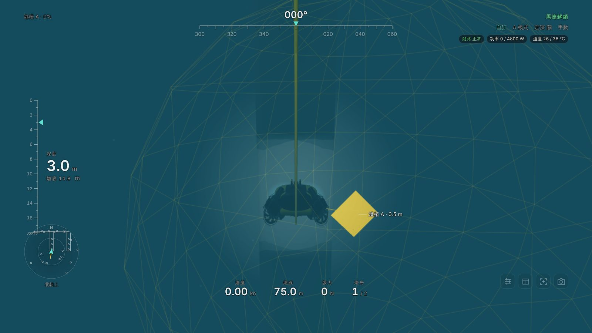 | 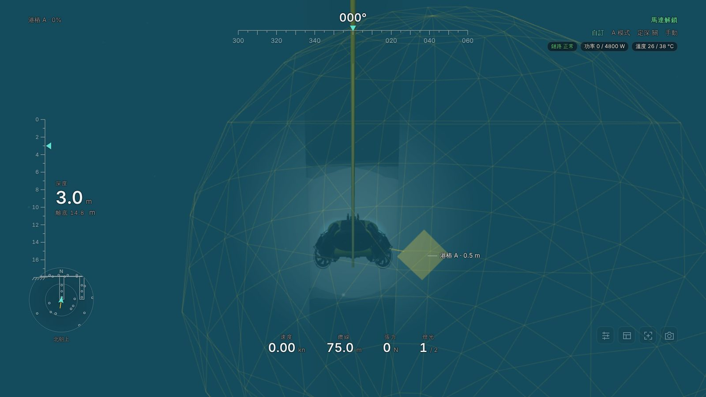 |
| chase-performance-reef | 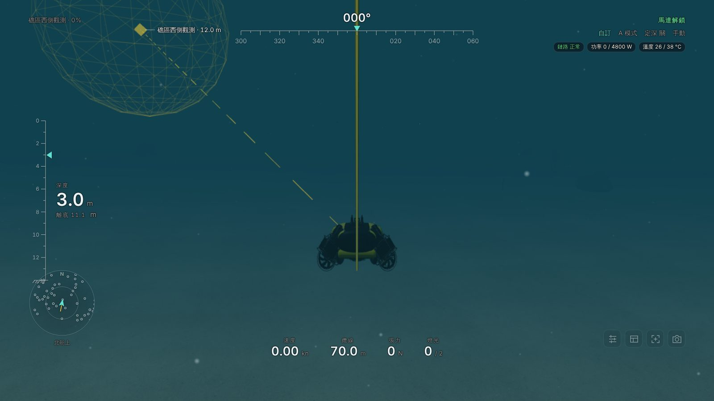 | 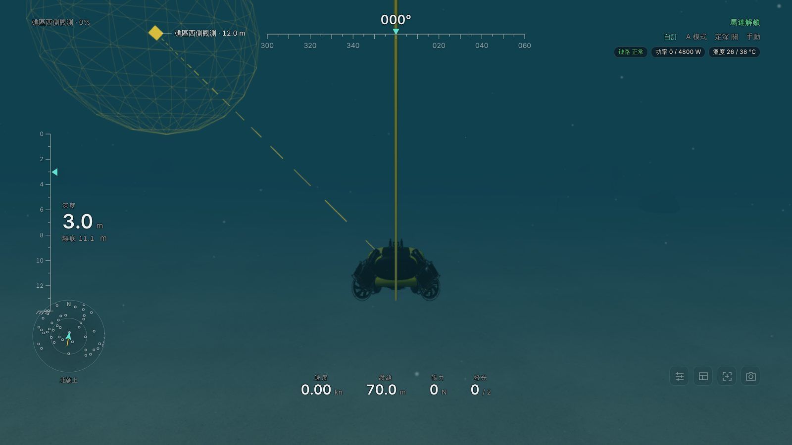 |
| menu-title | 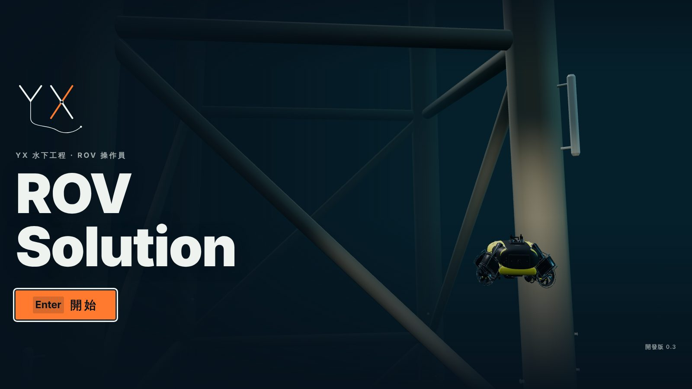 |  |
| onboard-medium-harbour | 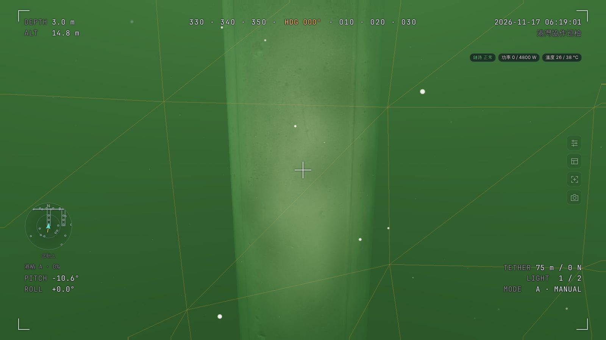 | 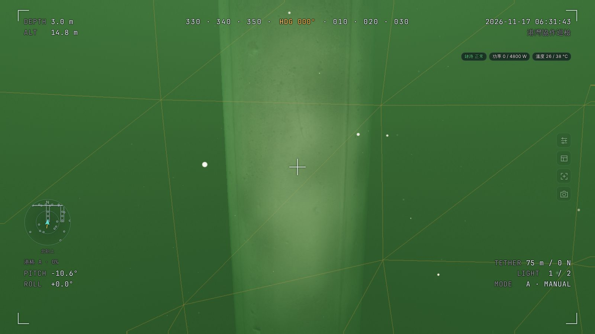 |
| onboard-medium-reef | 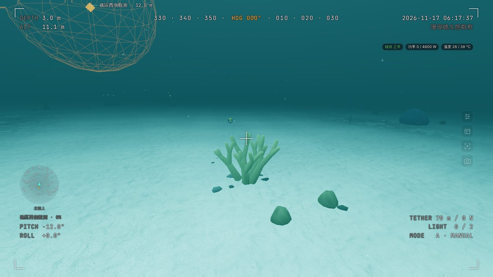 | 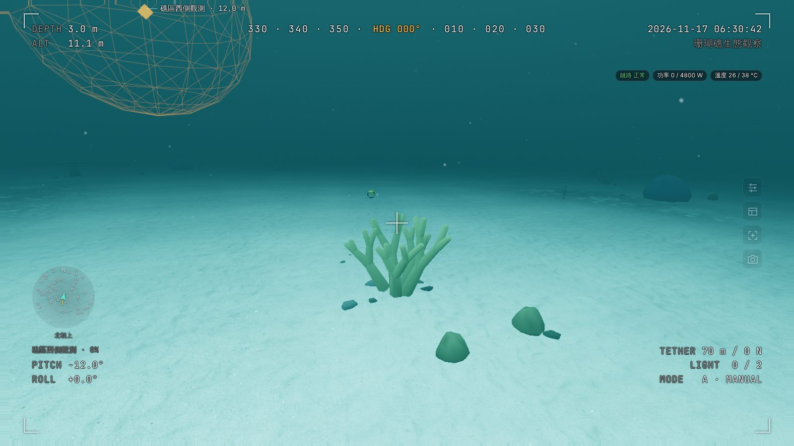 |
| onboard-medium-wreck-lit-2 |  | 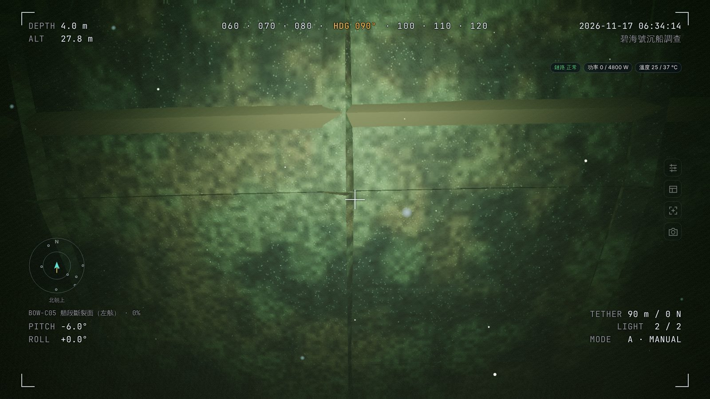 |

機載 medium（後製合併、背景改畫序）：前後平均絕對差 0.7–1.9／255（懸浮微粒與鏡頭雜訊每次不同）、畫面平均亮度差
< 0.2、曝光增益相同到小數第三位（礁區 21.91、港區 72.64、沉船 201.5）、雜訊高頻標準差 5.27 vs 5.33（沉船）。
追蹤鏡頭（LOD0 → LOD1）與標題畫面（LOD0 → LOD1）放大裁切比對看不出差別。截圖由 `browser_underwater_shots.py` 的
固定姿態重播產生（追蹤鏡頭另以同一重播加 `setCam('chase')`）。

## 9. 未做與需要實體 GPU 確認的事

- **全部需要實體 GPU 驗證**：特別是 UHD 620 與 MX110 上的 auto 幀率、`KHR_parallel_shader_compile` 是否讓預熱
  真的不卡、`force-high-performance-gpu` 在 Electron 44／Windows 10 1809 Optimus 上是否切到 MX110（Electron 文件
  只寫底線拼法，Chromium 原始碼是連字號拼法，兩者都已附加；請在 `chrome://gpu` 確認 GL_RENDERER）。
  `python tools/browser_gpu_bench.py --full --machine <代號>`（`ROV_BROWSER_GL=gpu`）可在實機重跑矩陣。
- 光學檔每個材質的燈光後向散射（8 步）仍是 medium 以上最大的像素成本；改成螢幕空間一次計算或中檔減步數會
  改變外觀，需要另開任務並做影像比對。
- 伺服器 0.2 s 一次的回聲射線追蹤與魚群更新同拍造成 p99 尖峰；錯開相位會改變模擬輸出，本輪不動。網箱場址的
  capsule 批次（236 條）與單點查詢的 Python 迴圈仍是主要成本；更進一步需要空間索引或 numba 版查詢（結果須逐位元
  比對），另開任務。
- 改動前完整表沒有網箱（量測途中容器重啟）；網箱的前後數字在 §5 的交錯對照表。
  斷線房間 30 s 寬限期內仍持續步進（為了重連語意，未改）。
- 甲板流程的 `browser_procedure_smoke` 在這台負載很高的機器上 900 s 逾時；`origin/main` 同樣逾時（見 PR 描述）。
- 光學檔沒有抗鋸齒（改動前也沒有）；若要在 high 檔加，建議 FXAA 併入輸出 pass，而不是 MSAA。
