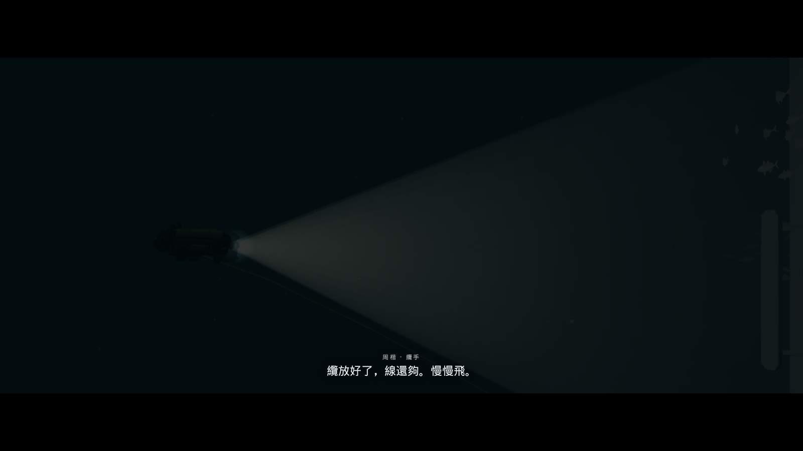
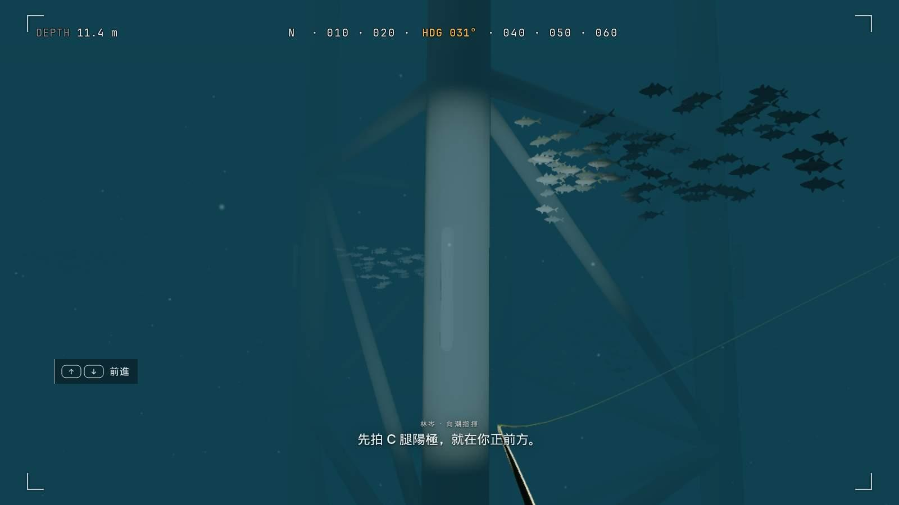
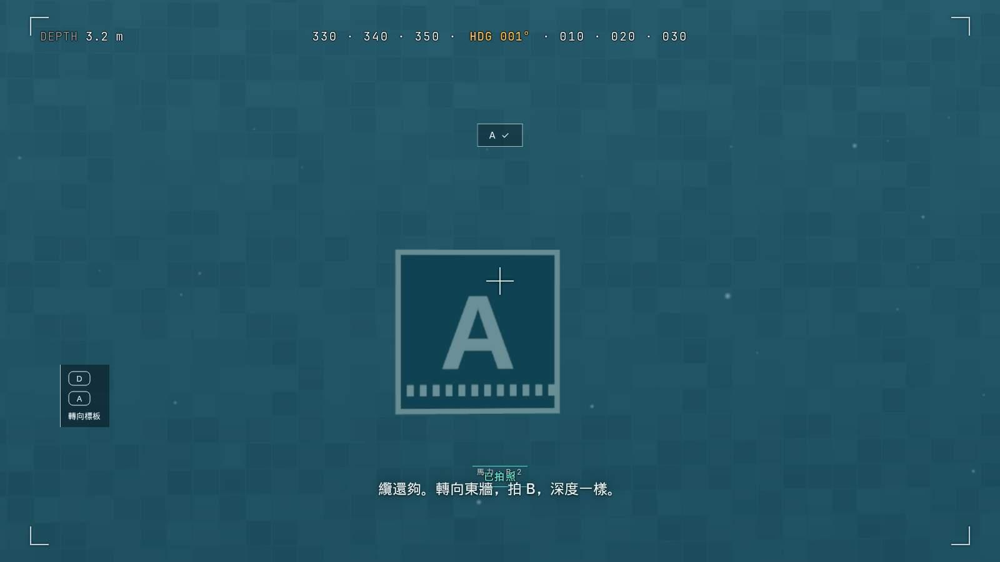
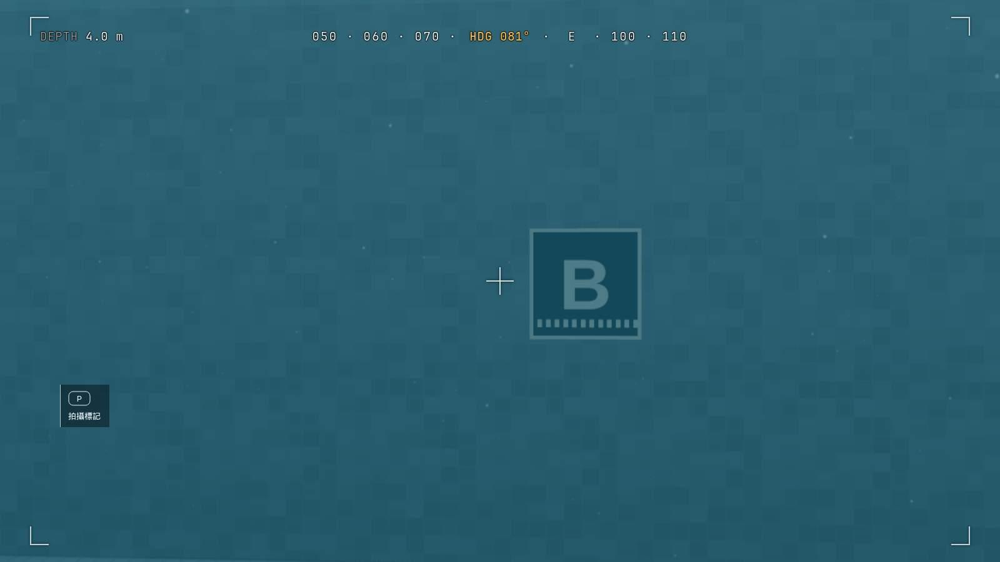
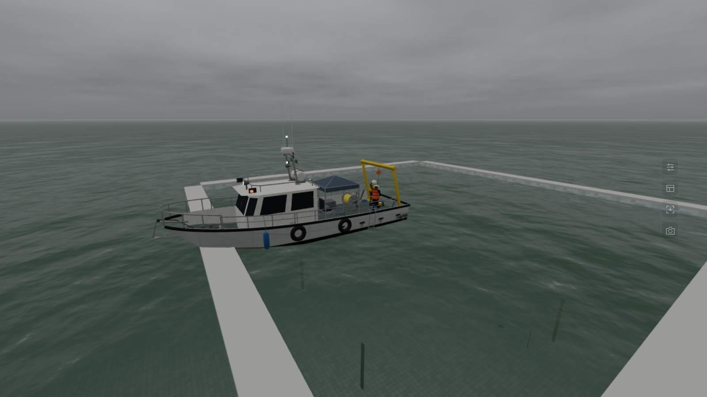
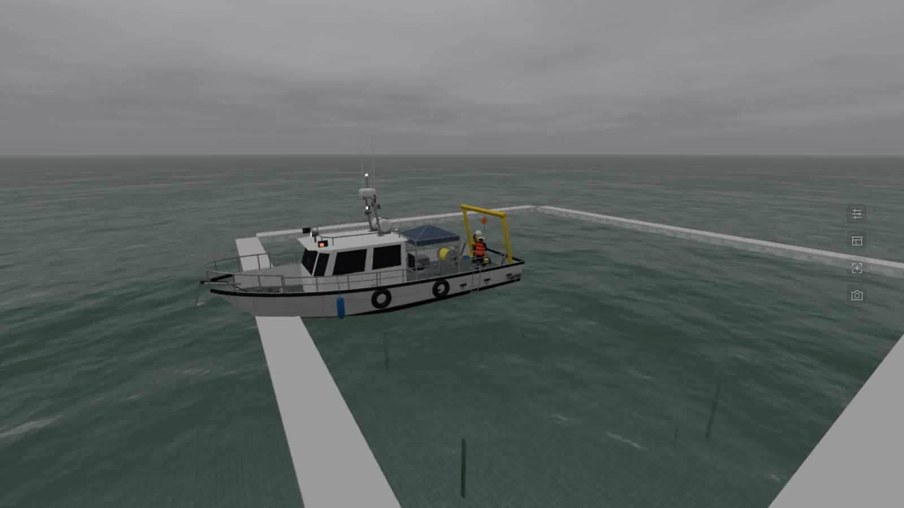
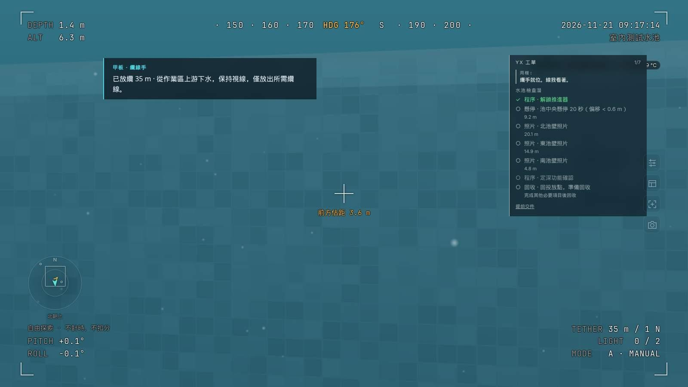
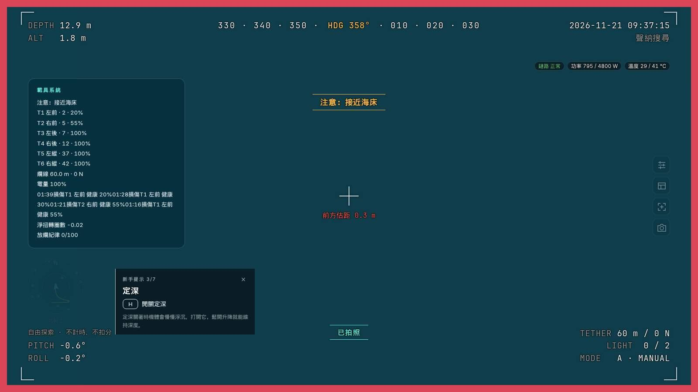
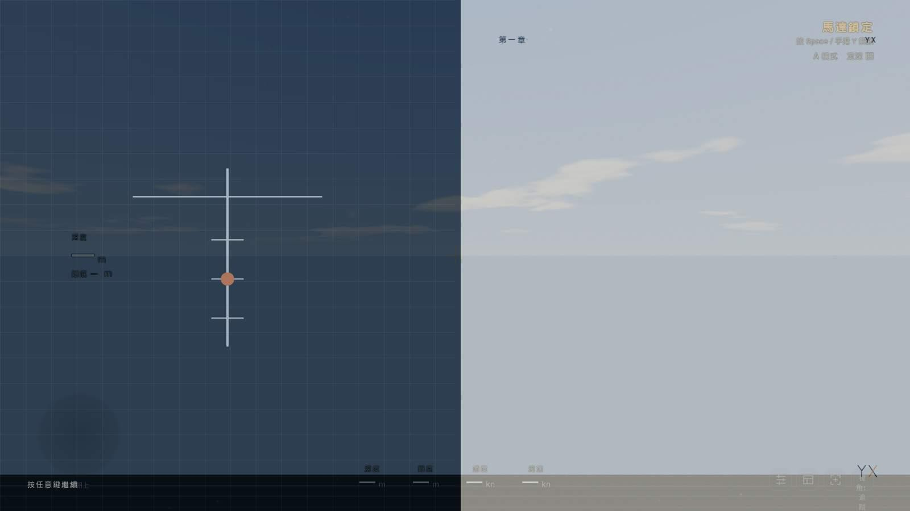
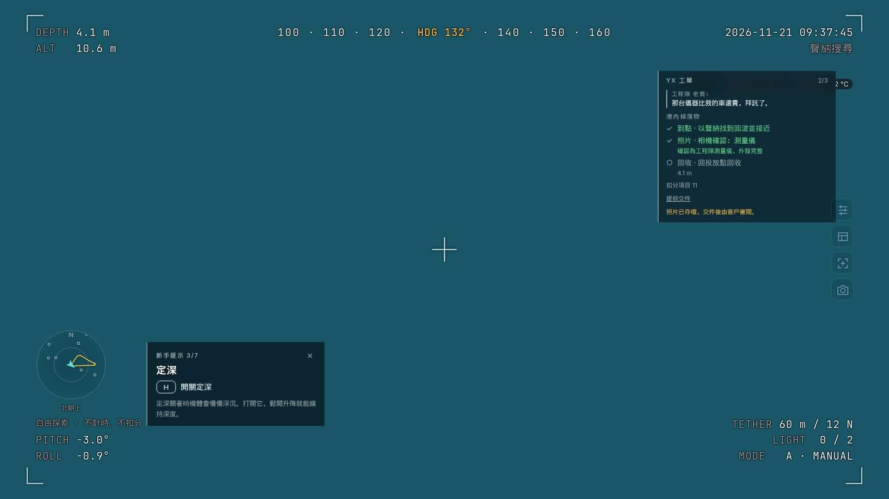

# 2026-11-21 自動試玩稽核

合併最新 `main`（含 R1 序章導演）後重跑。開場提示修正保留。本次重點是工具本身：單獨執行會自啟伺服器、預設只出報告（`--strict` 才失敗）、區分工具失敗與關卡卡關，並修掉預潛階段腳本誤送解鎖造成的 `invalid_command`。

兩次完整試玩（run1／run2）皆無「工具失敗」：沒有無法連線對話框、沒有黑畫面載入超時、沒有伺服器斷線被記成卡關。開場與序章兩次都走完；掉落物兩次結算；碼頭樁一與繫泊考試在第二次才結算（腳本駕駛的隨機性，見下方）。

開場前往 B 腿仍為一次一個操作提示（修前 4 次並存 → 0）。[修前](2026-11-20/transit-before.jpg) · [修後](2026-11-20/transit-after.jpg)

Chromium 159.0.8154.6 · software GL · Linux。1600×900，鍵盤。時間為實際秒數。卡關＝連續 120 秒未換節拍且目標進度未創新高。未解鎖工單用獨立存檔從水中試飛。長幀含截圖成本（>0.2 s）。

## 兩次結果對照

`*`＝未解鎖，獨立試飛。時長與長幀差異主要來自軟體渲染負載與腳本靠近目標時的抖動；**結果不同**的關卡在表下說明。

|關卡|run1|run2|時長 s|卡關|長幀|錯誤|卡關原因|
|---|---|---|---:|---:|---:|---:|---|
|cold_open|完成|完成|63.8 → 85.7|0 → 0|83 → 171|0 → 0|—|
|p0_induction|結算|結算|116.0 → 140.9|0 → 0|294 → 352|0 → 0|—|
|p1_pool_checkout|卡關|卡關|133.3 → 244.6|1 → 1|241 → 602|0 → 0|設計：`hover` 定點，腳本到點附近仍抖動／第二次甚至上鎖|
|p2_open_water|卡關*|卡關*|175.6 → 239.3|1 → 1|61 → 7|0 → 0|設計：走到 `drift` 後 120 s 無進度|
|c1_pier_level1|卡關*|結算*|344.9 → 209.6|1 → 0|1084 → 86|0 → 0|設計／腳本：run1 停在 `pile_b3`；run2 拍完並回收結算|
|c1_pier_level2|卡關*|卡關*|251.8 → 261.9|1 → 1|225 → 32|0 → 0|設計：`a1_upper` 取景／站位，腳本到點未達標|
|c1_hull_fouling|卡關*|卡關*|169.1 → 168.7|1 → 1|337 → 17|0 → 0|設計：`keel_port` 船底拍攝站位|
|c1_dropped_object|結算*|結算*|136.7 → 110.8|0 → 0|68 → 49|1 → 1|完成；各 1 筆資源 404（資產，非連線）|
|c1_quay_cp|卡關*|卡關*|121.5 → 344.5|1 → 1|73 → 29|0 → 0|設計：`cp_west` 輕觸目標，腳本未完成接觸|
|c1_hull_ut|卡關*|卡關*|254.6 → 225.6|1 → 1|634 → 146|0 → 0|設計：`ut_sb_fwd` 量測站位|
|c1_signoff_exam|卡關*|卡關*|470.9 → 307.1|1 → 1|307 → 53|0 → 0|設計：前段有進度，卡在 `quay_station`|
|c2_net_inspection|卡關*|卡關*|125.2 → 180.8|1 → 1|278 → 315|1 → 1|設計：run1 `ring_east`、run2 較遠到 `ring_north` 仍卡；各 1 筆 404|
|c2_mort_recovery|卡關*|卡關*|121.7 → 122.0|1 → 1|394 → 387|1 → 1|設計：`first_fish` 撈取；各 1 筆 404|
|c2_mooring_exam|卡關*|結算*|242.0 → 287.5|1 → 0|762 → 443|1 → 1|設計／腳本：run1 停 `west_buoy`；run2 結算；各 1 筆 404|
|c2_escape_event|尚無工單|尚無工單|—|—|—|—|設計表有列，版本無工單|

數字差異說明：同一腳本、同一軟體 GL。長幀在負載高時可差數倍，不能當效能回歸指標。`c1_pier_level1` 與 `c2_mooring_exam` 的完成／卡關切換，是腳本在最後幾個目標點附近是否剛好對準，屬設計難度與腳本能力交界，不是 harness。

## 相對 2026-11-20（修工具前）

|項目|2026-11-20|2026-11-21|
|---|---|---|
|開場多重提示|0（已修）|0|
|序章|結算但甲板有 invalid_command|結算，0 錯誤；R1 導演節拍全程跑完|
|工具失敗誤記為卡關|有連線／拒絕指令噪音|0 次工具失敗|
|可結算關卡|開場＋序章|開場＋序章＋掉落物；第二次另加碼頭樁一、繫泊|

## 逐關（以 run1 截圖為證；原因綜合兩次）

[聯絡表](2026-11-21/contact.jpg)

### cold_open — 完成（設計 OK）

完整 black→…→card。多重提示 0。無錯誤。

### p0_induction — 結算（設計 OK）

R1 導演：unlock→approach→…→A/B/C 拍照→licence→harbor→results。兩次 0 錯誤。預潛 `invalid_command` 已消除（腳本不再於甲板 begin 前狂按 Space；伺服器 begin 改為冪等）。

### p1_pool_checkout — 卡關（設計）

解鎖後停在 `hover`。腳本到定點附近仍無法穩定 station_keep；run2 結束時甚至 `locked: true`。非連線問題。

### p2_open_water — 卡關（設計）

獨立試飛：unlock→cp1→depth_hold→cp2→卡在 `drift`。

### c1_pier_level1 — 卡關／結算（設計／腳本）

run1 沿 pile_a1…b3 前進後卡在 b3；run2 完成回收結算。目標可見性與腳本對準容差是主因。

### c1_pier_level2 — 卡關（設計）

兩次都停在 `a1_upper`（上層樁位取景）。

### c1_hull_fouling — 卡關（設計）

星舷有進度，卡在 `keel_port`。

### c1_dropped_object — 結算（設計 OK）

contact→confirm_photo→recover→results。唯一錯誤是載入時資源 404，不影響通關。

### c1_quay_cp — 卡關（設計）

停在 `cp_west` 輕觸／CP 目標。

### c1_hull_ut — 卡關（設計）

停在 `ut_sb_fwd`。

### c1_signoff_exam — 卡關（設計）

有走過 crack／spall／chip，卡在 `quay_station`。

### c2_net_inspection — 卡關（設計）

網箱環巡：腳本進度不穩定；外加場景資源 404。

### c2_mort_recovery — 卡關（設計）

停在 `first_fish`（撈取／接近死魚）。

### c2_mooring_exam — 卡關／結算（設計／腳本）

run1 卡在 `west_buoy`；run2 結算。同碼頭樁一，屬腳本對準運氣。

### c2_escape_event — 尚無工單

## 證據圖（run1）

### cold_open

### p0_induction

### p1_pool_checkout

### c1_dropped_object

