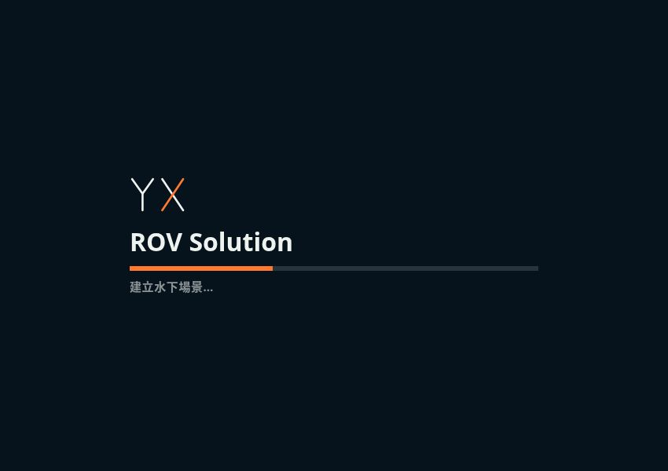

# X7 冷啟動與復原

Linux 開發版 Electron 44.5.1、Python 3.12、Xvfb 1280 × 800、SwiftShader。
每次量測開新 Electron 與 Python 程序，使用空白 userData、瀏覽器及 Numba 快取。
作業系統的檔案快取未清除。此為開發機單次觀測，不能據此推估 Steam 玩家的分位數。

| 區段 | 實測 | 量測終點 |
|---|---:|---|
| 冷啟動到可操作主選單 | 9,324 ms | 啟動程序到標題頁已接受選單輸入 |
| Electron | 89 ms | 主程序 uptime 到 ready 回呼 |
| Python 後端 | 7,975 ms | 配埠、啟動、三個 listener 綁定、收到子程序公告並通過 HTTP HEAD |
| 前端資源與選單初始化 | 1,072 ms | viewer navigation 到可操作標記，包含字典、目錄、模組與 UI 建立 |
| 著色器編譯、連結與狀態查詢 | 選單可操作前 0 ms，預覽出現後累計 4.4 ms | 包裝 WebGL compileShader、linkProgram、getProgramParameter 量到的同步 CPU 時間 |
| 第一個含模型的預覽畫格 | 414 ms | renderer.render 呼叫耗時，包含提交與可能的驅動等待 |

總時間另含視窗建立、導覽交接等開銷。渲染與著色器時間可能重疊；驅動背景編譯無獨立的 GPU 完成時間。
啟動圖與後端並行。選單開始接收輸入後預覽可繼續載入；GPU 故障時，安全模式的選單完全不建立 3D 場景。

在儲存庫根目錄執行以下指令。Electron 與已安裝的 Python、Playwright、viewer vendor 模組版本應與待測版本一致。

```sh
python simulator/desktop/measure_startup.py /path/to/electron
```

量測工具使用暫存使用者資料夾與本機 CDP。此 Linux 測試的附加參數為
`--no-sandbox --use-angle=swiftshader --enable-unsafe-swiftshader`。
一般玩家啟動沿用正式版 sandbox、CSP 與顯卡選擇。

## 復原行為

- WebGL 建立失敗或遊戲 canvas 遺失 context 時，自動以安全畫質重新載入一次。若潛航仍無法建立 context，可重試或回到 2D 選單。
- 三個埠屬於同一次啟動。若遇到綁定衝突、被拒或連線逾時，關閉該子程序並重新選擇整組埠，合計最多三次。
- 本機紀錄只寫入 UTC 時間和固定事件代碼。每代上限 64 KiB，保留兩代。原始 traceback、路徑、網址及玩家輸入均不進入紀錄。
- 沒有實體 Windows 顯卡或 Steam 客戶端的測試結果。防火牆提示屬於可檢查的原因，HTTP 逾時也可能由本機服務停滯引起。

| WebGL 建立失敗（修改前） | 自動進入安全模式（修改後） |
|---|---|
|  |  |
