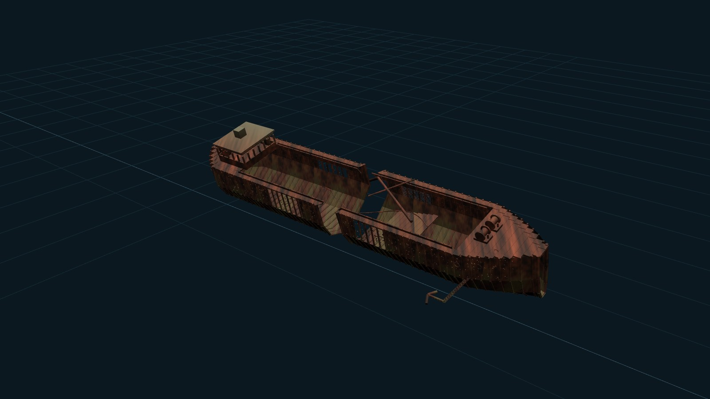
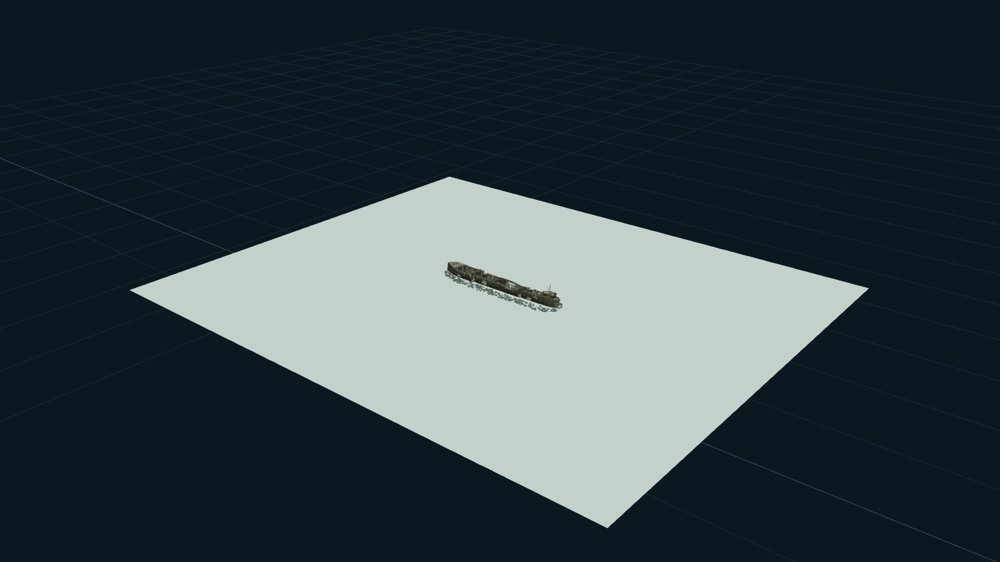
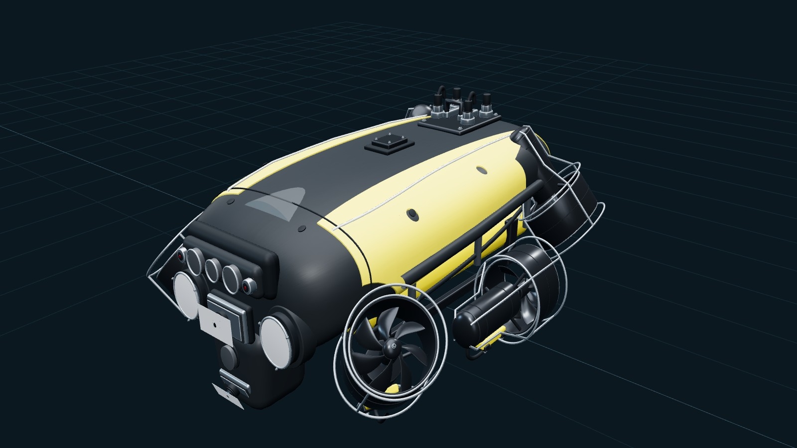
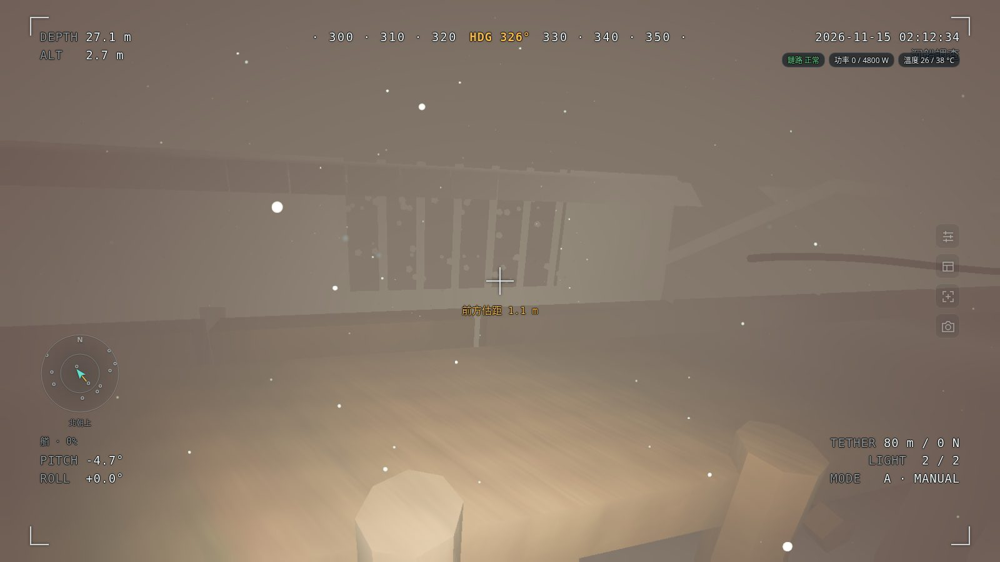
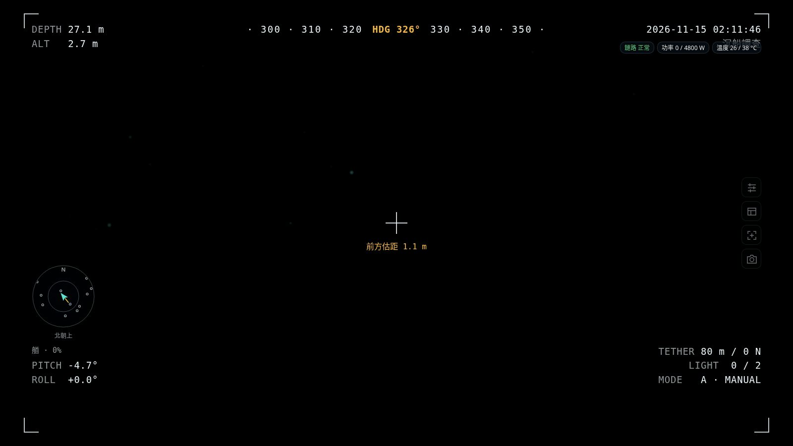

# G7：沉礁（Chenjiao）原創沉船

48 m × 9 m 的虛構近海貨船，船中斷成兩段，側傾 15°，龍骨低於平坦海床約 2.2 m。
沒有引用特定船隻、船名商標、照片或外部材質。船型、損傷、附著分布及勾纏保持力均是
訓練場景假設，並非海難重建或實測。`docs/reference/own/` 在此版本不存在；未改動 X1 參數。

模型含開口外板、橫向肋骨、塌落貨艙蓋、開窗艉樓、舷窗圈、絞車鼓與法蘭、倒伏桅杆、
錨鏈、錨、纜繩與下垂漁網、附著團塊。自製色彩與法線貼圖表現鏽蝕、上層較多的藻類及
底部泥沙；30 m 混濁水中的藻類分布是美術假設，不代表生態量測。

## 重建

```bash
uv venv /tmp/g7env --python 3.11
uv pip install --python /tmp/g7env/bin/python bpy==5.0.1 pillow scipy playwright -r simulator/requirements-fast.txt
/tmp/g7env/bin/python cad/build_wreck_chenjiao.py
/tmp/g7env/bin/python cad/pack_wreck_chenjiao.py
/tmp/g7env/bin/python simulator/tools/build_wreck.py simulator/output/chenjiao --asset wreck_chenjiao
/tmp/g7env/bin/python simulator/tools/render_wreck_compare.py
/tmp/g7env/bin/python simulator/tools/run_browser_checks.py browser_chenjiao_shots
```

建模與貼圖皆固定亂數種子。原始 GLB、PNG、碰撞三角形留在被忽略的 `simulator/output/chenjiao/`。
打包沿用 `pack_observation_rov.py` 的 CLI helper：dedup → weld → simplify → WebP → prune → meshopt。
LOD2 在 Blender 先做輪廓簡化，以避免 UV 邊界限制 meshoptimizer。每次 pack 複製 raw，不累積簡化誤差。

## 碰撞、勾纏與任務

沿用 Korean Castle 的 `build_wreck.py`，增加選填 `--asset` 輸出名稱；原有預設與 metadata 不變。
同為 0.3 m 格距、uint8、每格 0.05 m 的**無號**距離場（不是有內外符號的實心 SDF）。視覺與場共用
已烘入傾斜的 Blender 幾何；FieldMesh 薄殼厚度與座標轉換不變。極細網線仍受格距限制。

`wreck_chenjiao_snags.json` 是 FieldMesh 本地座標（X 沿船、Y 橫向、Z 向上），含位置、方向、半徑、
高度、類型、保持力。小球膠囊沿傾斜特徵取樣，對應 `world.SnagFeature` 的 point/radius/height/hold_n/item，
由 `wreck_chenjiao.py` 轉至 NED（模型原點埋入海床 1.2 m，已埋藏的特徵不加入）；direction 是描述用切線，沒有暗中改變 SnagFeature 直立軸的契約。
新增 `embedded` 選填欄位，防止同一繩網再畫一次程序小物。既有四個手放海床雜物原樣保留。
測試的 headless manifest 直接讀取壓縮 GLB 幾何，檢查 embedded 膠囊旁確實有可見表面。

只替換 `wreck_survey`。保留四個 checkpoint 的名稱、順序、高度、半徑與任務邏輯；
船長增加後艏艉站位 local ±20 → ±27 m，兩舷 ±6.5 → ±8 m，維持船外淨空。
原直立桅杆及橫桁由 GLB 內倒伏桅杆及同源距離場取代。其他情境與韓城沉船不變。

## 資產預算

見 [asset-report.json](asset-report.json)，draw calls 為模型自身的 primitive 批次，
不包含海床、ROV、陰影或後製 pass。GPU 記憶體以解碼後 RGBA8 加完整 mip chain 計算，不能用 WebP
檔案大小當成顯示記憶體。兩張 1024² 貼圖共約 10.67 MiB；預設與高畫質共用貼圖，均低於預算。
| 層級 | 三角形 | 模型 draw calls | GLB bytes | 貼圖 GPU MiB |
|---|---:|---:|---:|---:|
| LOD0 | 66,824 | 1 | 1,734,224 | 10.67 |
| LOD1 | 42,320 | 1 | 1,206,504 | 10.67 |
| LOD2 | 2,372 | 1 | 362,732 | 10.67 |

距離場為 188 × 69 × 47 格，609,684 cells；NPZ 約 182 KiB，勾纏清單約 23 KiB。

高畫質載入 LOD0、中畫質 LOD1、低畫質 LOD2；共用同一碰撞場。沒有大於 2 MB 的單一模型資產。
提交 GLB/NPZ/特徵清單是必要的執行時資產，使用者啟動模擬器不必安裝 Blender 或 scipy。
截圖及 JSON 報告是本 PR 的審查證據，不提交原始建置輸出。

## 同機位比較與遊戲內截圖

三者以同一相機、燈光和最大邊長正規化顯示；**不是同一物理比例**。X1 的精細零件與船體的
大型構造尺度不同，不能僅以總三角形數宣稱相同細緻度。船體已有細部構件與材質，仍有程序建模
規律性；近距離舷窗圈、絞車、附著物的雕刻細節不及 X1 的精密機械零件，需在 draft 審查中特別檢視。

| 沉礁 | 既有沉船 | X1 |
|---|---|---|
|  |  |  |

機載圖使用實際 viewer 的 real profile、高畫質、4 m 能見度及相同固定 replay 姿態，沒有放寬霧距；
這是可重現畫面驗證，不是完成任務的飛行錄影。位置、方向與燈級見 `onboard-report.json`。

| 開燈（2 級） | 關燈 |
|---|---|
|  |  |

既有選單預覽圖未重新產生；目前僅改動遊戲內場景資產，預覽縮圖仍可能顯示舊駁船。

舊版方塊外觀可參考既有 [第三人稱圖](../wreck_survey-third-before.jpg) 與
[機載圖](../wreck_survey-onboard-before.jpg)；它們使用舊版光學與不同站位，不用作亮度 A/B 比較。

## 驗證紀錄

使用上方 Python 3.11 環境（含專案選用的 numba 加速）及 Node 24，Chromium / SwiftShader：

- `cd simulator && python -m unittest discover -s tests`：410 tests，620.578 s，OK。
- `node --test simulator/tests/*.mjs`：133 passed，0 failed。
- `cd simulator && python -m unittest tests.test_wreck_chenjiao tests.test_scene_consistency`：21 tests，OK。
- `python simulator/tools/run_browser_checks.py browser_smoke observation_smoke browser_tether_smoke browser_menu_smoke browser_chenjiao_shots`：5/5 passed。
- 拍攝儀表修正後再跑 `python simulator/tools/run_browser_checks.py browser_chenjiao_shots`：1/1 passed。
- `python simulator/tools/check_changed_js.py origin/main` 與 `python simulator/tools/vendor_manifest.py --check`：通過。
