# A3 訓練機型材質

只更新既有重建的表面，不代表取得原廠 CAD、材質規格或磨耗實測。
來源與估算限制見 [VEHICLE_MODELS.md](../../../cad/VEHICLE_MODELS.md)。
模型底稿為 `origin/main` 的 `afc33198adfec6b34114db0416bf810be98157ff`。
分支提交前同步至 `22ece2a95cf7a0484036985ff04ae83959c45891`；兩版本的模型源檔與 GLB 完全相同。

## 前後比較

每組皆為相同源模型姿態、機位、照明及色彩管理，1600×900 PNG。
Blender 4.5.9、Cycles 24 samples、AgX Medium High Contrast、曝光 −0.5。
斜前與側面依原始包圍盒取景，包含完整伸出的機械臂；近景對準第一具推進器。
攝影機與燈光只存在於渲染暫存場景，不寫入 `.blend` 或 GLB。

| 機型／機位 | 修改前 | 修改後 |
|---|---|---|
| Falcon 斜前 | 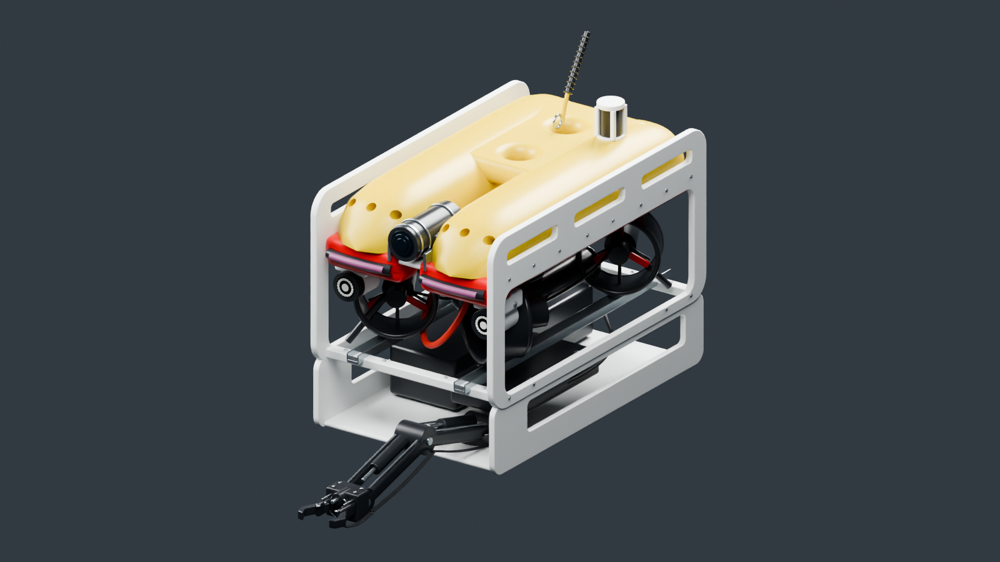 | 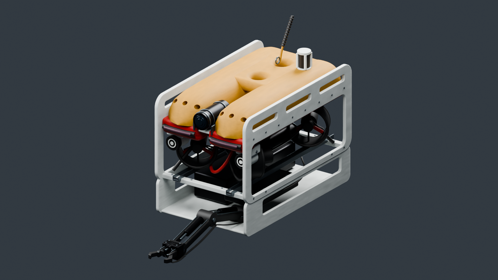 |
| Falcon 側面 | 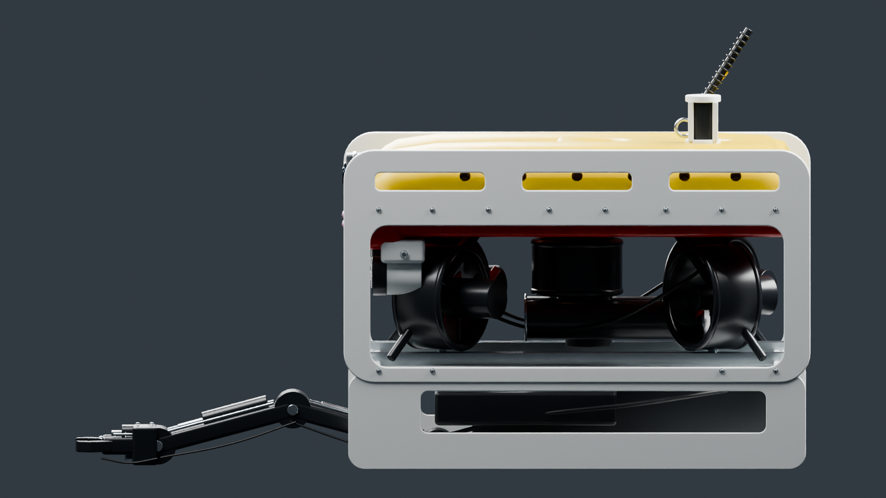 | 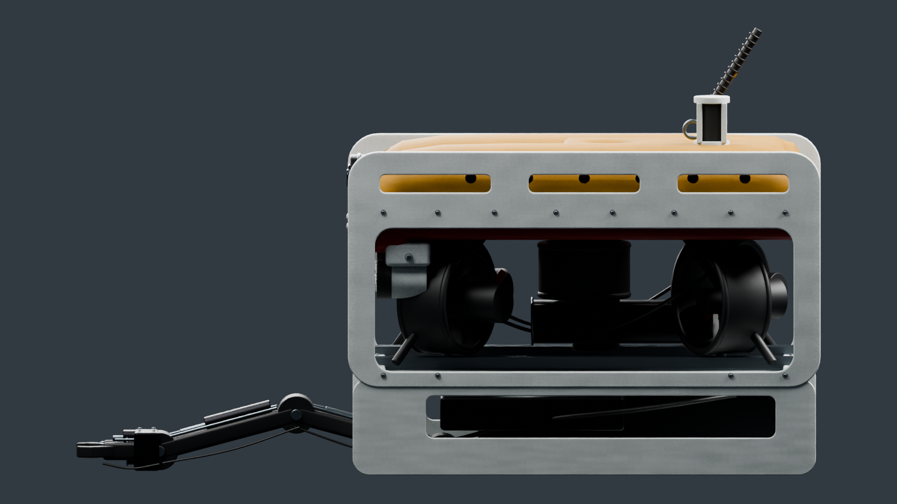 |
| Falcon 推進器 | 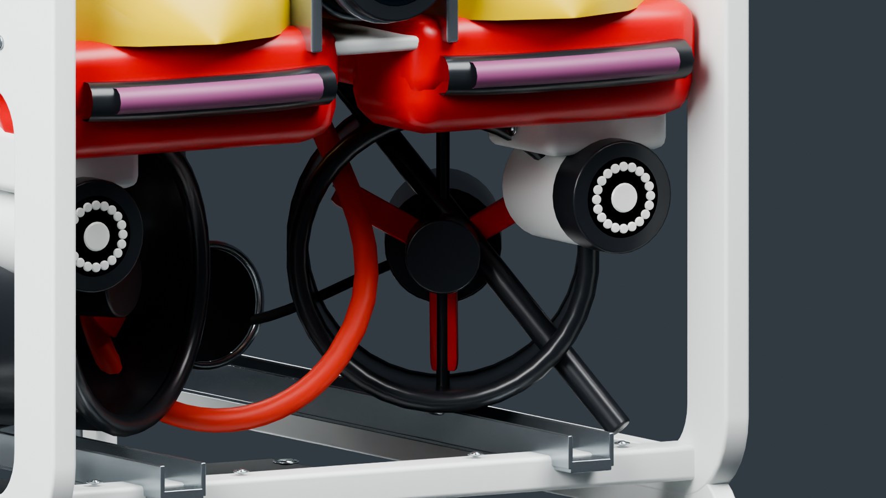 | 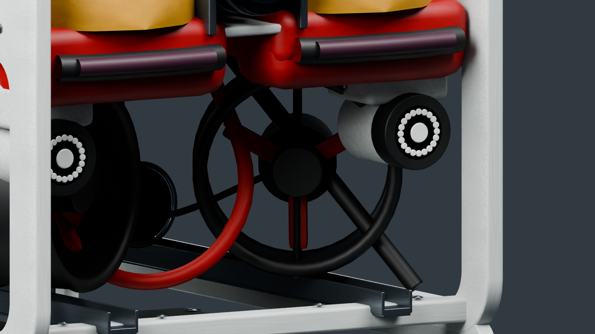 |
| BlueROV2 Heavy 斜前 | 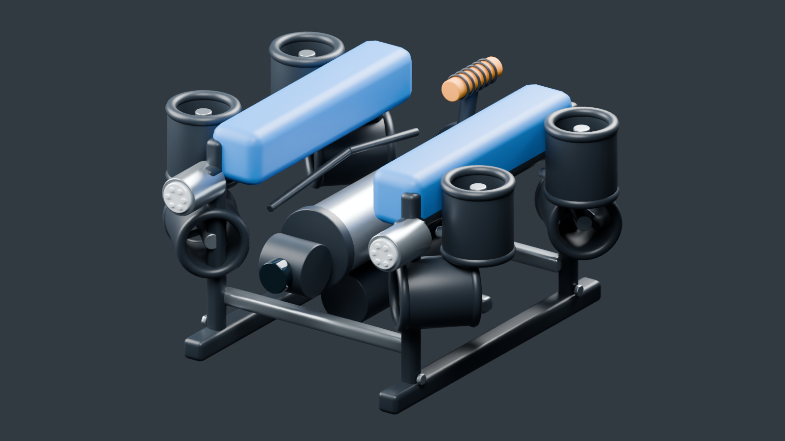 | 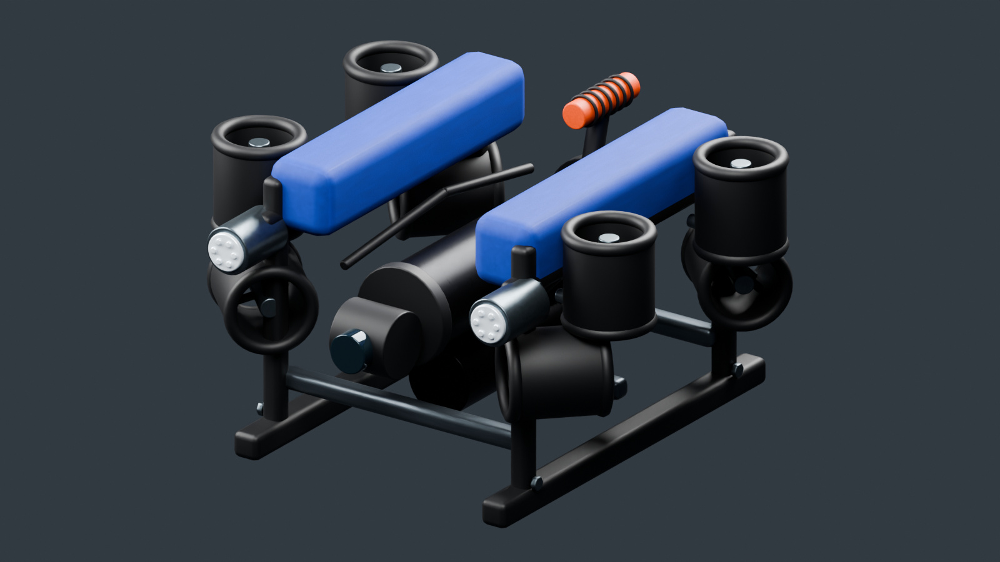 |
| BlueROV2 Heavy 側面 | 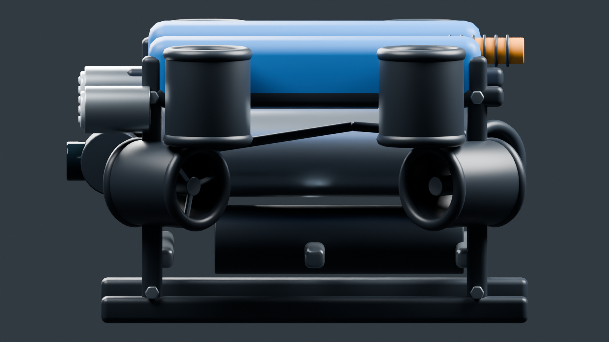 | 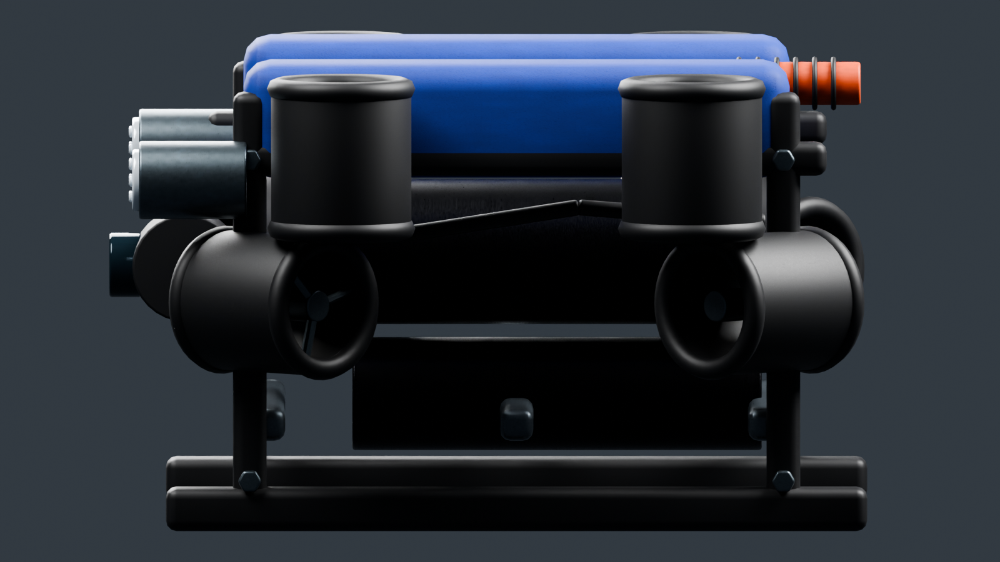 |
| BlueROV2 Heavy 推進器 | 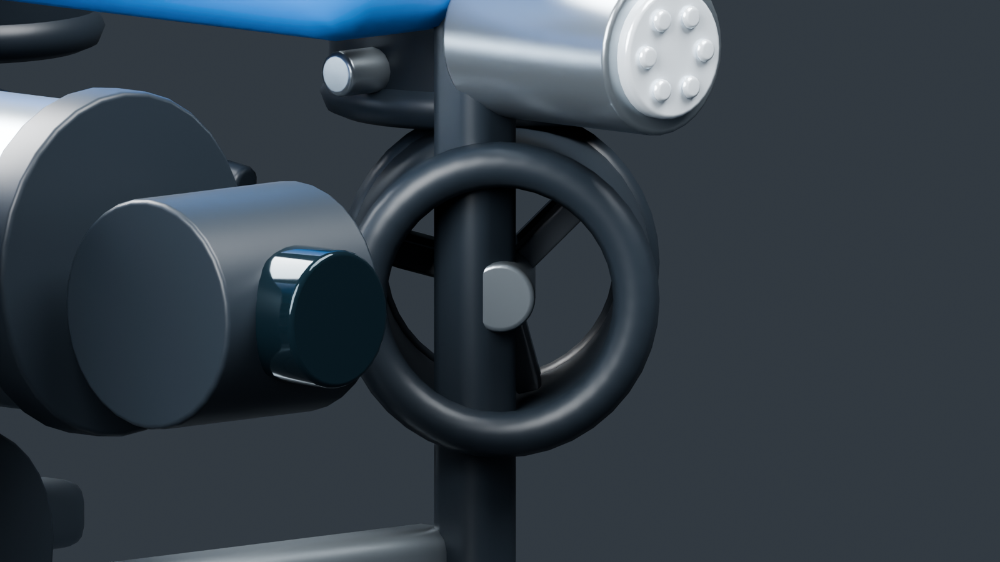 | 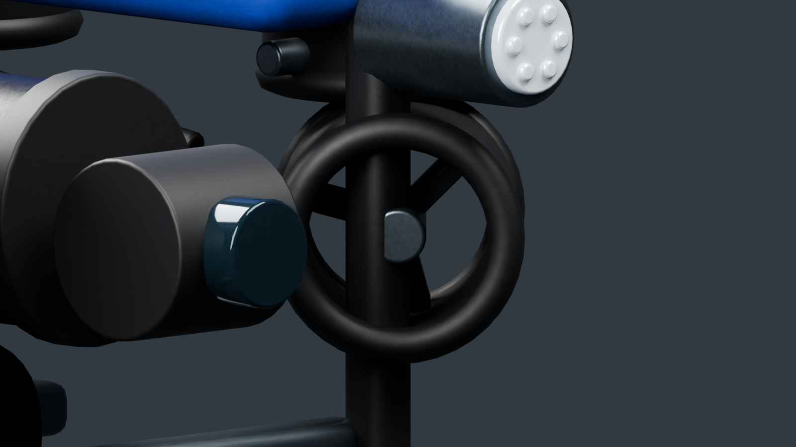 |

## 表面與限制

- 框架：保留原有聚合物板材配色，增加細紋、輕微擦痕及邊緣拋光；既有金屬橫樑使用緞面鋁材。
- 浮力材：閉孔泡沫／泡沫表皮的細微孔隙、粗糙度變化與邊緣磨耗，不使用位移或幾何破損。
- 電子舱與液壓筒：深色陽極處理金屬；螺絲、墊圈、接頭保留加工金屬反光。
- 導管、槳葉、線纜護套：非金屬 PBR，區分原有色彩與表面粗糙度。
- 以上材質種類、色澤和使用程度均為內部訓練視覺假設，並非原廠規格。未新增標誌、文字或商標圖樣。
- 每張貼圖 1024×1024；基色 JPEG，粗糙度／法線 PNG。原創程序紋理，固定亂數種子，無外部圖片。
- `.blend` 內嵌貼圖，可離線開啟；UV 是表面資料。原有 mesh/curve、modifier、節點名稱、父子階層、變換及物件自訂屬性保持不變。

## 大小與保真檢查

MB 採十進位 1,000,000 bytes；兩份 GLB 均低於 8 MB。

| 檔案 | 修改前 bytes | 修改後 bytes |
|---|---:|---:|
| `falcon.glb` | 4,499,452 | 6,932,364 |
| `bluerov2_heavy.glb` | 1,356,724 | 3,910,676 |
| `falcon.blend` | 6,021,888 | 5,277,467 |
| `bluerov2_heavy.blend` | 2,396,462 | 4,718,589 |

使用 glTF Transform 4.2.1 + meshoptimizer 0.24.0 的 `EXT_meshopt_compression`。
不執行 quantize、weld、join、prune、flatten 或 simplify。
PNG 只做解碼像素完全相同的 palette／deflate 重包裝。
原 Windows 源檔在 Linux 重導出時，少數曲線有約 1.5e−8 m 的浮點差異；
包裝器僅對索引順序完全相同且差異小於 1e−7 m 的頂點恢復原始 GLB 值。
解碼最終 GLB 後驗證全部有向三角形的座標完全相同（非近似容差比對）。
Falcon 的 361 節點／5 轉子、Heavy 的 154 節點／8 轉子，其名稱、階層、extras、變換皆完全一致。

## 重現

本次透過 upstream [Blender MCP](https://github.com/ahujasid/blender-mcp)
`8f40787fbde8e6d8fe51c5a3553e5635fff40d2b` 的 stdio MCP `execute_blender_code` 呼叫執行。
雲端無圖形顯示器，故用主執行緒輪詢 add-on command queue；所有 bpy 編修與渲染仍經 MCP。
未啟用資產生成／下載服務或遙測。

1. 在 `.runtime/a3/before/` 放上述底稿的兩份 `.blend` 與兩份 `.glb`。不要以更新後的檔案充當 before。
2. 要重新生成材質時，先將這兩份原始 `.blend` 複製回 `cad/`。下列腳本不是在已加工材質上疊加的工具。
3. 透過 Blender MCP 執行：

   ```python
   import runpy
   runpy.run_path('/absolute/path/to/rov/cad/training_vehicle_materials.py', run_name='__main__')
   ```

4. 開發用依賴：`@gltf-transform/core`、`@gltf-transform/extensions` 4.2.1（MIT）、
   `meshoptimizer` 0.24.0（MIT）、Pillow（HPND）。不改應用程式的 npm 依賴或建置方式。
   在儲存庫根目錄臨時安裝開發工具（不要提交 `node_modules`），再執行：

   ```bash
   npm install --no-save --package-lock=false @gltf-transform/core@4.2.1 @gltf-transform/extensions@4.2.1 meshoptimizer@0.24.0
   python cad/optimize_training_textures.py
   node cad/compress_training_models.mjs
   node cad/check_training_models.mjs
   ```

5. 每個模型、`before`／`after`、`quarter`／`side`／`thruster` 組合各呼叫一次：

   ```python
   import runpy
   runpy.run_path('/absolute/path/to/rov/cad/render_training_materials.py',
                 init_globals={'MODEL': 'falcon', 'STAGE': 'after', 'VIEW': 'quarter'})
   ```

## 瀏覽器驗證與既有預覽限制

在 `simulator/` 執行 `python -m qysim.server`，以 Chromium／Playwright 打開：

- `http://127.0.0.1:8080/model-preview.html?model=falcon`
- `http://127.0.0.1:8080/model-preview.html?model=bluerov2_heavy`

`python tools/browser_training_materials.py` 檢查 GLB 成功載入、PBR 貼圖存在、
每具轉子的索引／原地轉動／子槳葉，以及 Falcon 四個關節滑桿和夾爪滑桿。
**既有 model-preview.html 沒有轉子動畫 tick**；測試在該頁透過 `requestAnimationFrame`
以 `app.js` 相同的 quaternion 公式驅動全部轉子 0.5 秒，並檢查轉角改變且軸心不移動。
這是明確的測試驅動，不宣稱原頁會自動轉動；本次不擴大修改預覽頁程式。

儲存後重新開啟 `.blend` 的幾何／階層／變換／物件自訂屬性雜湊與底稿完全一致；
Falcon 18 張、Heavy 14 張使用中的影像均為內嵌 1K 貼圖。完整本機驗證結果見 PR 描述。

同步最新 main 後執行 `python -m unittest discover -s tests`：188 tests，OK，無跳過（86.940 秒）。
環境已安裝倉庫記載的可選 Numba 加速依賴。模型專項與 `browser_menu_smoke` 通過。
通用 `browser_smoke` 在渲染工作全部結束後，以 `ROV_BROWSER_TIMEOUT_SCALE=3`
隔離重跑通過（53 秒）；未修改的模型基線同一檢查亦通過（51 秒）。
先前與渲染並發時曾出現小窗／控制狀態等待超時；沒有修改或放寬測試斷言。
12 張 PNG 全部為 1600×900，最大 1,196,691 bytes。
