# YX fleet visuals (Q5)

Original close-range models for YX Model R, Model O and Model V (internal ids `x1`,
`bluerov2_heavy`, `falcon`). They share one material family and are not a copy of any
manufacturer's vehicle. Thruster positions and thrust axes come from
`simulator/qysim/vehicles.py`. Blade count is an estimated visual (that file does not
publish one): three blades, pitched so positive rotation about the thrust axis produces
positive thrust. Hull size, fastener pitch and foam colour are estimated geometry, not
measurements, and are not X1 facts.

Source: `cad/build_yx_vehicles.py`. Pack: `cad/pack_yx_vehicles.py` (meshopt, no position
quantize, so rotor pivots stay on the physics points). Counts below are from
`report.json` after the pack.

## Files

| Vehicle | LOD | File | Triangles | Bytes |
|---|---|---|---|---|
| Model R | 0 | `rov.glb` | 18024 | 236360 |
| Model R | 1 | `rov_lod1.glb` | 4364 | 83108 |
| Model R | 2 | `rov_lod2.glb` | 2236 | 54356 |
| Model O | 0 | `bluerov2_heavy.glb` | 21312 | 432712 |
| Model O | 1 | `bluerov2_heavy_lod1.glb` | 5332 | 79684 |
| Model O | 2 | `bluerov2_heavy_lod2.glb` | 2728 | 54944 |
| Model V | 0 | `falcon.glb` | 16884 | 384780 |
| Model V | 1 | `falcon_lod1.glb` | 4078 | 80056 |
| Model V | 2 | `falcon_lod2.glb` | 2118 | 55960 |

Budgets: near ≤ 40k, mid ≤ 12k, far ≤ 3k triangles, each file ≤ 1.5 MB. The viewer loads
all three levels (`vehicle_models.js`). Peers start at LOD1. Model R static parts are
joined by material so the existing draw-call limit of 40 still holds. Model O and Model V
keep separate part meshes.

## What is in the close model

Open frame, twin syntactic-foam pontoons, central polymer housing, aluminium skids,
ducted thrusters on the physics points, acrylic dome on `camera_gimbal`, two lamps on
`lamp_pivot_0` / `lamp_pivot_1`, wet-mate plugs, and a tether gland on the published
anchor with a hose back to the housing. LOD0 adds hex fasteners, clamp bands, shroud
guard spokes and three pitched blades. The foam colour and pore normal are procedural
(no scan). Model O adds outriggers to the four vertical thrusters. Model V is the larger
frame, with the foam split off the centreline so the single vertical thruster is clear,
plus the locked arm (`arm_yaw` and the joints the viewer already drives).

Nodes kept for the viewer: `ROTOR_i` or `Rotor_i` (`role`, `thruster_index`, `axis`),
`camera_gimbal`, `lamp_pivot_0`, `lamp_pivot_1`, `anchor_camera`, `anchor_tether`,
`anchor_arm_mount`, `anchor_lamp_0`, `anchor_lamp_1`, `yx_frame` (`frame: cg`), and on
Model V `arm_yaw`, `arm_shoulder`, `arm_elbow`, `arm_wrist`, `arm_jaw_left`,
`arm_jaw_right`, `arm_tip`.

## Before / after

Studio frames are a three-quarter view and a close view. Underwater frames are the chase
camera in a running session. The "before" set is the previous training GLBs; "after" is
this build.

| | Model R | Model O | Model V |
|---|---|---|---|
| Studio, before | 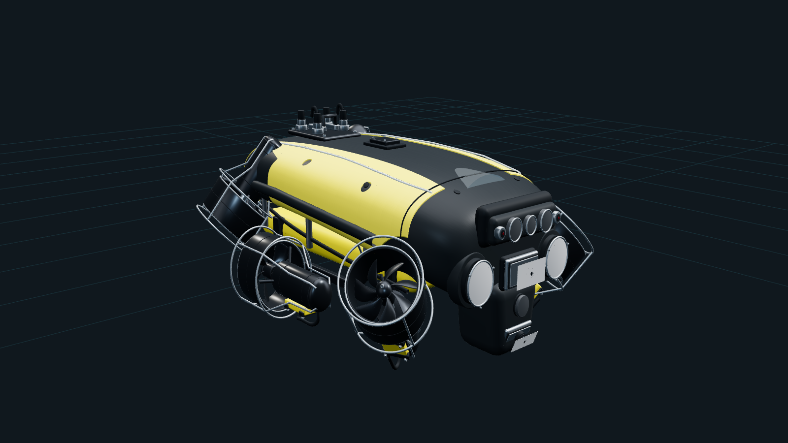 | 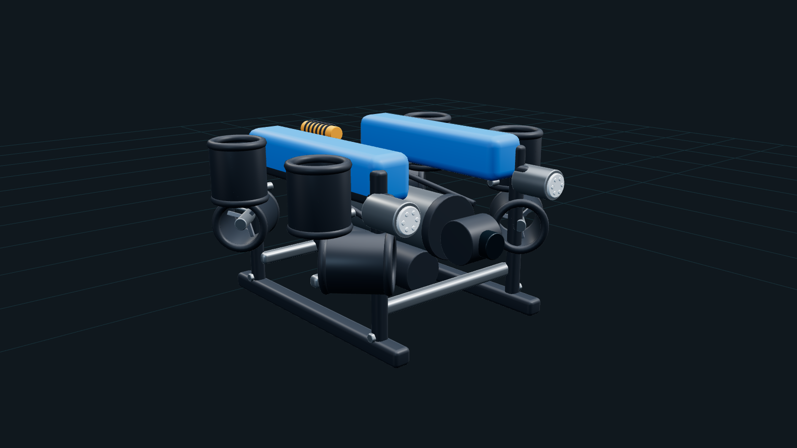 | 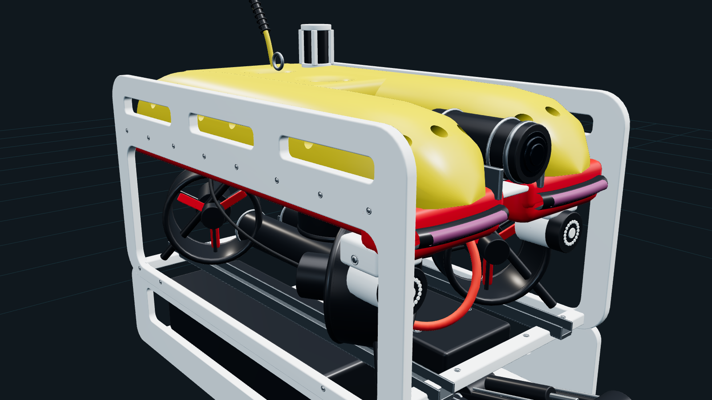 |
| Studio, after | 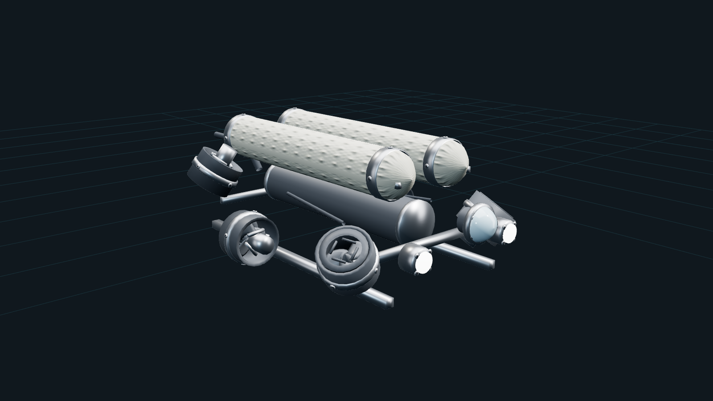 | 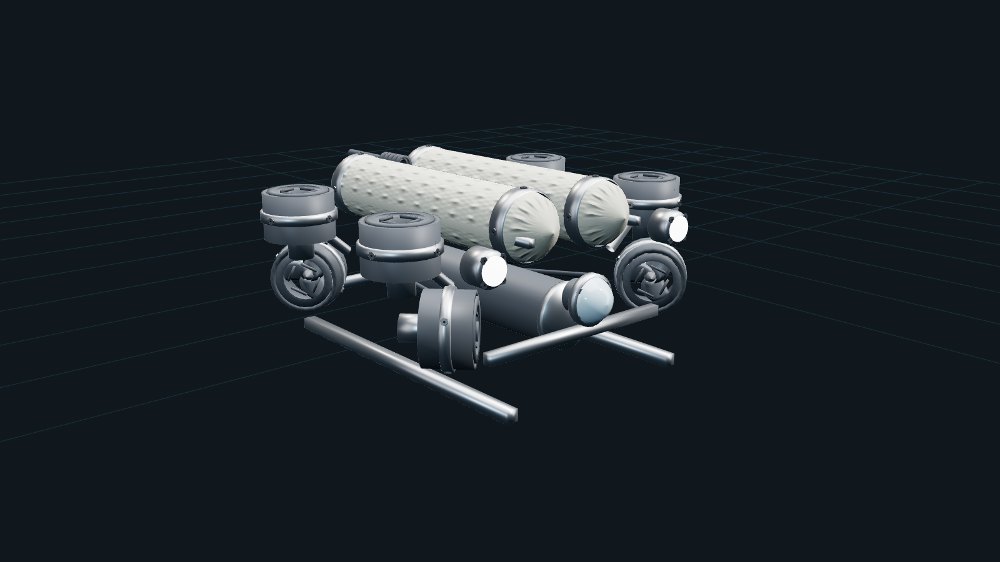 | 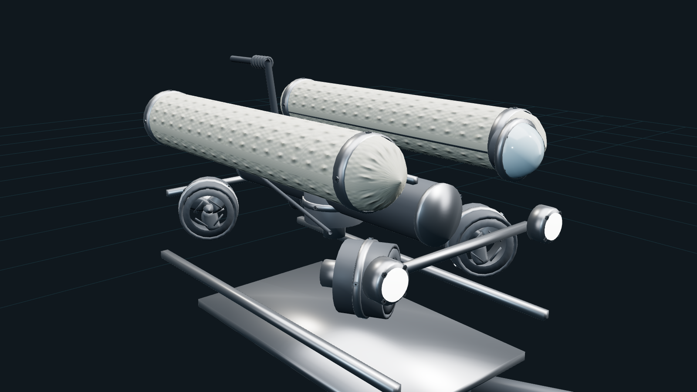 |
| Close, before | 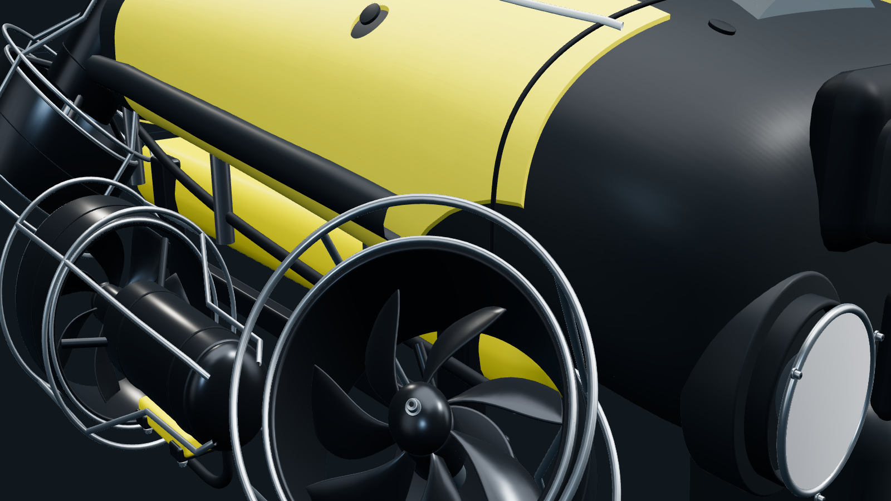 | 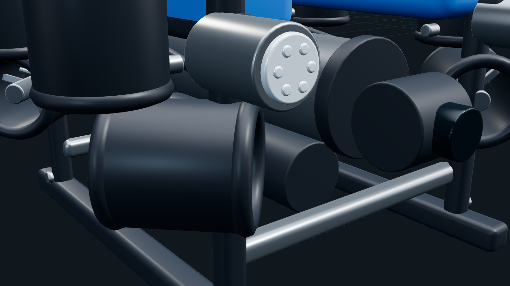 | 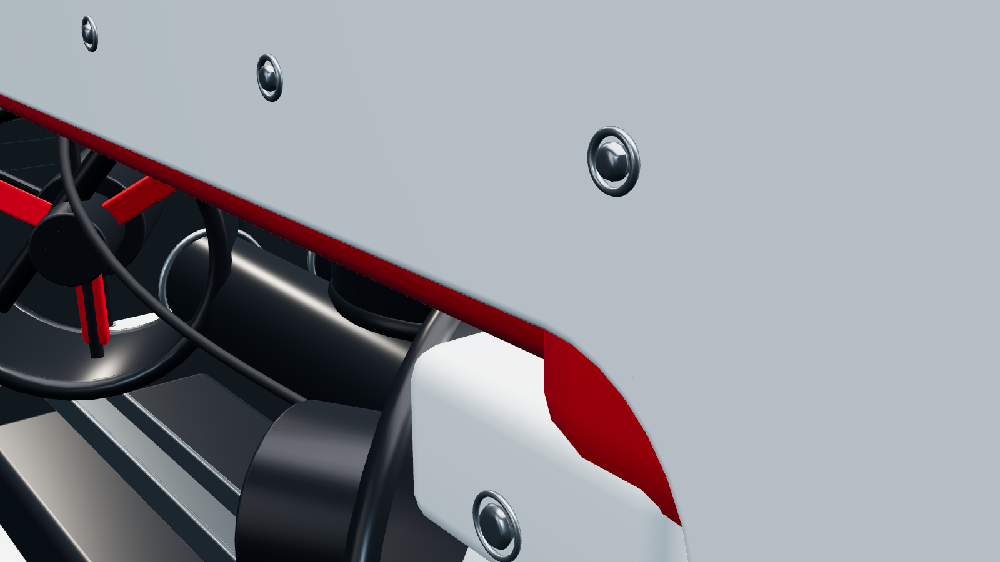 |
| Close, after | 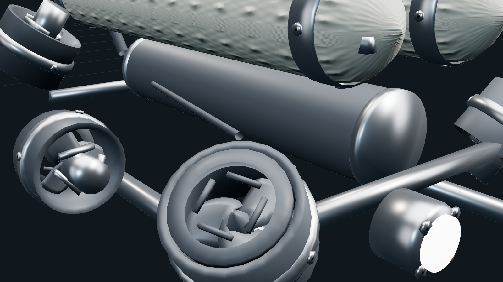 | 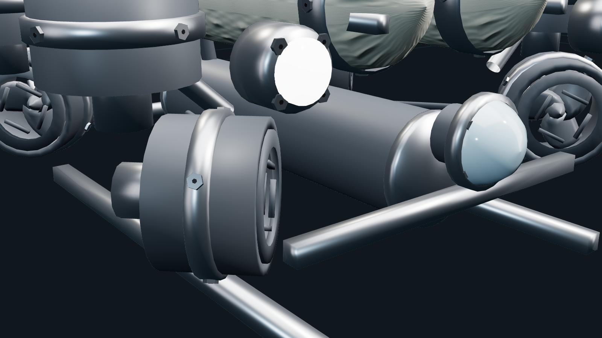 | 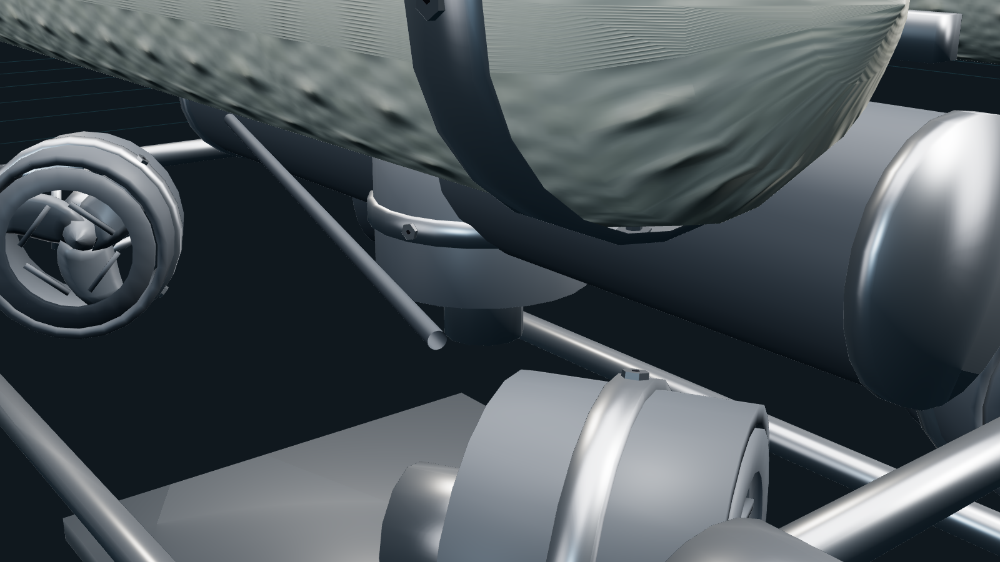 |
| Underwater, before | 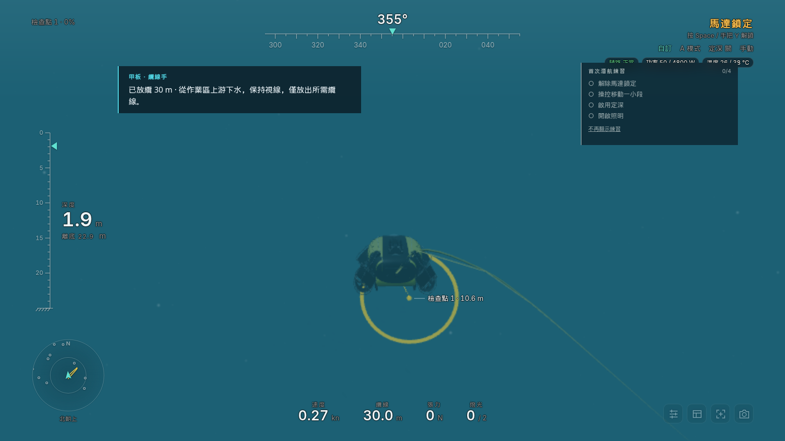 | 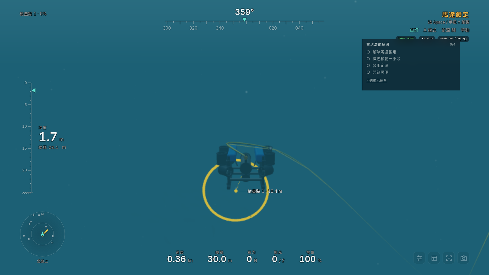 | 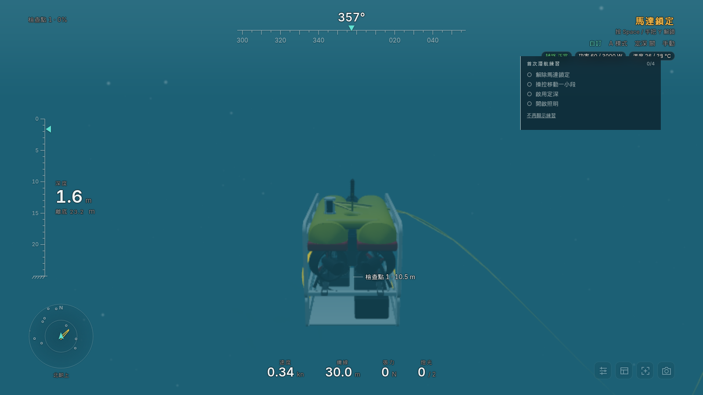 |
| Underwater, after | 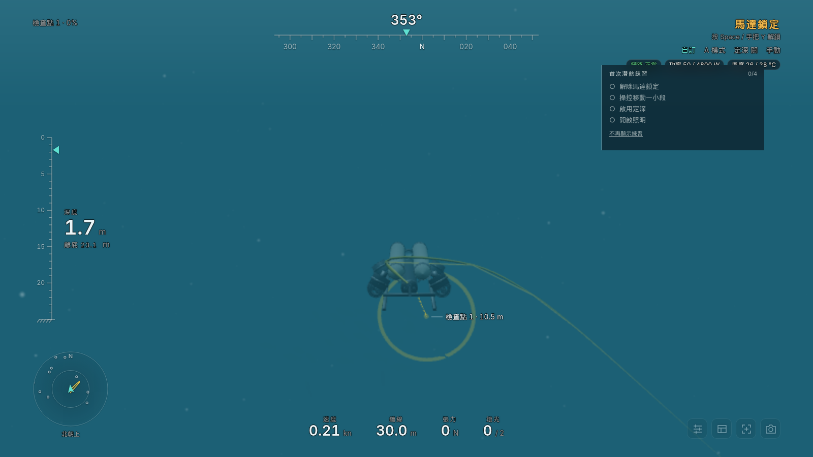 | 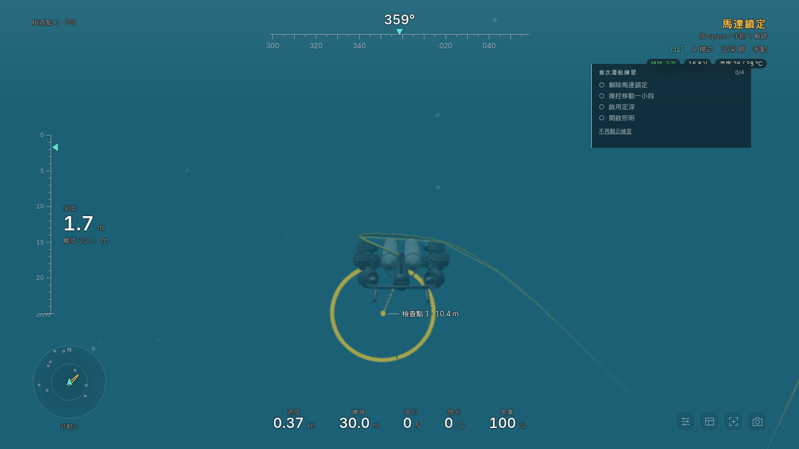 | 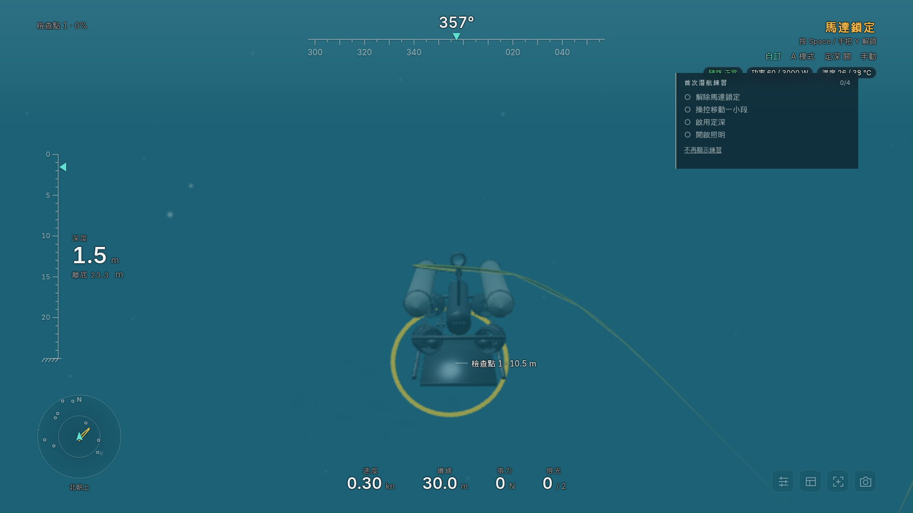 |
