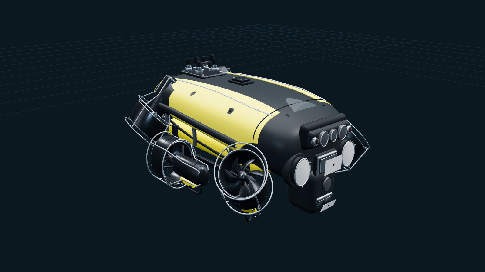
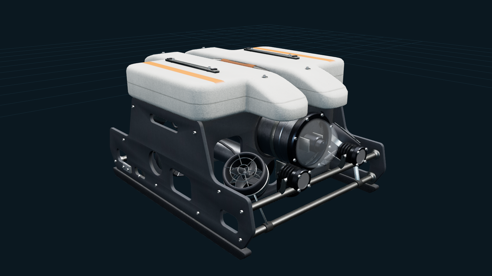
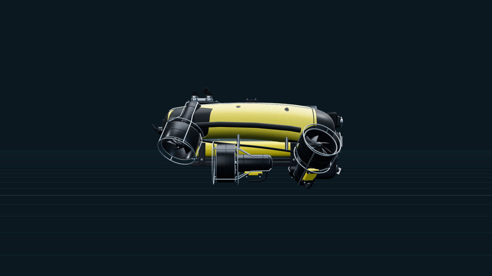
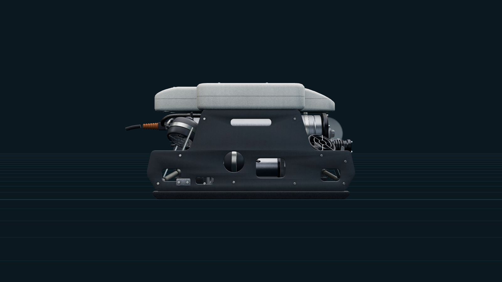
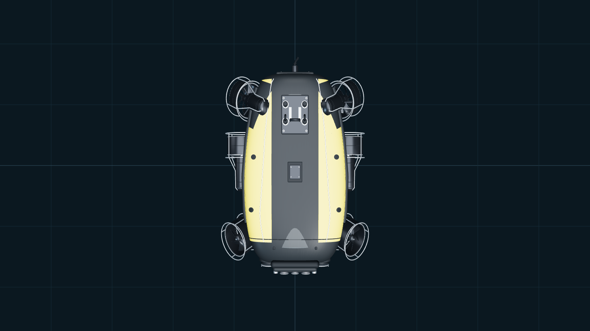
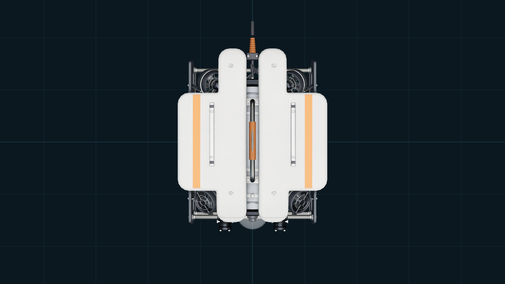
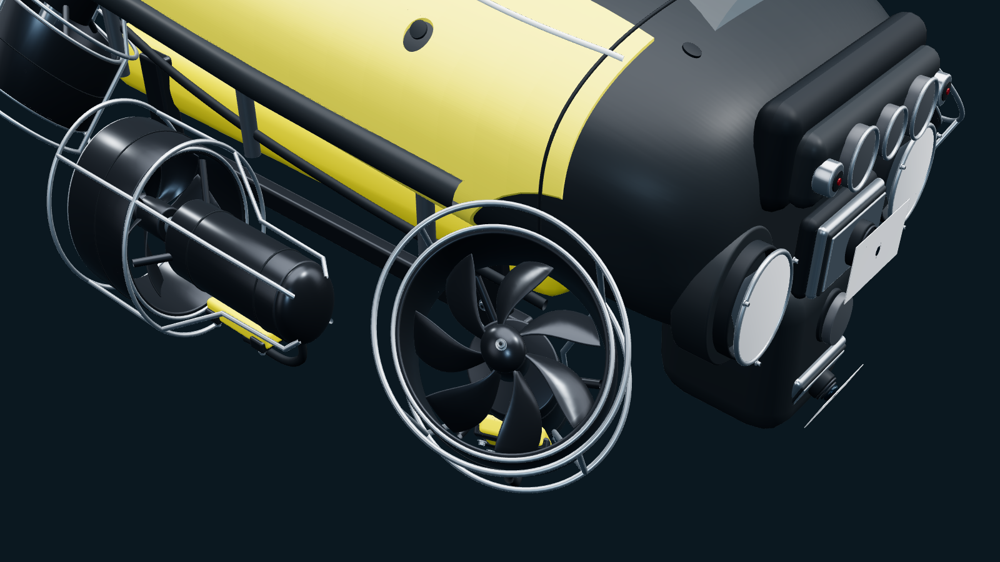
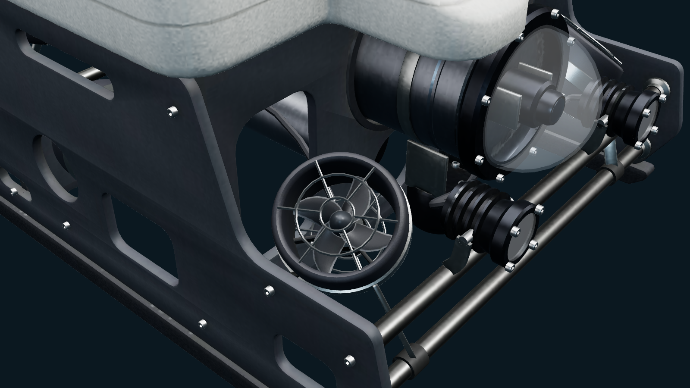
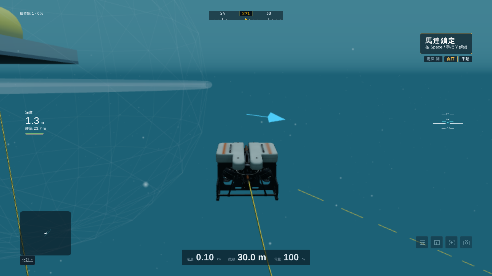

# Original observation ROV (generic asset set)

An original observation-class ROV for the Steam edition, built to replace the X1 training visual without
touching physics or SDK semantics. The bar is the existing X1 model; see [`x1-baseline.md`](x1-baseline.md).

- Selection: `?assets=generic`. The default (no parameter, or any other value) keeps every training model,
  so the internal training edition is unchanged. The setting is independent of the fidelity profile: it only
  changes which GLB is drawn for the `x1` vehicle id. The menu then lists the vehicle as `觀測型 ROV`.
- Files: `simulator/viewer/models/observation_rov.glb` (LOD0), `observation_rov_lod1.glb`, `observation_rov_lod2.glb`.
  The player's own vehicle uses LOD0; other players' vehicles (`fleet.js`) use LOD1.
- Source: `cad/build_observation_rov.py` (Blender) and `cad/pack_observation_rov.py` (glTF-Transform).
  Everything is generated from scratch: no third-party models, photographs, scans or texture libraries.

## Design

A generic open-frame layout, deliberately unlike the X1's moulded shell: two machined graphite side plates
and two bulkheads carry a split syntactic-foam float (warm white, with a moulded parting line, stainless
accessory rails and retroreflective tape strips), an anodised electronics housing that ends in a bolted
acrylic camera dome, a battery canister, a DVL on a drop bracket and a rear tether termination with a
segmented bend restrictor. All mount points come from the `x1` definition in `simulator/qysim/vehicles.py`:

| Physics item | Visual |
|---|---|
| 6 thrusters (positions and axes) | `Rotor_0`…`Rotor_5`, `role: rotor`, `thruster_index` 0–5, spin axis = thruster axis (unit test checks every LOD) |
| `lamp_body` × 2 | `lamp_pivot_0/1` within 1.2 cm of the physics lamp points (pivot axle sits just behind the lens) |
| `camera_body` | `camera_gimbal` at the dome centre; `anchor_camera` at the physics point |
| `gland_body` | tether bend restrictor and `anchor_tether` at the physics point |

Modelled parts: ducted thrusters (airfoil duct with rolled lip, stainless clamp band, finned motor can,
three stator struts, 4-blade twisted, cambered and skewed propeller with hub nose, wire guards on both ends,
brackets to the side plate and lower cross tube, motor cable), lamps (finned body, bezel with four screws,
reflector, emissive LED, cover glass, tilt axle and yoke), camera (body, lens, tilt bearings and yoke) inside
the dome, end caps with 8-bolt circles, nine wet-mate penetrators with nuts and boots, routed cables, housing
and battery clamp bands, bulkhead grommets, three cross tubes with bolted flanges, UHMW skids, zinc anodes,
lift handle with orange grip and bolted feet, DVL with four tilted transducers, and 78 socket-head
screws with hex recesses.

## Toolchain

| Step | Tool | Notes |
|---|---|---|
| Modelling, UV, baking | Blender 5.0.1 as the `bpy` wheel (Python 3.11), headless | No Blender install needed: `python3.11 -m venv v && v/bin/pip install bpy pillow` |
| PBR textures | Procedural Cycles shaders baked on the CPU | One half-resolution ray-traced mask pass (edge wear from a bevel-normal comparison, cavity occlusion, AO), upscaled and reused by cheap colour, roughness/metal and normal passes |
| Compression, LODs | glTF-Transform CLI 4.5.1 (MIT, build-time only) | `dedup`, meshoptimizer `simplify`, `resize`, `prune --keep-leaves`, `meshopt` |

```bash
python3.11 -m venv /tmp/bpy && /tmp/bpy/bin/pip install bpy pillow
/tmp/bpy/bin/python cad/build_observation_rov.py .          # ~10 min; --quick bakes 512 px in ~1 min
python cad/pack_observation_rov.py                          # npx @gltf-transform/cli@4.5.1
python simulator/tools/render_vehicle_compare.py            # comparison renders into this folder
```

**Textures are JPEG, not KTX2.** The viewer on `main` has no KTX2 loader or Basis transcoder (T08 trimmed the
vendored three.js; the vendor manifest's `runtime` list is empty), so adding KTX2 would mean vendoring
`KTX2Loader`, the 0.5 MB transcoder and wiring `detectSupport(renderer)` into every renderer. That is left for
a separate change; no extra WebGL context is created anywhere. Consequence: GPU memory is that of
uncompressed RGBA8 (see below).

## Asset report

Generated by `cad/pack_observation_rov.py` into [`asset-report.json`](asset-report.json).

| | X1 `rov.glb` (bar) | LOD0 `observation_rov.glb` | LOD1 | LOD2 |
|---|---:|---:|---:|---:|
| File size | 1.38 MB | 3.16 MB | 1.32 MB | 0.61 MB |
| Triangles drawn | 486,000 | 79,204 | 50,751 | 25,535 |
| Draw calls (front view) | 468 | 49 | | |
| Materials | 15 (factors only) | 10 (2 textured atlases + 8 small factor materials) | 10 | 10 |
| Textures | none | body 2048² × 3, thruster 1024² × 3 | 1024² × 6 | 512² × 6 |
| Texture GPU memory (RGBA8 + mips) | 0 | 84 MB | 34 MB | 8 MB |

Budgets from T11 (≤ 80k triangles, 2K textures, ≤ 8 MB) are met by LOD0 and asserted in
`simulator/tests/test_observation_rov_asset.py`. Each atlas has base colour (sRGB), normal (tangent space,
tangents exported) and ORM (R ambient occlusion, G roughness, B metalness).

## Side by side

Same camera, lights and studio environment for both, rendered through `createVehicleModel()` at 1600 × 900,
device scale factor 1 (`simulator/tools/render_vehicle_compare.py`).

| View | X1 (training, the bar) | Observation ROV (generic) |
|---|---|---|
| Front three-quarter |  |  |
| Side |  |  |
| Top |  |  |
| Thruster close-up |  |  |

In game, `?assets=generic&cam=chase` (`simulator/tools/browser_vehicle_assets_smoke.py`, which also asserts
that the generic GLB was requested, the default still requests `rov.glb`, all six rotors map to thrusters and
the menu label changes):



## X1 training LODs (I1)

The training X1 itself is now packed into three LODs (`rov.glb`, `rov_lod1.glb`, `rov_lod2.glb`) by
`cad/pack_x1_rov.py`. See [`x1-lod-report.json`](x1-lod-report.json) and the before/after shots under
[`x1-lod/`](x1-lod/). LOD0 keeps the 486k-triangle appearance bar while cutting draw calls from ~468 to
≤ 40; peers start at LOD1 via `THREE.LOD`.

## Verdict against the X1 bar

**Where it meets or exceeds the bar**

- Surface: every large part has baked PBR maps with edge wear, cavity grime, staining streaks, brushed
  metal and baked AO. The X1 has no textures at all, so this is the clearest gain.
- Part coverage: thrusters with real bladed rotors and guards, lamp and camera optics, penetrators and
  cables, tether gland, handles, fasteners with hex recesses. Nothing on the X1's list of modelled parts is
  missing in kind, and the frame, DVL bracket, anodes and skids add engineering detail the X1 does not show.
- Cost: 6 times fewer triangles and about 10 times fewer draw calls than the X1, with three LODs.

**Where it falls short**

- Geometric density per part is lower. Each X1 thruster is 39.6k triangles with a 7-blade impeller and a
  thick rail cage; ours is about 5k with a 4-blade propeller and 4-sided guard wires that look faceted in an
  extreme close-up. Lathe parts use 20–48 segments, so silhouettes of the motor cans and lamp fins are
  visibly polygonal at very close range where the X1 is smooth.
- Normal maps carry fine grain, the moulded seam and tape edges only; edge rounding comes from real bevels.
  There are no decals, markings or biofouling, and the wear is uniform rather than art-directed.
- The textures are procedural bakes, not authored art: up close the foam reads as clean, slightly
  uniform polyurea. Photographic realism would need an artist or scanned materials (T11 says the same).
- File size is 2.3 times the X1 (3.16 MB vs 1.38 MB) and texture memory is about 84 MB, because there is
  no KTX2 path yet.
- LOD reduction is limited by UV seams (LOD1 64 %, LOD2 32 % of LOD0) rather than the usual 50 % / 25 %.
- Only checked with software rendering (SwiftShader) in this container, not on a GPU or in the Electron build.
- Physics is the X1's; the visual is a different vehicle, so collision spheres and the camera height follow
  the X1 definition rather than this frame's own geometry.
