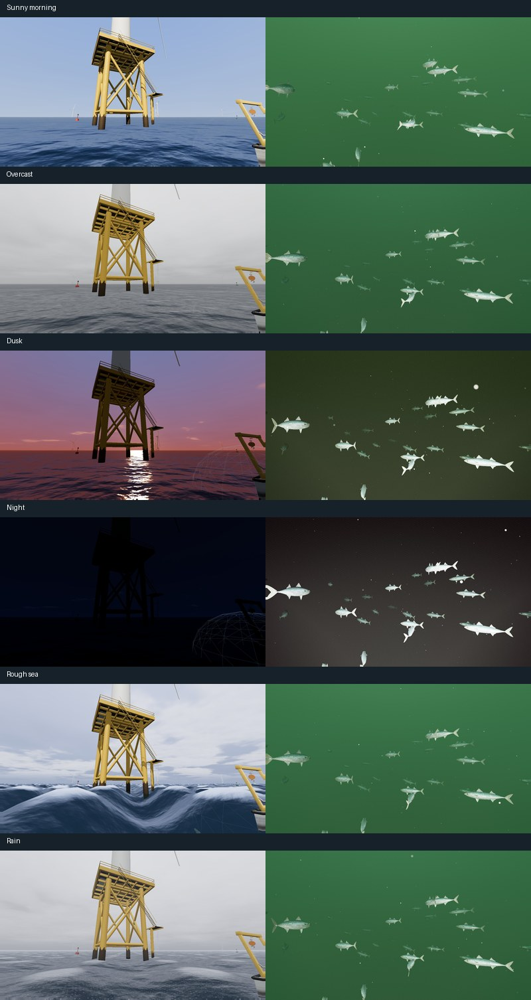

# 導管架作業的六種天候

左欄是水上固定觀點，右欄是同一魚群旁的機載鏡頭。兩欄均使用導管架場景、種子 42、中畫質及真實擬真設定。由上而下是晴天上午、陰天、黃昏、夜間、浪大與雨天。水下比較固定使用二段燈，能見度維持 8 m。



浪頭與雨滴位於世界座標。低畫質以較疏的海面網格及簡單的撞水亮點呈現。自然光依既有水型的光譜衰減，夜間關閉水下自然光。懸浮顆粒與魚側反光取決於燈束、距離及水質。天候亮度、色溫與波幅都是呈現假設。

使用下列指令可重拍。腳本會在正常的回放渲染管線中替換情境天候。

```sh
python simulator/tools/run_browser_checks.py browser_weather_shots
```

先前版本的導管架可對照[水面日光](../daylight/jacket-surface-after.jpg)與[水下開燈](../underwater-look/jacket-lamps-after.jpg)。
