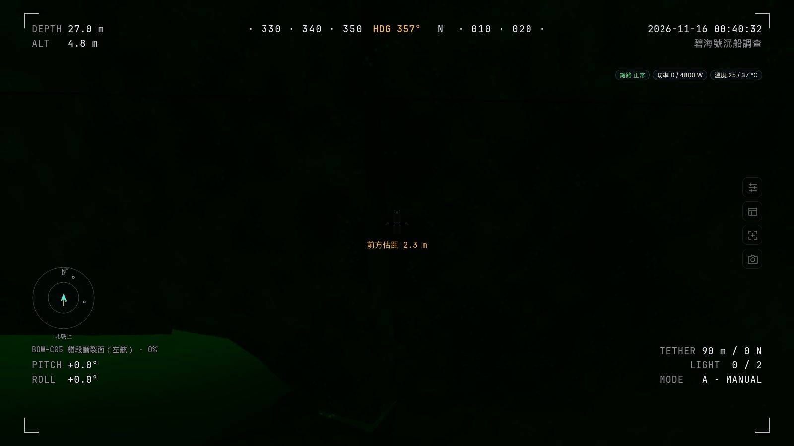
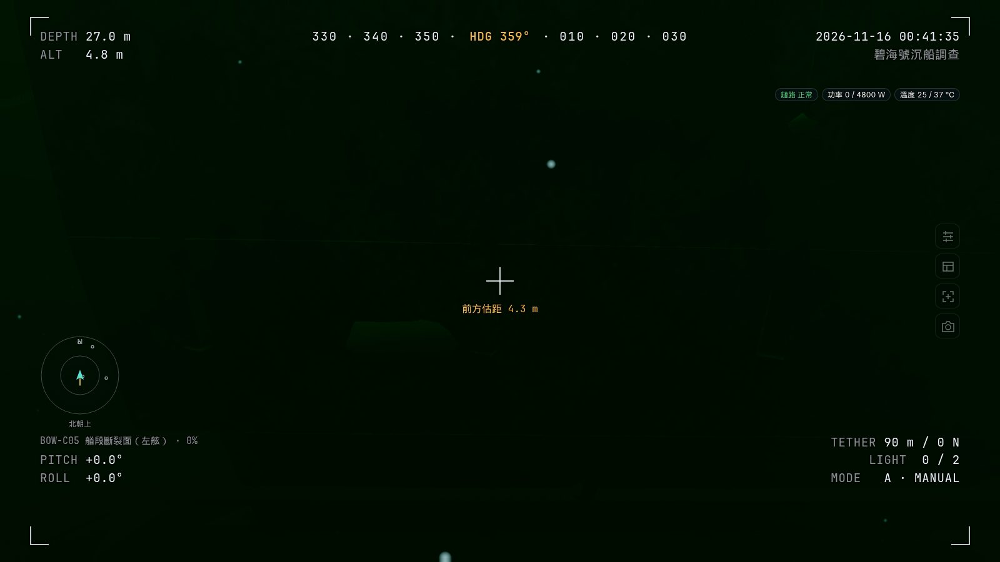
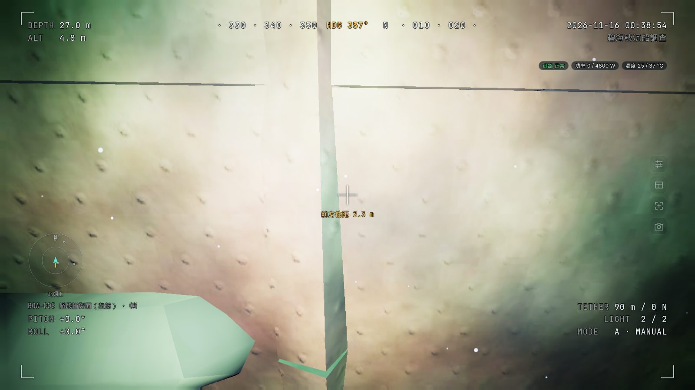
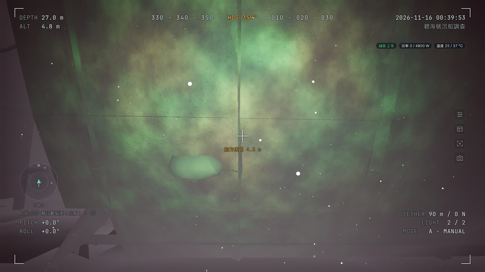
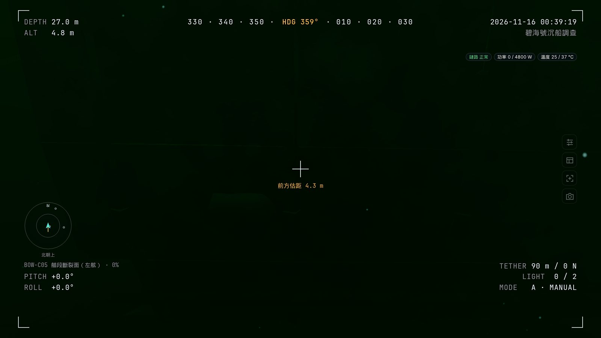

# I4：韓國城沉船重做（碧海號）

來源仍是 `cad/korean_castle/Korean_Castle_Display.blend`（海報推估示意，**非實測、不可用於導航**）。
場址玩家名稱為「碧海號」，內部 key 仍是 `korean_castle`。
A2（PR #40）材質較好但三角形 718k、貼圖約 235 MiB、`.blend` 100 MB，故未合併。
I4 在預算內重做外觀，並以**模擬器內** real 模式截圖驗收。

## 材質返工（審查後）

- 鏽蝕：深褐／暗赭＋綠灰附著膜，低飽和；對比接近 `main`（albedo std≈20），避免亮橘／薄荷迷彩。
- 噪聲：可無縫拼接的 fBm＋柔和 Worley（無軸對齊磚格）；保留 SurfaceMeters UV，**不再** 4.2× 放大。
- 附著：柔和綠灰／褐灰，依離底高度分層；藤壺／贻貝稀疏幾何。
- 碎石：獨立中性岩石色（`I4_rock_basecolor`），法線共用鋼構。
- 上層建築／艙底淤泥／暗凹槽：接上鋼構或附著圖集，不再平灰。
- 拿掉 GLB 內嵌平坦海床平面；場景改用既有 `seabed.js` 沙紋海床。
- 六張圖：LOD0 為 1024²；LOD1 512²；LOD2 256²。

## 預算與資產報告

見 [asset-report.json](asset-report.json)。GPU 記憶體以解碼後 RGBA8＋完整 mip chain 計算。

| 層級 | 三角形 | draw calls | GLB | 貼圖 GPU MiB |
|---|---:|---:|---:|---:|
| LOD0（high） | 248,341 | 62 | 5.09 MB | 32.00 |
| LOD1（medium） | 83,121 | 62 | 2.86 MB | 8.00 |
| LOD2（performance） | 17,955 | 62 | 0.81 MB | 2.00 |

**超過 2 MB 新資產軟上限的理由**：

- **LOD0**：248k 可視三角形（任務 ≤300k）加上六張 1K PBR（GPU ≤32 MiB）經 meshopt＋WebP 後約 5.1 MB；不能為壓檔而砍三角形或改回低對比貼圖。
- **LOD1**：83k 三角形＋512² 圖集約 2.86 MB（較前一版 3.55 MB／1K 圖已縮小）。medium 距離仍需讀得清板縫與附著；LOD2（0.81 MB）供遠距／performance。

碰撞三角形仍為 2,842；距離場與 `korean_castle.json` 路線／格網不變。`build_wreck.py` 使用 `cKDTree(compact_nodes=False)`。

## 重建

```bash
uv venv /tmp/i4env --python 3.11
uv pip install --python /tmp/i4env/bin/python 'bpy==5.0.1' 'numpy<2' pillow scipy
/tmp/i4env/bin/python cad/build_korean_castle_i4.py
/tmp/i4env/bin/python cad/pack_korean_castle.py
/tmp/i4env/bin/python simulator/tools/build_wreck.py simulator/output/korean_castle_i4
```

建置腳本開啟既有 `.blend`、改寫 packed 無縫 1K 圖、為上層建築／淤泥接材質、修剪過重附著物、加入稀疏斷口薄片與深度加權藤壺／贻貝，
匯出 LOD0／1／2 raw GLB 與碰撞／路線陣列，**不回寫 `.blend`**。打包：dedup → weld →（LOD1/2 resize＋輕量 simplify）→ WebP → prune → meshopt。

## 同機位模擬器內截圖（real）

機載第一人稱；眼點以距離場為準約 1 m／3 m（本地 y ≈ −10.3／−12.3，x=50、z=5），開燈（2 級）與關燈。HUD 顯示「碧海號」。不是 Blender 離線算圖。

| | 1 m 開燈 | 1 m 關燈 | 3 m 開燈 | 3 m 關燈 |
|---|---|---|---|---|
| 修改前（main） |  |  |  |  |
| 修改後 |  |  |  |  |

重現：`ROV_WRECK_TAG=after python simulator/tools/run_browser_checks.py browser_korean_castle_shots`（腳本會斷言眼點 SDF，並刪除未加標籤的 `onboard-*.jpg`）。

補充（無水體衰減的 studio 對照，**同一正規化鏡頭**）：[studio-before](studio-before.jpg)／[studio-after](studio-after.jpg)（`simulator/tools/render_korean_castle_studio.py`）。

## 假設與限制

- 鏽色、鉚接／板縫法線、附著密度與斷口薄片為視覺重建假設，無此船實測校色。
- 生物細節為合併批次幾何，非逐株動畫；厘米級細件不進碰撞。
- korean_castle 在 G5（SwiftShader）量測中仍是最重場址之一；本 PR 降三角形並維持 LOD0 貼圖 ≤32 MiB，帧時間前後對照見下表。

## korean_castle 幀時間（同機 `browser_scene_review`，SwiftShader）

軟體算圖，僅供相對比較。完整 JSON：[perf-before.json](perf-before.json)／[perf-after.json](perf-after.json)。

| 畫質／視角 | 修改前 mean ms（tris） | 修改後 mean ms（tris） |
|---|---:|---:|
| performance／onboard | 450.1（308535） | 103.5（44896） |
| performance／third | 360.5（307147） | 102.8（45520） |
