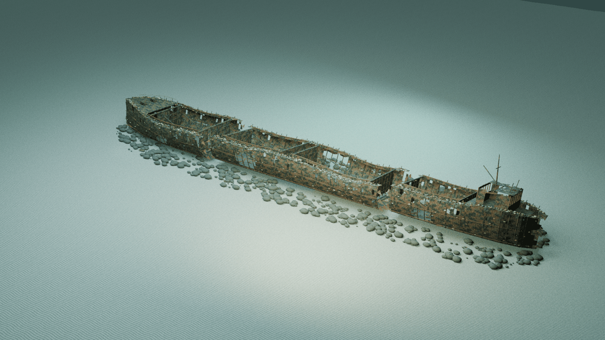
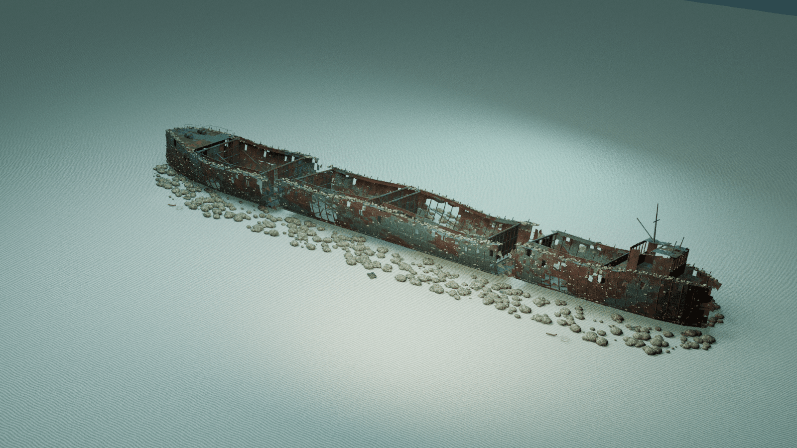
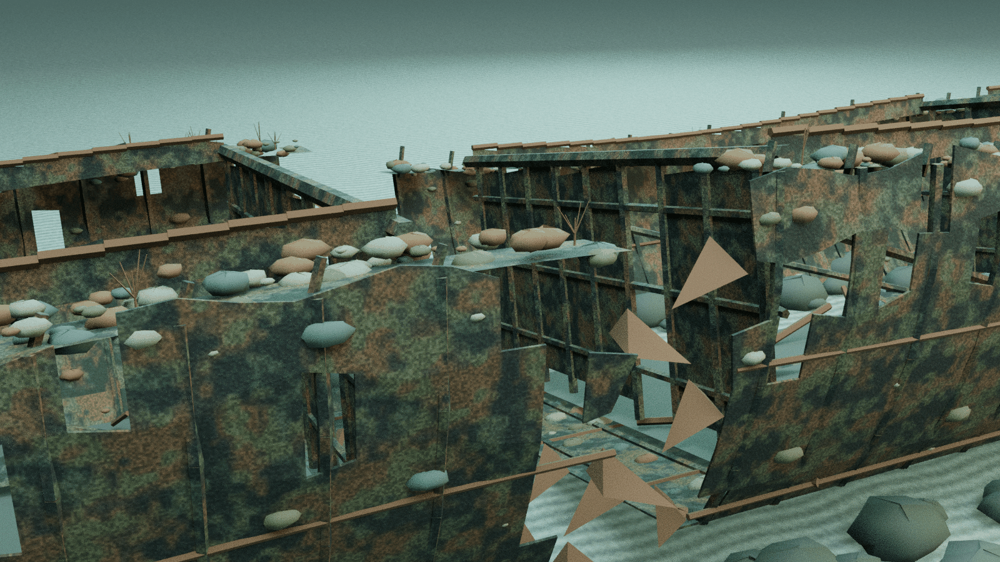
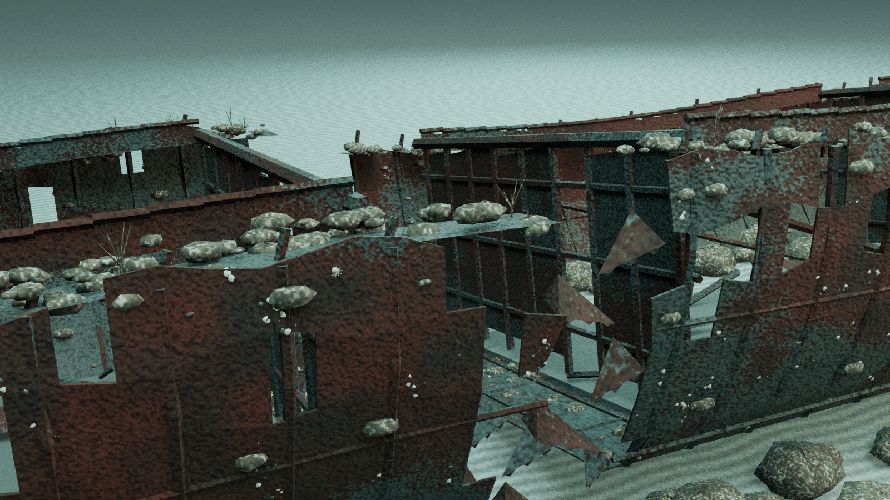
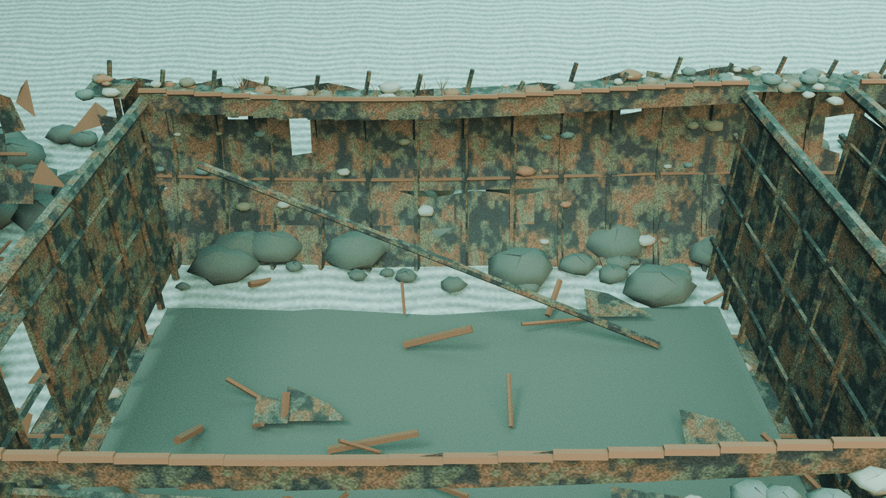
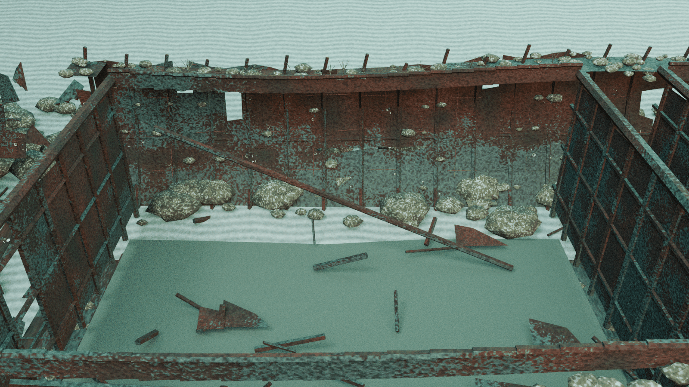
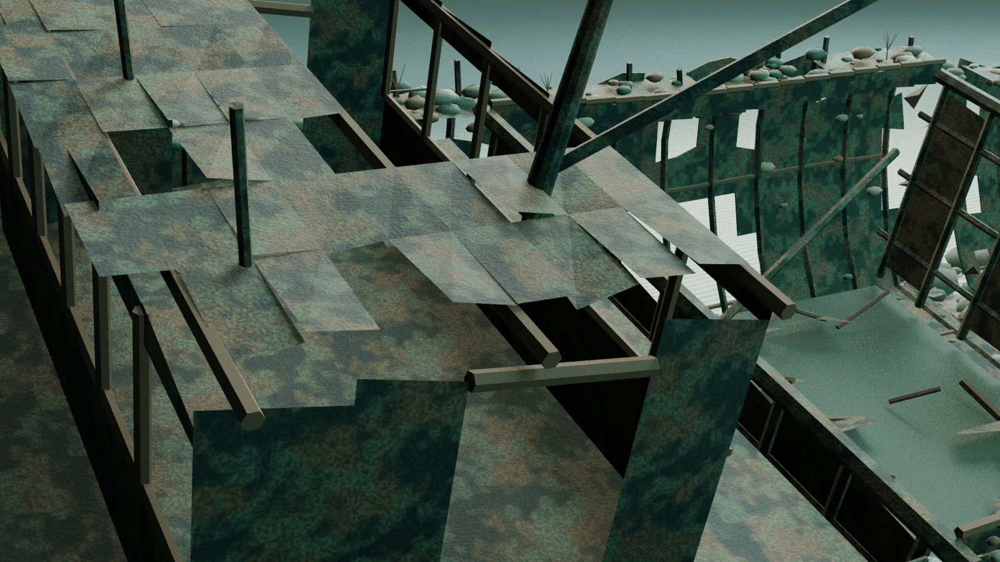
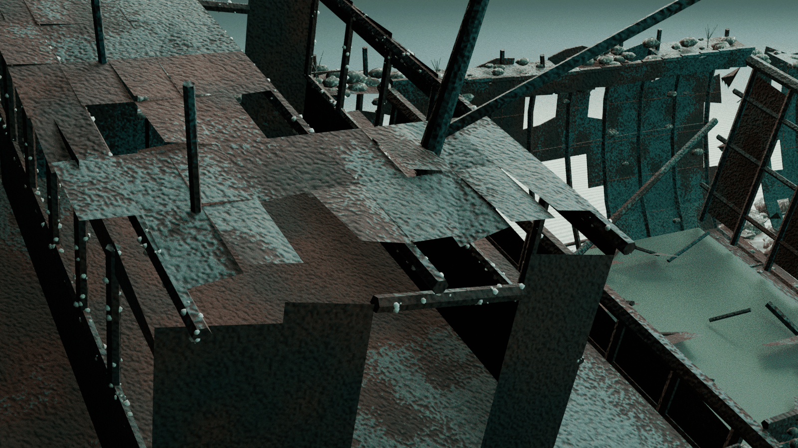

# A2 沉船細化與驗收

來源：`cad/korean_castle/Korean_Castle_Display.blend`。修改前版本為
`afc33198adfec6b34114db0416bf810be98157ff`（本次開工時最新 `origin/main`）。
交付前已 rebase 至最新 main `41ac39a5d23c52b46cac9dd10fb2a6316586f8ee`；該段上游更新未改動沉船來源。
本模型仍是依海報推估的示意重建，**非實測、不可用於導航**。

## 同機位對照

以下為 Blender Cycles 的材質／幾何檢查圖，不是模擬器的機載影像。
兩版沿用相同燈光、曝光、鏡頭與 48 samples；沒有為修改後額外加燈或後製霧效。
修改後啟用與 glTF 匯出相同的幾何 LOD，避免用高精細離線模型掩蓋網頁模型的取捨。
PNG 均為 1600 × 900，轉為 256 色 PNG 調色盤以符合每張小於 1.5 MB 的限制。

| 機位 | 修改前 | 修改後 |
|---|---|---|
| 全景 |  |  |
| 艏段斷裂面 |  |  |
| 二號貨艙艙外俯視 |  |  |
| 艉樓右舷窗框 |  |  |

相機位置／注視點／焦距（Blender 原模型座標，m／mm）：

| 機位 | 位置 | 注視點 | 焦距 |
|---|---|---|---|
| 全景 | 180, -165, 108 | 76, 0, 3 | 42 |
| 斷裂面 | 35, -25, 16 | 47, 1, 5.7 | 38 |
| 二號貨艙 | 61, -14, 24 | 61, 1.5, 8 | 32 |
| 窗框 | 145, 23, 17 | 137, 8.8, 12 | 45 |

## 修改內容與依據

- 三段船體各一套獨立 2048² Base Color／Roughness／Normal 圖集。左右舷分開配置，
  沿船長不重複平鋪；保留大片不規則舊塗層，加入氧化、剝落邊界、點蝕及低處沉積色。
  原有鋼構重新使用各段圖集，氧化鋼不是亮面裸金屬。海水衰減不烘入底色，仍交由模擬器處理。
- 沿原船殼投射鋼板搭接縫與鉚釘列；原船殼、斷裂位置與分段姿態不變。
- 幾何藤壺（開口殼緣）、贻貝群、海葵觸手及分枝軟珊瑚；群落密度隨離底高度指數下降。
  原有大塊附著物增加顆粒狀生物殼表面，艉樓窗框另有藤壺群。
- 原斷裂鋼板上加薄片剝離與捲折邊，保留既有外露肋骨與縱桁。
- 船旁添加三組舱蓋、脫落絞盤、開口彎管和盤繞細纜；舱蓋與絞盤有碰撞代理。
- 海床局部細分成較密網格，刻出淺沖刷凹槽、非均勻沉積肩及沿船側堆積。

已讀 [真實 ROV 研究](../../reference/real-rov-research.md)，特別是「檢測怎麼飛、事故怎麼發生」
與纜線應變段落：保留艙外檢查路線、斷裂面辨識與窗框開口，不用裝飾堵住任務位置。
IMCA 02/23 及密西根湖事故支持鋼構／纜線勾纏是訓練重點，**並不支持此船的生物種群或腐蝕年齡**。
本次群落、塗層顏色、鉚接節距、殘骸位置與沖刷方向均為明確的視覺重建假設。
基底沒有 `docs/reference/own/` 的實船量測可供校正。

## 幾何、LOD 與碰撞契約

117 個既有非海床網格的頂點、面索引及世界變換逐物件 SHA-256 對比完全一致，
包括原船體、原附著物、原碰撞代理和預覽路線。
原有 2,842 個碰撞三角形逐值保留，另增加 288 個大型殘骸碰撞三角形，共 3,130 個。
檢查點與路線定義未修改。距離場由正式工具重建，網格為 530 × 170 × 71，間距仍為 0.3 m。

`A2_Runtime_LOD` 是生物細節的 Decimate modifier：保留完整來源網格，
viewport／匯出使用 27% 三角形，離線高精細渲染可停用。
審查圖強制開啟此 modifier；程式沒有宣稱已實作遊戲內依距離自動切換 LOD。
小型群落按材質合併成網格，避免每顆藤壺各自形成 draw call。
鋼板縫、船體和大型殘骸不做此簡化。

輸出使用 WebP 保留 2K 尺寸並降低貼圖傳輸量，再使用 meshopt 壓縮網格。
現有 three.js r160 GLTFLoader 已支援 `EXT_texture_webp`，無需修改載入器。
WebP 是傳輸壓縮，並不降低 GPU 解壓後的貼圖記憶體。

檔案大小與實際測試結果見下方完成紀錄。

## 重現

建模透過 [Blender MCP](https://github.com/ahujasid/blender-mcp)
`execute_blender_code` 進行，版本 `8f40787fbde8e6d8fe51c5a3553e5635fff40d2b`（MIT）。
執行環境是 Blender 4.3.2，MCP stdio client 連到本機 addon；無顯示器環境以主執行緒輪詢
addon 原有 command queue。未啟用資產下載服務或遙測，未將工具套件加入本 repo。

`cad/korean_castle/detail_wreck.py` 保存建模配方（固定亂數種子）；必須在未細化的基底場景執行，
已含 `A2_` 物件時會拒絕重複疊加。交付 `.blend` 已內嵌全部貼圖，正常匯出不必重跑配方。

```bash
cd simulator
mkdir -p /tmp/a2-wreck
blender -b --python tools/wreck_blender_export.py -- \
  ../cad/korean_castle/Korean_Castle_Display.blend /tmp/a2-wreck
python tools/build_wreck.py /tmp/a2-wreck
# @gltf-transform/cli 4.5.1，工具安裝於 repo 外，無新增專案 npm 依賴
GTF=/path/to/gltf-transform
$GTF webp /tmp/a2-wreck/korean_castle_raw.glb /tmp/a2-wreck/textures.glb --quality 60 --effort 80
$GTF meshopt /tmp/a2-wreck/textures.glb viewer/models/korean_castle.glb
python -m unittest discover -s tests
python tools/run_browser_checks.py browser_smoke browser_menu_smoke browser_wreck_asset_smoke
```

渲染原圖：

```bash
blender -b SOURCE.blend -t 4 --python simulator/tools/render_wreck_review.py -- docs/design/wreck before
blender -b cad/korean_castle/Korean_Castle_Display.blend -t 4 \
  --python simulator/tools/render_wreck_review.py -- docs/design/wreck after
```

以 Pillow `image.convert('RGB').quantize(colors=256, method=Image.Quantize.MEDIANCUT)`
及 `save(..., optimize=True)` 輸出調色盤 PNG。沒有縮小解析度或使用生成式影像替代渲染。

## 還不夠好的部分

- 原模型仍有規則的矩形缺口、平直肋骨與多面體形狀；本次保留宏觀結構，沒有重新做考古級破損重建。
- 近距離可看出群落簡化，海葵與軟珊瑚沒有隨流動畫；物種與密度未經實地調查。
- 細纜、管件、鉚釘及生物小於距離場有效解析度的細節仍是外觀，不會逐根勾纜。
  大型舱蓋與絞盤有碰撞；不能把所有畫面細節理解為物理上可勾掛的結構。
- 沖刷／沉積只有約 0.2 m 級的表面起伏；物理海床仍使用既有海床接觸面，沒有新增沉積物動力學。
- 無實船照片校色、沒有真機水下對照；這些明亮診斷渲染不代表 32 m 水深下的自然可見距離。
- 來源 `.blend` 超過 2 MB，以及 GLB／距離場／對照圖都是本任務明確要求的二進位交付物，
  因此一併提交；未提交中間 raw GLB、暫存貼圖、Blender 備份檔、node_modules 或展示頁產生物。

## 構建工具調整

原距離場工具在密集、近乎共面的船殼取樣上遇到 KD-tree 查詢退化。
`build_wreck.py` 僅將建樹改為 `cKDTree(pts, compact_nodes=False)`；
仍為精確最近點搜尋（`eps=0`），沒有改 5 cm 表面取樣、0.3 m 網格、5 cm 量化或上限。
在同一份 4,906,638 點雲上，以固定種子 2026 在場景範圍內取 5,000 個位置，
原／新索引的距離陣列逐值完全相同；該次查詢耗時 5.24 s／0.40 s。
這是本機樣本量測，不是所有模型的效能保證；數據見 [index-validation.json](index-validation.json)。

## 瀏覽器驗證

最終在最新 main 基底、渲染結束且無其他重負載任務時執行：

```bash
cd simulator
ROV_CHROMIUM=/usr/bin/chromium python tools/run_browser_checks.py \
  browser_smoke browser_menu_smoke browser_wreck_asset_smoke
```

結果：**3/3 PASS**（通用 69.9 s、選單 30.7 s、沉船資源 8.8 s）。

沉船專用檢查驗證實際 GLB 的 12 MB 上限、三套 2K PBR 貼圖、meshopt／WebP 解碼及 WebGL 繪製。

早先兩次通用檢查曾在開放水域 Falcon 夾爪 `window.__viewer.S.operations.arm.grip < .5`
等待超時（原定 60 秒）。最終隔離重負載後通過；不能僅憑此斷定超時原因。
使用 repo 既有 `requirements-fast.txt` 啟用 numba，沒有調大超時、修改斷言或改動夾爪／前端控制程式。

## 完成紀錄

最新 main 基底上的 `cd simulator && python -m unittest discover -s tests`：

```text
Ran 189 tests in 190.456s
OK
```

包括新增大型殘骸碰撞測試；沒有跳過測試，既有測試未刪改或放寬。

| 交付項目 | 大小 |
|---|---:|
| `.blend` 來源（貼圖內嵌） | 100,616,887 bytes |
| meshopt GLB | 11,849,352 bytes |
| 距離場 NPZ | 2,145,227 bytes |

精確指紋與圖片尺寸／大小見 [validation.json](validation.json)。
