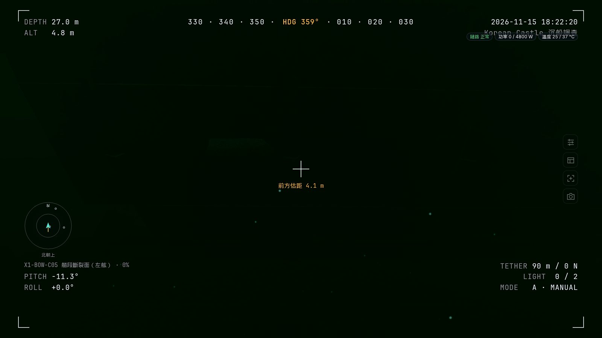

# I4：韓國城沉船重做（碧海號）

來源仍是 `cad/korean_castle/Korean_Castle_Display.blend`（海報推估示意，**非實測、不可用於導航**）。
場址玩家名稱為「碧海號」，內部 key 仍是 `korean_castle`。
A2（PR #40）材質較好但三角形 718k、貼圖約 235 MiB、`.blend` 100 MB，故未合併。
I4 在預算內重做外觀，並以**模擬器內** real 模式截圖驗收。

## 材質返工（審查後）

- 鏽蝕：深褐／暗赭，低飽和；斷口氧化物同調，不用亮橘。
- 附著：柔和綠灰／褐灰，藤壺（limestone）偏褐、贻貝（olive）偏綠灰，依離底高度分層。
- 船殼 UV 約 4.2× 重複，附著／碎石世界投影約 0.22–0.28 m⁻¹，近距消除像素塊。
- 碎石改獨立中性岩石色（`I4_rock_basecolor`），不再套附著螢光綠。
- 拿掉 GLB 內嵌平坦海床平面；場景改用既有 `seabed.js` 沙紋海床。
- 六張 1024² 圖（鋼構 base／rough／normal、附著 base／normal、碎石 base）；碎石法線共用鋼構。

## 預算與資產報告

見 [asset-report.json](asset-report.json)。GPU 記憶體以解碼後 RGBA8＋完整 mip chain 計算。

| 層級 | 三角形 | draw calls | GLB | 貼圖 GPU MiB |
|---|---:|---:|---:|---:|
| LOD0（high） | 248,341 | 61 | 5.57 MB | 32.00 |
| LOD1（medium） | 83,120 | 61 | 3.55 MB | 32.00 |
| LOD2（performance） | 17,965 | 61 | 1.59 MB | 32.00 |

（檔案大小以 `docs/design/wreck/asset-report.json` 為準。）

**LOD0 超過 2 MB 新資產軟上限的理由**：248k 可視三角形（任務 ≤300k）加上六張 1K PBR（GPU ≤32 MiB）經 meshopt＋WebP 後仍約 5.6 MB；LOD2（performance）1.59 MB 已低於 2 MB。不為壓檔而砍三角形預算或改回低密度 UV。

碰撞三角形仍為 2,842；距離場與 `korean_castle.json` 路線／格網不變。`build_wreck.py` 使用 `cKDTree(compact_nodes=False)`。

## 重建

```bash
uv venv /tmp/i4env --python 3.11
uv pip install --python /tmp/i4env/bin/python 'bpy==5.0.1' 'numpy<2' pillow scipy
/tmp/i4env/bin/python cad/build_korean_castle_i4.py
/tmp/i4env/bin/python cad/pack_korean_castle.py
/tmp/i4env/bin/python simulator/tools/build_wreck.py simulator/output/korean_castle_i4
```

建置腳本開啟既有 `.blend`、改寫 packed 1K 圖、提高船殼 texel 密度、修剪過重附著物、加入稀疏斷口薄片與深度加權藤壺／贻貝，
匯出 LOD0／1／2 raw GLB 與碰撞／路線陣列，**不回寫 `.blend`**。打包：dedup → weld →（輕量 simplify）→ WebP → prune → meshopt。

## 同機位模擬器內截圖（real）

機載第一人稱、距船殼約 1 m 與 3 m，開燈（2 級）與關燈。不是 Blender 離線算圖。

| | 1 m 開燈 | 1 m 關燈 | 3 m 開燈 | 3 m 關燈 |
|---|---|---|---|---|
| 修改後 |  |  |  |  |

舊站位（約 3.5 m）對照仍保留：[before lit](before-onboard-lit.jpg)／[before dark](before-onboard-dark.jpg)。

重現：`python simulator/tools/run_browser_checks.py browser_korean_castle_shots`（寫入本目錄）。

補充（無水體衰減的 studio 對照，非驗收基準）：[studio-before](studio-before.jpg)／[studio-after](studio-after.jpg)。

## 假設與限制

- 鏽色、鉚接／板縫法線、附著密度與斷口薄片為視覺重建假設，無此船實測校色。
- 生物細節為合併批次幾何，非逐株動畫；厘米級細件不進碰撞。
- korean_castle 在 G5（SwiftShader）量測中仍是最重場址之一；本 PR 降三角形並維持貼圖 ≤32 MiB，帧時間前後對照見 PR 描述。

## korean_castle 幀時間（同機 `browser_scene_review`，SwiftShader）

軟體算圖，僅供相對比較。完整 JSON：[perf-before.json](perf-before.json)／[perf-after.json](perf-after.json)。

| 畫質／視角 | 修改前 mean ms（tris） | 修改後 mean ms（tris） |
|---|---:|---:|
| performance／onboard | 450.1（308535） | 103.5（44896） |
| performance／third | 360.5（307147） | 102.8（45520） |
