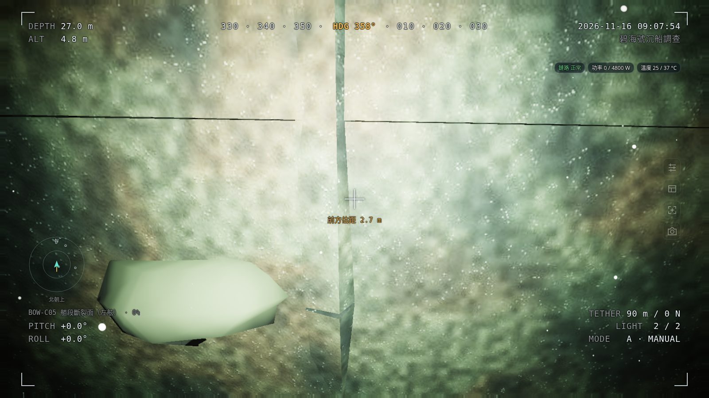
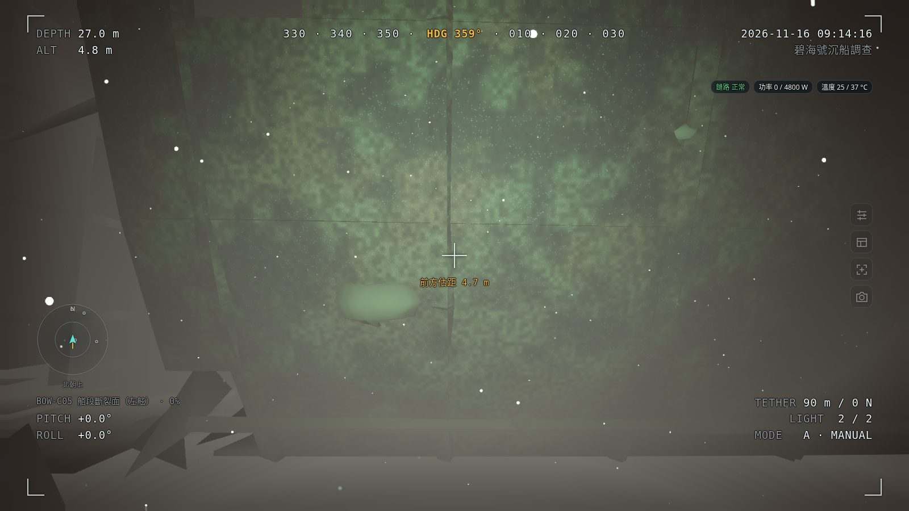
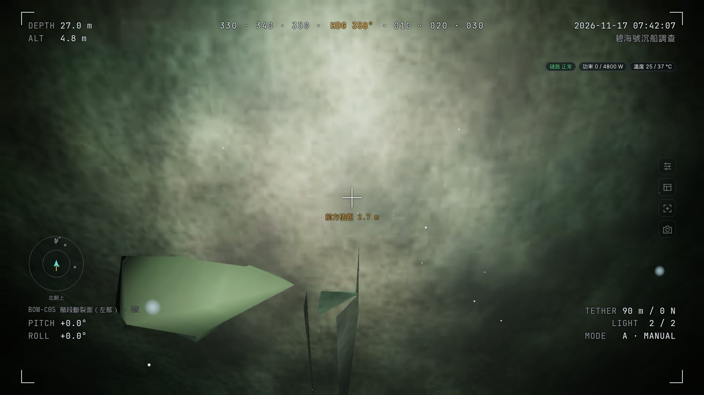
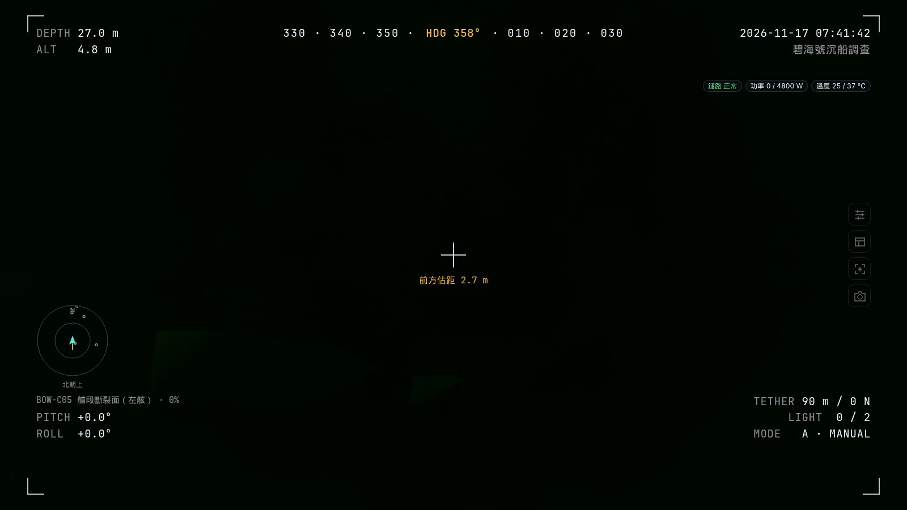
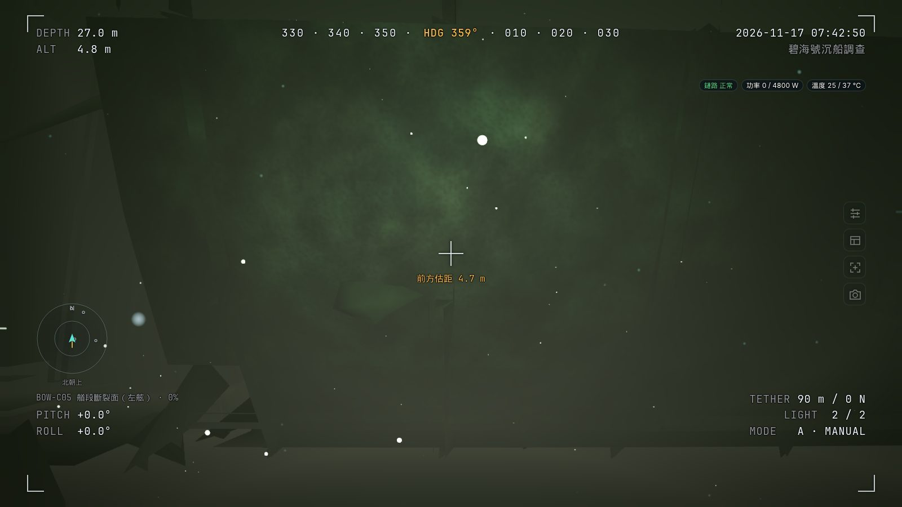
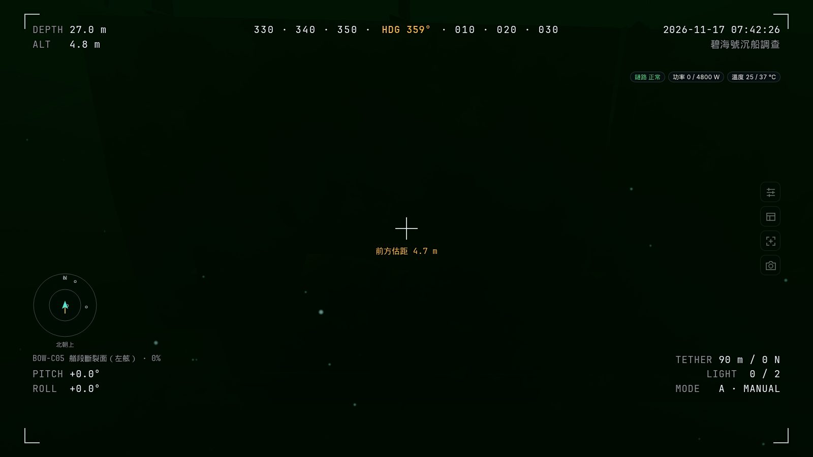
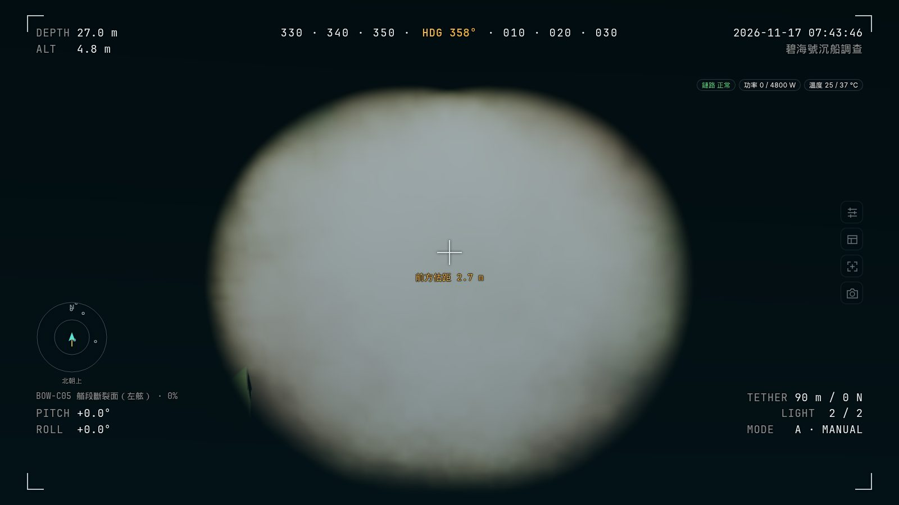
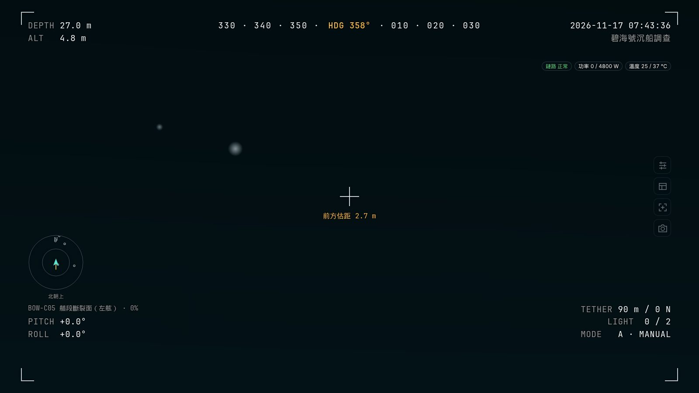
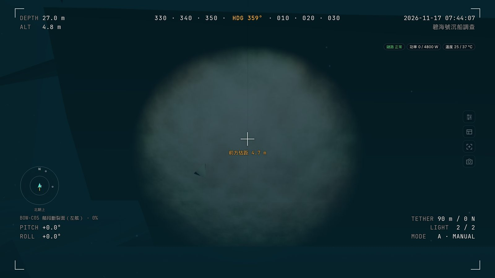
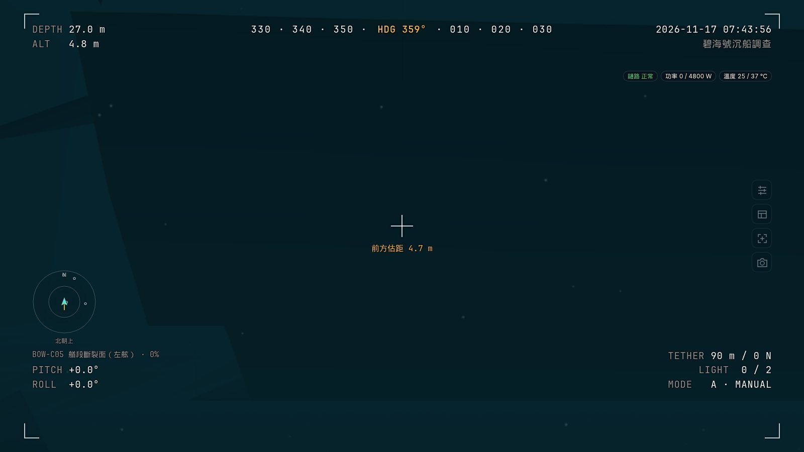

# I4：韓國城沉船重做（碧海號）

來源仍是 `cad/korean_castle/Korean_Castle_Display.blend`（海報推估示意，**非實測、不可用於導航**）。
場址玩家名稱為「碧海號」，內部 key 仍是 `korean_castle`。
A2（PR #40）材質較好但三角形 718k、貼圖約 235 MiB、`.blend` 100 MB，故未合併。
I4 在預算內重做外觀，並以**模擬器內** real 模式截圖驗收。

## 材質返工（審查後）

- 鏽蝕：深褐／暗赭＋綠灰附著膜，低飽和；對比接近 `main`，避免亮橘／薄荷迷彩。
- 噪聲：可無縫拼接的 fBm＋柔和 Worley（無軸對齊磚格）；保留 SurfaceMeters UV，**不再** 4.2× 放大；另加以船體公尺座標取樣的低頻頂點色，與 UV 重複週期無關。另有約厘米尺度的平滑 Worley 凹點法線；法線以週期中央差分生成，移除非整數週期板紋及硬閾值鉚釘。
- 附著：柔和綠灰／褐灰，依離底高度分層；藤壺／贻貝稀疏幾何。
- 碎石：獨立中性岩石色（`I4_rock_basecolor`），法線共用鋼構。
- 上層建築／艙底淤泥／暗凹槽：接上鋼構或附著圖集，不再平灰。
- 拿掉 GLB 內嵌平坦海床平面；場景改用既有 `seabed.js` 沙紋海床。
- 六張圖：LOD0 五張 1024²＋一張 512² 粗糙度（28 MiB，留 4 MiB 餘裕）；LOD1 512²；LOD2 256²。

## 預算與資產報告

見 [asset-report.json](asset-report.json)。GPU 記憶體以解碼後 RGBA8＋完整 mip chain 計算。

| 層級 | 三角形 | draw calls | GLB | 貼圖 GPU MiB |
|---|---:|---:|---:|---:|
| LOD0 | 248,341 | 61 | 5.51 MB | 28.00 |
| LOD1 | 73,012 | 3 | 2.52 MB | 8.00 |
| LOD2 | 18,628 | 3 | 0.77 MB | 2.00 |

**超過 2 MB 新資產軟上限的理由**：

- **LOD0**：248k 可視三角形、PBR 圖集與頂點色，meshopt＋WebP 後約 5.5 MB。近距材質與破損輪廓需要保留。
- **LOD1**：船殼板保護簡化後約 73k 三角形、512² 圖集、合併後約 3 次繪製，2.52 MB。LOD2 約 0.77 MB／3 draws。
- `modelUrl()` 同時解析兩艘沉船；保留 main 的沉礁號距離 LOD、碧海號畫質 LOD，選單兩者使用中階模型。
- Vendor：`Sky.js`／`Water.js` 依 CREDITS 保留（`KEEP_MODULES`）。


碰撞三角形仍為 2,842；距離場與 `korean_castle.json` 路線／格網不變。`build_wreck.py` 使用 `cKDTree(compact_nodes=False)`。

## 重建

```bash
uv venv /tmp/i4env --python 3.11
uv pip install --python /tmp/i4env/bin/python 'bpy==5.0.1' 'numpy<2' pillow scipy
/tmp/i4env/bin/python cad/build_korean_castle_i4.py
/tmp/i4env/bin/python cad/pack_korean_castle.py
/tmp/i4env/bin/python simulator/tools/build_wreck.py simulator/output/korean_castle_i4
```

建置腳本開啟既有 `.blend`、改寫 packed 無縫 1K 圖、為上層建築／淤泥接材質、修剪過重附著物、加入稀疏斷口薄片與深度加權藤壺／贻貝，
匯出 LOD0／1／2 raw GLB 與碰撞／路線陣列，**不回寫 `.blend`**。打包：dedup → weld →（LOD1/2 resize＋輕量 simplify）→ WebP → prune → meshopt。

## 同機位模擬器內截圖（real）

基準：`origin/main` 的 `0bc4ccba84f1150bf4536b1fe26f80e3c52bc081`。先以一幀校準相機安裝偏移，再重新載入相同回放並渲染十幀拍攝；前後使用同一流程。

機載第一人稱；以伺服器 FieldMesh.sdf 二分求解 1.000 m／3.000 m 眼點，再補償相機安裝偏移。截圖後讀取瀏覽器實際 camera.position，轉回 NED 再斷言誤差 <5 mm，並斷言開燈曝光與目標差距 <5%。眼點（本地 y ≈ −10.3／−12.3，x=50、z=5），開燈（2 級）與關燈。HUD 顯示「碧海號」。不是 Blender 離線算圖。

| | 1 m 開燈 | 1 m 關燈 | 3 m 開燈 | 3 m 關燈 |
|---|---|---|---|---|
| 修改前（main） |  |  |  |  |
| 修改後 high |  |  |  |  |
| medium |  |  |  |  |
| low |  |  |  |  |

重現：`ROV_WRECK_TAG=after ROV_WRECK_QUALITY=high|medium|low python simulator/tools/run_browser_checks.py browser_korean_castle_shots`；設 `ROV_WRECK_TAG=before` 會自動從 `origin/main` 讀取模型。臨時截圖在 TemporaryDirectory；JSON 保存實測距離與模型 SHA256。

補充（無水體衰減的 studio 對照，**共用 main 船殼包圍盒、縮放與鏡頭**）：[studio-before](studio-before.jpg)／[studio-after](studio-after.jpg)（`simulator/tools/render_korean_castle_studio.py`）。

## 假設與限制

- 鏽色、凹蝕法線、附著密度與斷口薄片為視覺重建假設，無此船實測校色。
- 生物細節為合併批次幾何，非逐株動畫；厘米級細件不進碰撞。
- korean_castle 在 G5（SwiftShader）量測中仍是最重場址之一；本 PR 降三角形並維持 LOD0 貼圖 ≤32 MiB；舊幀時間數據不代表本輪效能。

## 驗證

本輪 Python 497 項通過（1 項既有跳過）、Node 322 項通過；browser_smoke、browser_menu_smoke、browser_korean_castle_shots 以及 observation_smoke、browser_tether_smoke、browser_gpu_bench 均通過。最終材質另重跑 3 項資產測試與截圖斷言；完整指令、結果列於 PR #70。舊的 perf-before/after.json 是前輪 SwiftShader 量測，不能當成本輪效能結論。
