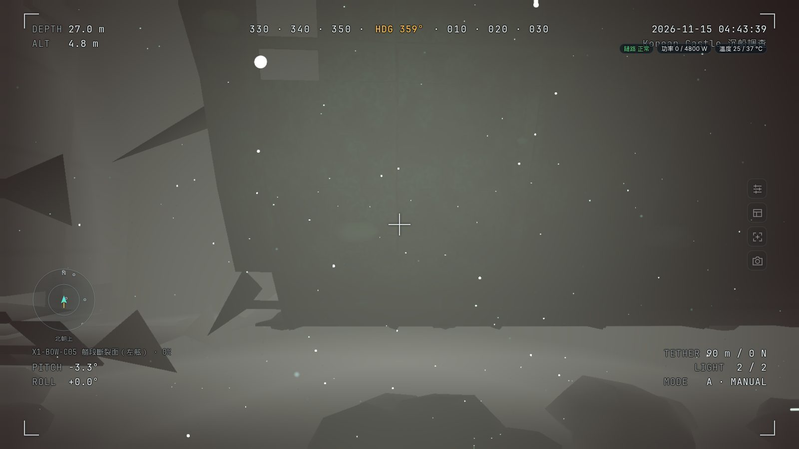
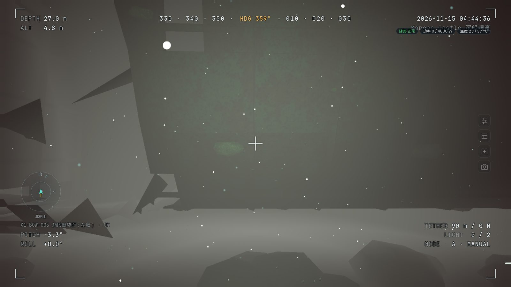
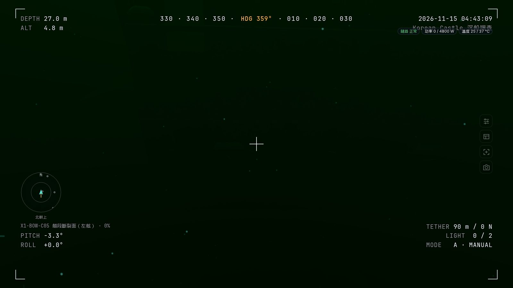
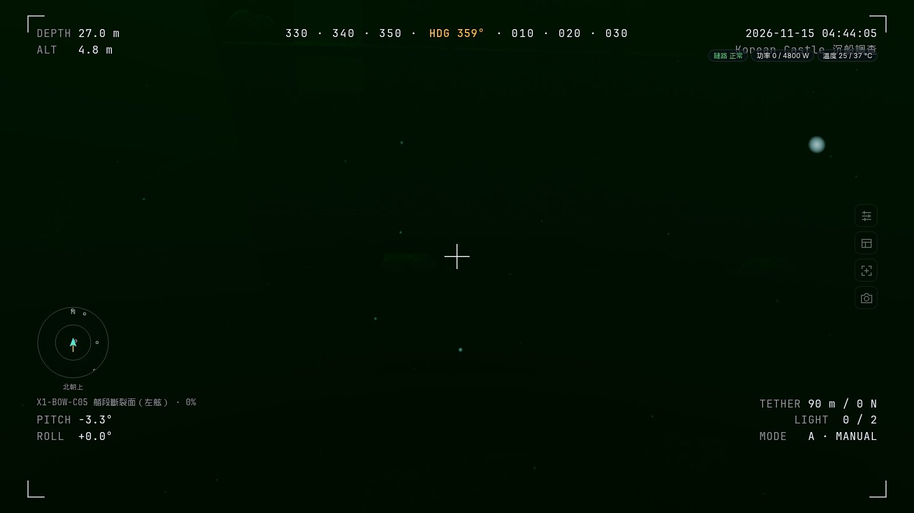

# I4：韓國城沉船重做

來源仍是 `cad/korean_castle/Korean_Castle_Display.blend`（海報推估示意，**非實測、不可用於導航**）。
A2（PR #40）材質較好但三角形 718k、貼圖約 235 MiB、`.blend` 100 MB，故未合併。
I4 在預算內重做外觀，並以**模擬器內** real 模式截圖驗收。

## 預算與資產報告

見 [asset-report.json](asset-report.json)。GPU 記憶體以解碼後 RGBA8＋完整 mip chain 計算。

| 層級 | 三角形 | draw calls | GLB | 貼圖 GPU MiB |
|---|---:|---:|---:|---:|
| LOD0（high） | 268,092 | 62 | 7.09 MB | 32.00 |
| LOD1（medium） | 89,495 | 62 | 3.80 MB | 32.00 |
| LOD2（performance） | 17,963 | 62 | 1.77 MB | 32.00 |

六張 1024² 圖（鋼構 base／rough／normal、附著 base／normal、海床 base）。高畫質與預設共用同一套 1K 圖集，均 ≤32 MiB（高畫質上限 96 MiB）。
碰撞三角形仍為 2,842；距離場與 `korean_castle.json` 路線／格網不變。`build_wreck.py` 使用 `cKDTree(compact_nodes=False)`。

## 重建

```bash
uv venv /tmp/i4env --python 3.11
uv pip install --python /tmp/i4env/bin/python 'bpy==5.0.1' 'numpy<2' pillow scipy
/tmp/i4env/bin/python cad/build_korean_castle_i4.py
/tmp/i4env/bin/python cad/pack_korean_castle.py
cd simulator && python tools/build_wreck.py ../simulator/output/korean_castle_i4
```

建置腳本開啟既有 `.blend`、改寫 packed 1K 圖、修剪過重附著物、加入稀疏斷口薄片與深度加權藤壺／贻貝，
匯出 LOD0／1／2 raw GLB 與碰撞／路線陣列，**不回寫 `.blend`**。打包：dedup → weld →（輕量 simplify）→ WebP → prune → meshopt。

## 同機位模擬器內截圖（real）

機載第一人稱、固定站位，開燈（2 級）與關燈。不是 Blender 離線算圖。

| | 修改前 | 修改後 |
|---|---|---|
| 開燈 |  |  |
| 關燈 |  |  |

重現：`python simulator/tools/run_browser_checks.py browser_korean_castle_shots`（寫入本目錄）。

## 假設與限制

- 鏽色、鉚接／板縫法線、附著密度與斷口薄片為視覺重建假設，無此船實測校色。
- 生物細節為合併批次幾何，非逐株動畫；厘米級細件不進碰撞。
- korean_castle 在 G5（SwiftShader）量測中仍是最重場址之一；本 PR 降三角形並維持貼圖 ≤32 MiB，帧時間前後對照見 PR 描述。

## korean_castle 幀時間（同機 `browser_scene_review`，SwiftShader）

軟體算圖，僅供相對比較。`browser_gpu_bench` 尚未合入 main，本輪以 `browser_scene_review` 同機位量測。完整 JSON：[perf-before.json](perf-before.json)／[perf-after.json](perf-after.json)。

| 畫質／視角 | 修改前 mean ms（tris） | 修改後 mean ms（tris） |
|---|---:|---:|
| performance／onboard | 450.1（308535） | 103.5（44896） |
| performance／third | 360.5（307147） | 102.8（45520） |

