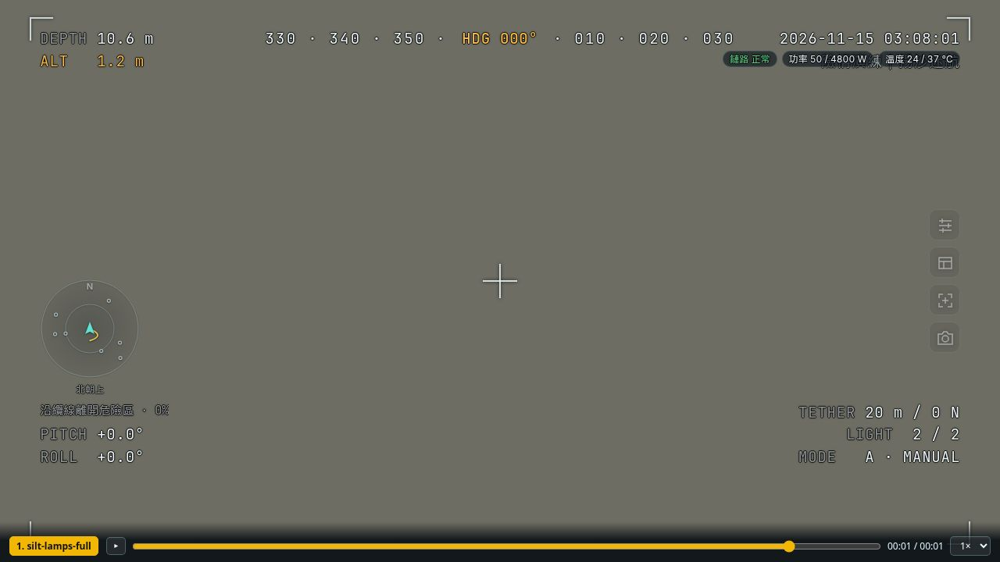
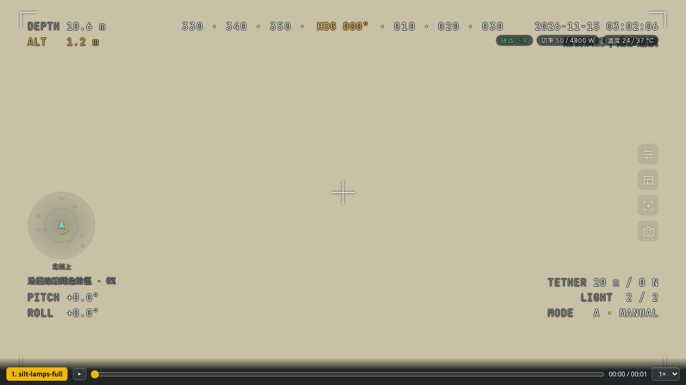
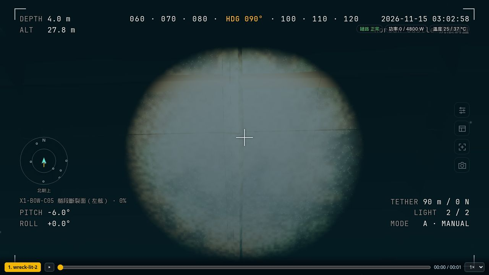
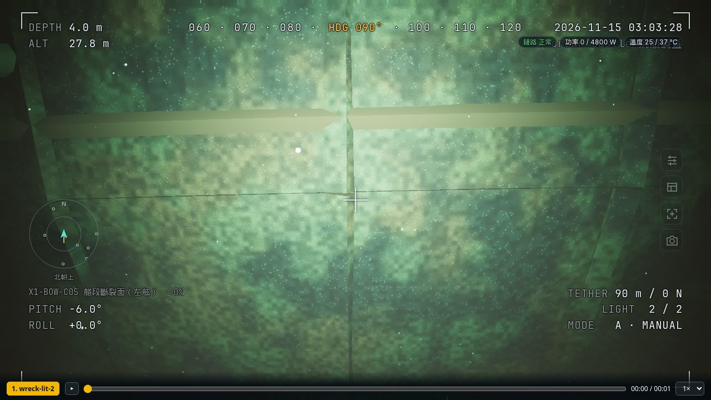
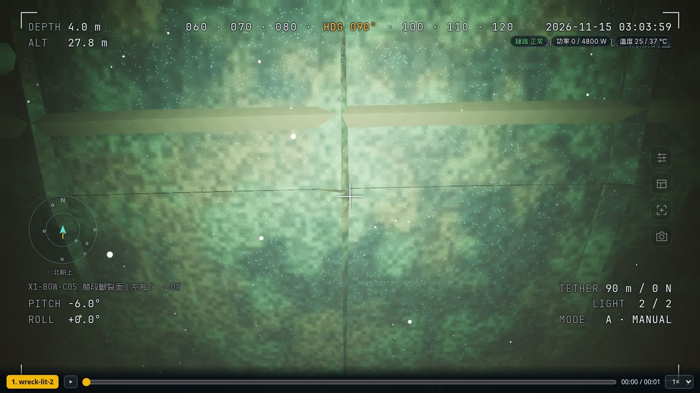
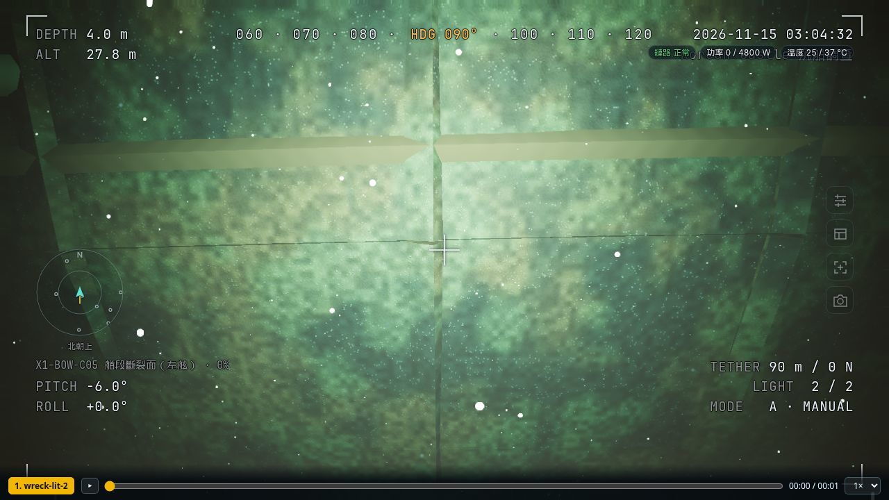

# GPU 效能量測：`cursor-cloud-sw`

> **警告：Cursor Cloud／SwiftShader，非實體 GPU。不可作 Steam 預設依據。**
> 重跑：`ROV_CHROMIUM=… ROV_BROWSER_GL=gpu python tools/browser_gpu_bench.py --full --machine <代號> --duration 30 --desktop`

- 量測時間：2026-11-15 10:46（Asia/Taipei）；UTC 2026-11-15T02:46:26Z
- GL 模式：`software`（實際 WebGL：ANGLE (Google, Vulkan 1.3.0 (SwiftShader Device (Subzero) (0x0000C0DE)), SwiftShader driver)）
- 取樣：穩定 4.0 s 的 rAF 間隔（軟體算圖縮短；GPU 機請用 30 s）；`?nointro`；
  各情境 seed=1 起始姿態（只切換機載／追蹤相機）或重負載回放
- `wreck_survey` 各列量於 G7 沉船模型合併之前（舊方塊船體）
- 視埠：1280×720，deviceScaleFactor=1

## 機器規格

| 項目 | 值 |
|---|---|
| CPU | Intel(R) Xeon(R) Processor |
| 邏輯核心 | 4 |
| RAM | 15.6 GB |
| OS | Linux 6.12.113+ (Ubuntu 24.04.5 LTS) |
| 螢幕 | 1920x1200 @ 60.0 Hz |
| lspci GPU | （無） |
| Chrome | /usr/local/bin/google-chrome |
| chrome://gpu | {"ok": true, "hardware_accelerated_mentioned": false, "software_mentioned": false, "excerpt": "\n  \n\n\n"} |

## 結果表（瀏覽器）

| 場址 | 畫質 | 視角 | mean ms | p95 | p99 | draw calls | tris | mem估MB | >16.7ms |
|---|---|---|---:|---:|---:|---:|---:|---:|:---:|
| open_water | performance | onboard | 54.73 | 66.7 | 66.7 | 36 | 31458 | 41 | 是 |
| open_water | performance | third | 451.833 | 599.9 | 599.9 | 504 | 518397 | 85.7 | 是 |
| open_water | medium | onboard | 185.6 | 200.1 | 200.1 | 42 | 33511 | 63.3 | 是 |
| open_water | medium | third | 271.093 | 283.3 | 283.4 | 510 | 520461 | 101.8 | 是 |
| open_water | high | onboard | 244.106 | 250 | 250.1 | 42 | 35559 | 79.8 | 是 |
| open_water | high | third | 421.65 | 433.4 | 433.4 | 509 | 522497 | 121 | 是 |
| open_water | ultra | onboard | 251.038 | 250.1 | 266.7 | 42 | 39655 | 72.2 | 是 |
| open_water | ultra | third | 375.736 | 383.4 | 383.4 | 510 | 526605 | 115.7 | 是 |
| tutorial_pool | performance | onboard | 90.367 | 100.1 | 100.1 | 40 | 28998 | 45.2 | 是 |
| tutorial_pool | performance | third | 451.833 | 466.6 | 466.6 | 506 | 515169 | 95 | 是 |
| tutorial_pool | medium | onboard | 257.275 | 266.7 | 266.7 | 46 | 31051 | 70.8 | 是 |
| tutorial_pool | medium | third | 344.433 | 350 | 350.1 | 511 | 517221 | 117 | 是 |
| tutorial_pool | high | onboard | 377.264 | 383.4 | 383.4 | 51 | 33087 | 96.1 | 是 |
| tutorial_pool | high | third | 524.975 | 550 | 550 | 517 | 519269 | 143.8 | 是 |
| tutorial_pool | ultra | onboard | 392.409 | 416.6 | 416.6 | 46 | 37195 | 79.4 | 是 |
| tutorial_pool | ultra | third | 527.062 | 549.9 | 549.9 | 511 | 523365 | 126.2 | 是 |
| harbor_inspection | performance | onboard | 96.821 | 100.1 | 116.7 | 75 | 39525 | 48.4 | 是 |
| harbor_inspection | performance | third | 461.089 | 466.7 | 466.7 | 545 | 526544 | 100.1 | 是 |
| harbor_inspection | medium | onboard | 251.031 | 266.7 | 266.7 | 81 | 41866 | 75.2 | 是 |
| harbor_inspection | medium | third | 354.158 | 366.7 | 366.7 | 549 | 528804 | 112.7 | 是 |
| harbor_inspection | high | onboard | 398.473 | 416.7 | 416.7 | 92 | 65246 | 108.8 | 是 |
| harbor_inspection | high | third | 564.562 | 583.2 | 583.2 | 560 | 552184 | 155.8 | 是 |
| harbor_inspection | ultra | onboard | 362.492 | 383.3 | 383.3 | 81 | 47722 | 85.7 | 是 |
| harbor_inspection | ultra | third | 520.812 | 533.3 | 533.3 | 549 | 534660 | 122.4 | 是 |
| jacket_inspection | performance | onboard | 70.112 | 83.4 | 83.4 | 42 | 33797 | 47.8 | 是 |
| jacket_inspection | performance | third | 441.66 | 466.6 | 466.6 | 510 | 519864 | 94.1 | 是 |
| jacket_inspection | medium | onboard | 206.655 | 216.7 | 233.4 | 48 | 37178 | 67.8 | 是 |
| jacket_inspection | medium | third | 295.221 | 300 | 300 | 516 | 523324 | 107.3 | 是 |
| jacket_inspection | high | onboard | 305.943 | 316.7 | 333.4 | 68 | 53176 | 91.9 | 是 |
| jacket_inspection | high | third | 434.98 | 450 | 450 | 539 | 540050 | 141.2 | 是 |
| jacket_inspection | ultra | onboard | 283.32 | 283.4 | 300 | 47 | 41914 | 75.1 | 是 |
| jacket_inspection | ultra | third | 419.98 | 449.9 | 449.9 | 515 | 528060 | 115 | 是 |
| korean_castle | performance | onboard | 272.2 | 283.3 | 283.4 | 89 | 304618 | 79.8 | 是 |
| korean_castle | performance | third | 722.2 | 983.3 | 983.3 | 553 | 790598 | 126.7 | 是 |
| korean_castle | medium | onboard | 372.718 | 383.4 | 383.4 | 94 | 306591 | 117.9 | 是 |
| korean_castle | medium | third | 512.475 | 550 | 550 | 558 | 792650 | 156.7 | 是 |
| korean_castle | high | onboard | 562.475 | 583.3 | 583.3 | 94 | 308639 | 130.4 | 是 |
| korean_castle | high | third | 763.85 | 799.9 | 799.9 | 560 | 794722 | 169.3 | 是 |
| korean_castle | ultra | onboard | 556.225 | 583.3 | 583.3 | 94 | 312735 | 123.1 | 是 |
| korean_castle | ultra | third | 752.75 | 783.3 | 783.3 | 560 | 798818 | 161.3 | 是 |
| coral_reef | performance | onboard | 77.562 | 83.4 | 83.4 | 72 | 48902 | 51 | 是 |
| coral_reef | performance | third | 439.98 | 450 | 450 | 537 | 535794 | 96.4 | 是 |
| coral_reef | medium | onboard | 203.325 | 216.7 | 216.7 | 78 | 50955 | 74.1 | 是 |
| coral_reef | medium | third | 292.843 | 300 | 300 | 542 | 537846 | 116.8 | 是 |
| coral_reef | high | onboard | 268.88 | 283.3 | 283.3 | 78 | 53003 | 87.8 | 是 |
| coral_reef | high | third | 418.32 | 433.4 | 433.4 | 543 | 539974 | 131.7 | 是 |
| coral_reef | ultra | onboard | 273.32 | 283.3 | 283.4 | 78 | 57099 | 81.7 | 是 |
| coral_reef | ultra | third | 411.64 | 416.8 | 416.8 | 543 | 544070 | 124.3 | 是 |
| hull_inspection | performance | onboard | 92.42 | 100 | 100.1 | 53 | 42097 | 44.6 | 是 |
| hull_inspection | performance | third | 449.978 | 466.7 | 466.7 | 518 | 528244 | 96.9 | 是 |
| hull_inspection | medium | onboard | 219.289 | 233.4 | 233.4 | 59 | 44158 | 64 | 是 |
| hull_inspection | medium | third | 308.962 | 316.6 | 316.7 | 523 | 530304 | 120.6 | 是 |
| hull_inspection | high | onboard | 334.708 | 350 | 350 | 60 | 62978 | 101.6 | 是 |
| hull_inspection | high | third | 468.5 | 483.3 | 483.3 | 524 | 549124 | 134 | 是 |
| hull_inspection | ultra | onboard | 338.875 | 366.6 | 366.7 | 59 | 50294 | 76.3 | 是 |
| hull_inspection | ultra | third | 453.689 | 466.7 | 466.7 | 523 | 536440 | 116.5 | 是 |
| wreck_survey | performance | onboard | 59.948 | 66.7 | 66.7 | 40 | 31454 | 46.4 | 是 |
| wreck_survey | performance | third | 421.65 | 433.3 | 433.3 | 513 | 519186 | 91.3 | 是 |
| wreck_survey | medium | onboard | 192.052 | 200 | 200 | 47 | 33691 | 67 | 是 |
| wreck_survey | medium | third | 281.093 | 299.9 | 299.9 | 518 | 521410 | 107.4 | 是 |
| wreck_survey | high | onboard | 256.244 | 266.7 | 266.8 | 46 | 35935 | 90.7 | 是 |
| wreck_survey | high | third | 387.864 | 416.6 | 416.6 | 516 | 523574 | 136 | 是 |
| wreck_survey | ultra | onboard | 261.444 | 266.7 | 283.3 | 48 | 39743 | 75.4 | 是 |
| wreck_survey | ultra | third | 396.955 | 416.7 | 416.7 | 517 | 527302 | 116.1 | 是 |

## 最重畫面

- `silt-lamps-full:performance` mean=54.503 ms p95=66.7 draw=27 tris=28067 shot=`cursor-cloud-sw/heavy-silt-lamps-full-performance.jpg`
- `silt-lamps-full:medium` mean=446.278 ms p95=616.7 draw=33 tris=30120 shot=`cursor-cloud-sw/heavy-silt-lamps-full-medium.jpg`
- `silt-lamps-full:high` mean=464.789 ms p95=766.6 draw=33 tris=32168 shot=`cursor-cloud-sw/heavy-silt-lamps-full-high.jpg`
- `silt-lamps-full:ultra` mean=468.511 ms p95=816.6 draw=33 tris=36264 shot=`cursor-cloud-sw/heavy-silt-lamps-full-ultra.jpg`
- `wreck-lit-2:performance` mean=485.167 ms p95=566.7 draw=60 tris=304000 shot=`cursor-cloud-sw/heavy-wreck-lit-2-performance.jpg`
- `wreck-lit-2:medium` mean=1444.367 ms p95=1883.2 draw=66 tris=306053 shot=`cursor-cloud-sw/heavy-wreck-lit-2-medium.jpg`
- `wreck-lit-2:high` mean=2733.25 ms p95=2999.9 draw=66 tris=308101 shot=`cursor-cloud-sw/heavy-wreck-lit-2-high.jpg`
- `wreck-lit-2:ultra` mean=1994.367 ms p95=3083.2 draw=66 tris=312197 shot=`cursor-cloud-sw/heavy-wreck-lit-2-ultra.jpg`

## Electron 桌面版

| 場址 | 畫質 | 視角 | mean ms | p95 | p99 | draw calls | tris |
|---|---|---|---:|---:|---:|---:|---:|
| open_water | performance | onboard | 80.998 | 133.3 | 150 | 32 | 29782 |

## 建議（依本機數字；軟體算圖時僅作流程驗證）

**本機 WebGL 為軟體算圖，數字不可用於 Steam 預設畫質或最低需求。**請在實體 GPU 上以 `ROV_BROWSER_GL=gpu` 重跑後再定案。

| 畫質層 | 本輪最差 mean ms | 建議目標硬體（草稿） |
|---|---:|---|
| performance | 722.2（未達 60 fps） | 整合式 GPU 入門筆電；Steam Deck 預設可落在此層 |
| medium | 512.5（未達 60 fps） | 中階整合式或入門獨顯（如 MX／入門 RTX） |
| high | 763.9（未達 60 fps） | 主流獨顯，1080p／1440p 目標 60 fps |
| ultra | 752.8（未達 60 fps） | 高階獨顯或降低解析度後的主流卡 |

### auto 模式判斷門檻（建議寫回 `render_quality.js` 前先在 GPU 複測）

- 維持現況：連續樣本 < 50 fps → 先關光學再降 pixel ratio；> 58 fps 且穩定 8 s 再緩升。
- 軟體算圖：維持 `effectsSuppressed` 起始為真，且初始 ratio ≤ 0.6。
- 獨顯：可從 ratio 1.0／medium 光學起步；入門 MX 從 0.85。
- 若 GPU 複測後 medium 在整合式上仍常 > 16.7 ms，auto 的非軟體起始應改為 performance。

## 超過 16.7 ms（60 fps）的組合

- open_water / performance / onboard: mean 54.73 ms (p95 66.7); draw 36, tris 31458
- open_water / performance / third: mean 451.833 ms (p95 599.9); draw 504, tris 518397
- open_water / medium / onboard: mean 185.6 ms (p95 200.1); draw 42, tris 33511
- open_water / medium / third: mean 271.093 ms (p95 283.3); draw 510, tris 520461
- open_water / high / onboard: mean 244.106 ms (p95 250); draw 42, tris 35559
- open_water / high / third: mean 421.65 ms (p95 433.4); draw 509, tris 522497
- open_water / ultra / onboard: mean 251.038 ms (p95 250.1); draw 42, tris 39655
- open_water / ultra / third: mean 375.736 ms (p95 383.4); draw 510, tris 526605
- tutorial_pool / performance / onboard: mean 90.367 ms (p95 100.1); draw 40, tris 28998
- tutorial_pool / performance / third: mean 451.833 ms (p95 466.6); draw 506, tris 515169
- tutorial_pool / medium / onboard: mean 257.275 ms (p95 266.7); draw 46, tris 31051
- tutorial_pool / medium / third: mean 344.433 ms (p95 350); draw 511, tris 517221
- tutorial_pool / high / onboard: mean 377.264 ms (p95 383.4); draw 51, tris 33087
- tutorial_pool / high / third: mean 524.975 ms (p95 550); draw 517, tris 519269
- tutorial_pool / ultra / onboard: mean 392.409 ms (p95 416.6); draw 46, tris 37195
- tutorial_pool / ultra / third: mean 527.062 ms (p95 549.9); draw 511, tris 523365
- harbor_inspection / performance / onboard: mean 96.821 ms (p95 100.1); draw 75, tris 39525
- harbor_inspection / performance / third: mean 461.089 ms (p95 466.7); draw 545, tris 526544
- harbor_inspection / medium / onboard: mean 251.031 ms (p95 266.7); draw 81, tris 41866
- harbor_inspection / medium / third: mean 354.158 ms (p95 366.7); draw 549, tris 528804
- harbor_inspection / high / onboard: mean 398.473 ms (p95 416.7); draw 92, tris 65246
- harbor_inspection / high / third: mean 564.562 ms (p95 583.2); draw 560, tris 552184
- harbor_inspection / ultra / onboard: mean 362.492 ms (p95 383.3); draw 81, tris 47722
- harbor_inspection / ultra / third: mean 520.812 ms (p95 533.3); draw 549, tris 534660
- jacket_inspection / performance / onboard: mean 70.112 ms (p95 83.4); draw 42, tris 33797
- jacket_inspection / performance / third: mean 441.66 ms (p95 466.6); draw 510, tris 519864
- jacket_inspection / medium / onboard: mean 206.655 ms (p95 216.7); draw 48, tris 37178
- jacket_inspection / medium / third: mean 295.221 ms (p95 300); draw 516, tris 523324
- jacket_inspection / high / onboard: mean 305.943 ms (p95 316.7); draw 68, tris 53176
- jacket_inspection / high / third: mean 434.98 ms (p95 450); draw 539, tris 540050
- jacket_inspection / ultra / onboard: mean 283.32 ms (p95 283.4); draw 47, tris 41914
- jacket_inspection / ultra / third: mean 419.98 ms (p95 449.9); draw 515, tris 528060
- korean_castle / performance / onboard: mean 272.2 ms (p95 283.3); draw 89, tris 304618
- korean_castle / performance / third: mean 722.2 ms (p95 983.3); draw 553, tris 790598
- korean_castle / medium / onboard: mean 372.718 ms (p95 383.4); draw 94, tris 306591
- korean_castle / medium / third: mean 512.475 ms (p95 550); draw 558, tris 792650
- korean_castle / high / onboard: mean 562.475 ms (p95 583.3); draw 94, tris 308639
- korean_castle / high / third: mean 763.85 ms (p95 799.9); draw 560, tris 794722
- korean_castle / ultra / onboard: mean 556.225 ms (p95 583.3); draw 94, tris 312735
- korean_castle / ultra / third: mean 752.75 ms (p95 783.3); draw 560, tris 798818
- coral_reef / performance / onboard: mean 77.562 ms (p95 83.4); draw 72, tris 48902
- coral_reef / performance / third: mean 439.98 ms (p95 450); draw 537, tris 535794
- coral_reef / medium / onboard: mean 203.325 ms (p95 216.7); draw 78, tris 50955
- coral_reef / medium / third: mean 292.843 ms (p95 300); draw 542, tris 537846
- coral_reef / high / onboard: mean 268.88 ms (p95 283.3); draw 78, tris 53003
- coral_reef / high / third: mean 418.32 ms (p95 433.4); draw 543, tris 539974
- coral_reef / ultra / onboard: mean 273.32 ms (p95 283.3); draw 78, tris 57099
- coral_reef / ultra / third: mean 411.64 ms (p95 416.8); draw 543, tris 544070
- hull_inspection / performance / onboard: mean 92.42 ms (p95 100); draw 53, tris 42097
- hull_inspection / performance / third: mean 449.978 ms (p95 466.7); draw 518, tris 528244
- hull_inspection / medium / onboard: mean 219.289 ms (p95 233.4); draw 59, tris 44158
- hull_inspection / medium / third: mean 308.962 ms (p95 316.6); draw 523, tris 530304
- hull_inspection / high / onboard: mean 334.708 ms (p95 350); draw 60, tris 62978
- hull_inspection / high / third: mean 468.5 ms (p95 483.3); draw 524, tris 549124
- hull_inspection / ultra / onboard: mean 338.875 ms (p95 366.6); draw 59, tris 50294
- hull_inspection / ultra / third: mean 453.689 ms (p95 466.7); draw 523, tris 536440
- wreck_survey / performance / onboard: mean 59.948 ms (p95 66.7); draw 40, tris 31454
- wreck_survey / performance / third: mean 421.65 ms (p95 433.3); draw 513, tris 519186
- wreck_survey / medium / onboard: mean 192.052 ms (p95 200); draw 47, tris 33691
- wreck_survey / medium / third: mean 281.093 ms (p95 299.9); draw 518, tris 521410
- wreck_survey / high / onboard: mean 256.244 ms (p95 266.7); draw 46, tris 35935
- wreck_survey / high / third: mean 387.864 ms (p95 416.6); draw 516, tris 523574
- wreck_survey / ultra / onboard: mean 261.444 ms (p95 266.7); draw 48, tris 39743
- wreck_survey / ultra / third: mean 396.955 ms (p95 416.7); draw 517, tris 527302

原因分析：軟體算圖或無硬體加速時幾乎所有光學檔都會超過 16.7 ms；在真實 GPU 上請用瀏覽器 Performance 面板或 Spector.js 截一幀，對照 draw calls／後製 pass。本輪若有重負載截圖見上方「最重畫面」。

## 重負載截圖

揚沙全白（`incident_silt`，燈 2）與沉船開燈 2（`korean_castle`）在軟體算圖下的畫面；真實 GPU 上請用 Spector.js／Performance 再截一幀分析 pass。

| 場景 | performance | medium |
|---|---|---|
| silt-lamps-full |  |  |
| wreck-lit-2 |  |  |

| 場景 | high | ultra |
|---|---|---|
| silt-lamps-full |  |  |
| wreck-lit-2 |  |  |

## 瀏覽器 vs Electron（同機軟體算圖）

本輪 Electron（`--desktop`）在 `open_water`／performance／onboard：mean ≈ 81 ms，draw 32，tris ≈ 30k；同條件瀏覽器 mean ≈ 55 ms。兩者皆為 SwiftShader，差異來自 Electron 合成路徑與啟動暖機，**不能**外推到 Steam 打包版 GPU 表現。

## 後續（不在本 PR 改渲染）

1. 在至少一台整合式 GPU 與一台獨顯上以 `--full --duration 30 --desktop` 重跑，取代本檔數字。
2. 依 GPU 數字決定 Steam 預設畫質、Deck 預設，以及 `render_quality.js` auto 起始層。
3. 對 mean > 16.7 ms 的光學檔用 Spector.js 標出 pass 成本（曝光、背景、粒子、結構）。
4. 第三人稱比機載多出的成本幾乎全是載具模型本身：各情境、各畫質第三人稱減去機載都是 +464～473 draw calls、
   +486k～488k 三角形（例如 open_water performance：36 → 504、31,458 → 518,397），正好等於 X1 `rov.glb`
   的 468 draw calls／486k 三角形（見 `docs/design/vehicle/README.md`）；機載視角不畫自己的機體。
   這不是場景遠距剔除的問題。後續應為 X1 第三人稱模型做 LOD 或合併材質（渲染程式不在本 PR 修改）。
