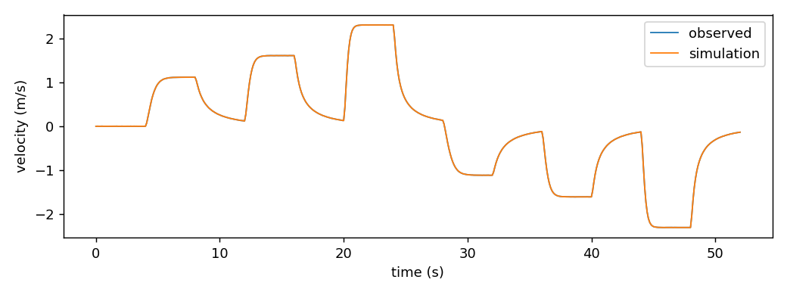
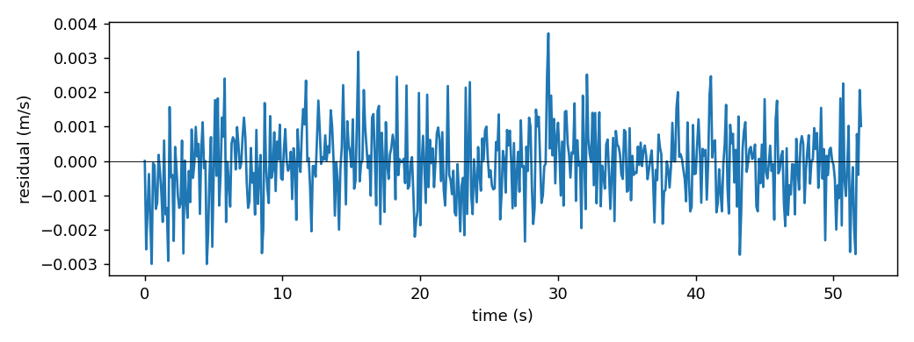
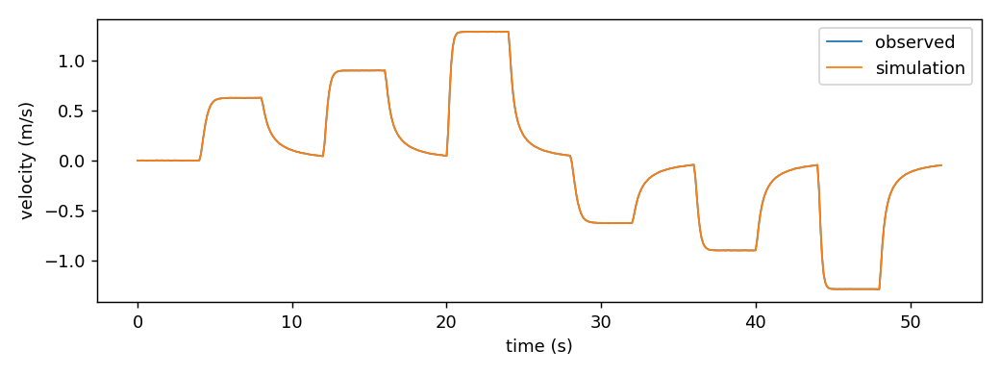
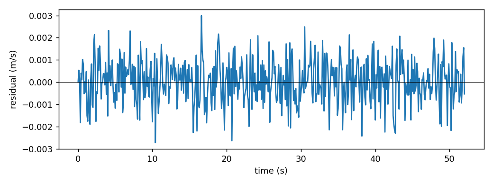
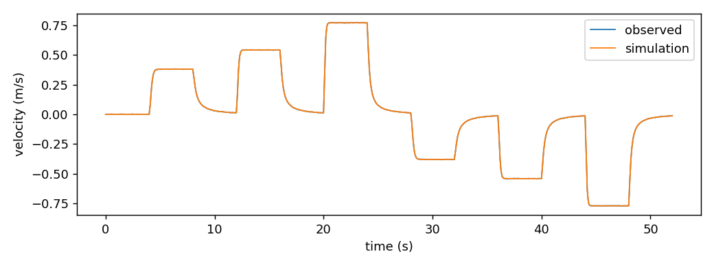
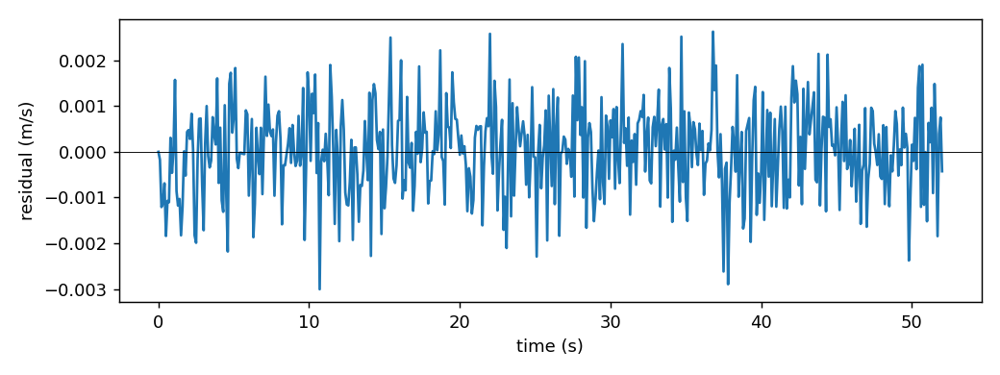
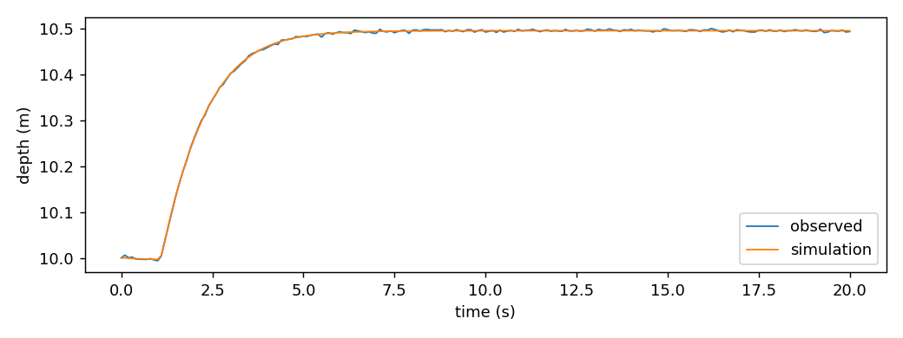
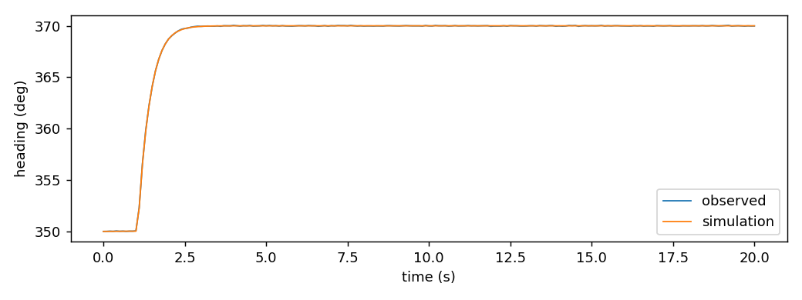

# 合成資料擬合報告範例

**全部是合成資料；不可視為實測，也不自動套用。**

重建命令見上一層 README；seed=51。以下誤差為相對已知參數的絕對百分比。

| 軸 | 參數 | 真值 | 擬合 | 誤差 | 條件式 95% CI |
|---|---|---:|---:|---:|---|
| surge | added_mass | 15.00000 | 14.99562 | 0.029% | [14.97813, 15.01311] |
| surge | linear_drag | 8.00000 | 7.99954 | 0.006% | [7.97408, 8.02501] |
| surge | quadratic_drag | 51.25560 | 51.25331 | 0.004% | [51.23536, 51.27126] |
| sway | added_mass | 25.00000 | 24.99657 | 0.014% | [24.95428, 25.03887] |
| sway | linear_drag | 12.00000 | 11.99205 | 0.066% | [11.91886, 12.06524] |
| sway | quadratic_drag | 168.17018 | 168.14142 | 0.017% | [168.04974, 168.23310] |
| heave | added_mass | 30.00000 | 30.00648 | 0.022% | [29.89579, 30.11717] |
| heave | linear_drag | 15.00000 | 14.95628 | 0.291% | [14.69450, 15.21807] |
| heave | quadratic_drag | 686.62636 | 686.69164 | 0.010% | [686.14644, 687.23683] |

附加質量單位 kg；線性阻力 N·s/m；二次阻力 N·s²/m²。

三軸各參數誤差皆 < 0.3%，符合 <5% 驗收。正反向推力線性係數亦在 <5%；
目前引擎的推力二次項真值為零，測試使用絕對誤差 <0.1 N（零值不計相對誤差）。

定深回放 RMSE：0.002049 m；定向：0.021253 deg。

纜線密度：1000.0072 kg/m³；濕重：-0.017399 N/m。

[完整機器可讀報告與 CI](report/report.json)

信賴區間假設與模型限制見上一層 README。這是相同模型產生資料的數值驗證，不是對真機的驗證。
