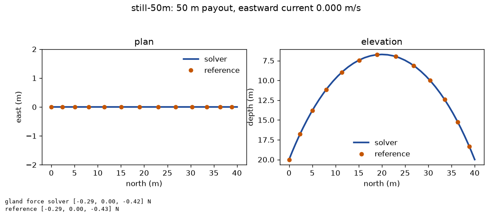
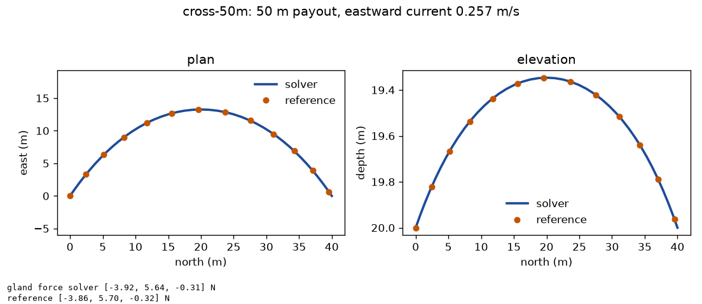
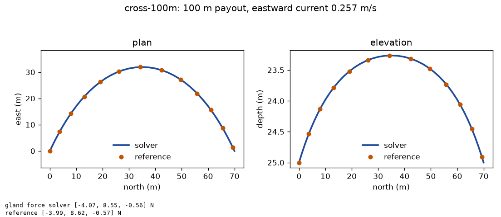

# 臍帶纜參數：公開規格、出處與三組穩態校準

本頁對照 `simulator/qysim` 的纜線求解器。數值表的程式來源是
`simulator/qysim/vehicles.py` 的 `X1_TETHER_PARAMETERS`。X1 實際用的纜沒有過磅、拉斷或拖曳量測，
下列凡是 X1 自己的尺寸與強度都標**暫定**。其他機型或廠商頁上的數字只用來劃出公開範圍，不寫成 X1 的事實。

本頁不寫廠商名稱。帶名稱的產品頁與論文頁碼在
`research_notes/臍帶纜物理與收放文獻/tether_properties.md` 與
`docs/reference/tether-research.md`。那兩份是筆記，本頁是求解器要對的規格。

等級只用三檔：

| 等級 | 意思 |
|---|---|
| measured | 本專案對 X1 這條纜的量測。目前沒有。 |
| published | 公開文獻或公開規格裡可以對上公式定義的數值，採為模型預設。不是 X1 實測。 |
| estimated | 由公開範圍推出、或根本沒有公開數字的假設。 |

程式裡另保留 `reseller`：單一經銷頁列出的 X1 纜長、外徑與破斷。在這三檔裡它屬於 published 的來源種類，但因為未經量測，本頁一律再標暫定，程式等級不改成 published，以免和期刊擬合值混在一起。

## 公開規格（觀測級、中性或近中性）

「中性」在公開規格裡幾乎都指**淡水**中性，因此在海水裡會略為正浮。負浮力纜更細、導體更粗，不在本模型的預設裡。

| 項目 | 公開範圍 | 不確定度 | 本模型 |
|---|---|---|---|
| 外徑 | 約 3.5–12 mm；論文裡另有一條 14 mm 的量測纜 | 手冊公差常見 ±0.25–0.5 mm。外徑差 0.5 mm，排水重就差約 5–10% | **9.5 mm，暫定**（reseller） |
| 空氣中每公尺重 | 3.5 mm 光纖纜約 9.5 g/m（比重 0.99）；7.6 mm 中性纜 43 g/m。沒有 9.5 mm 纜的過磅值 | 發泡護套把線重調到接近排水重，沿纜可差數 g/m | **0.0709 kg/m**，由「淡水中性」密度 1000 kg/m³ × 斷面積推出，不是過磅（estimated） |
| 水中每公尺重 | 淡水中性、海水略正浮。7.6 mm、空氣中 43 g/m 的纜，淡水約 −2 g/m、海水約 −3.5 g/m | 外徑公差與發泡不均會讓淨浮力沿纜變化數 g/m | 淡水 0。海水 **−1.77 g/m**（正浮），用海水密度 1025 kg/m³ 減去上面的線重。X1 浮力等級未公開（estimated） |
| 破斷強度 | 約 90–750 kgf。工作負載有人取破斷的 15%，有人 23%，有人一半 | 沒有統一的安全係數。失效點常常在接頭，不在纜身：一份手冊寫纜身 450 kg、應力釋放 136 kg、接頭 80 kg | **300 kgf = 2943 N，暫定**（reseller）。工作負載比 0.5、接頭比 136/450 都是 estimated，不是這條纜的額定 |
| 最小彎曲半徑 | 約 5×外徑（7.6 mm 纜的工作彎曲**直徑** 75 mm，半徑 37.5 mm）到約 10×外徑（8–11 mm 纜 82–114 mm）；3.5 mm 光纖纜建議 70 mm，約 20×外徑 | 靜態與反覆收放的建議不同。求解器沒有彎曲剛度，也不檢查彎曲半徑 | 不設數值。10×9.5 mm ≈ 95 mm 只可當數量級，不能寫進參數表 |

海水與淡水的排水重差約 2.5%。一條淡水恰好中性的 9.5 mm 纜，在海水每公尺約正浮 1.8 g，350 m 合計約 0.6 kgf 向上。量級小，但鬆弛段會往上拱，無流情境的懸鏈線就是這個力撐起來的。

## 阻力係數與渦激振動

求解器的力是 `½ ρ d l (Cdn |vₙ| vₙ + Cdt |vₜ| vₜ)`，法向與切向**都用外徑 × 長度**，切向沒有再乘 π。換算別的文獻時必須先對這個定義。

雷諾數用海水動黏度 1.19×10⁻⁶ m²/s（約 15 °C）與暫定外徑 9.5 mm：0.5 kn（0.257 m/s）時 Re ≈ 2.1×10³，0.5 m/s 時約 4×10³，1 m/s 時約 8×10³。都在次臨界區，還沒進到阻力危機。

| 係數 | 公開值 | 定義 | 證據 | 本模型 |
|---|---|---|---|---|
| 法向 Cd，固定光滑圓柱 | 次臨界約 **1.2**（Re 約 10⁴–2×10⁵ 的高原）。本纜在 0.5 kn 的 Re 較低，光滑圓柱更接近 **1.0–1.1** | 投影面積 d·l | Roshko 1961；圓柱阻力的標準曲線 | 不單獨採用。見下一列 |
| 法向 Cd，小型纜擬合 | **1.25**。作者寫 1.0–2.0 之間對短纜水池試驗差異小 | d·l | Buckham 2003，水池纜 Ø13.6 mm，表 3.4 | **1.25，published**。落在光滑圓柱與實纜擬合的重疊區 |
| 法向 Cd，海上拖曳 | **1.65**（由穩態傾角反推） | 論文的纜線阻力模型 | Zand 碩士論文，Ø14 mm、海水中性 | 不採用為預設。那是另一條纜的擬合 |
| 法向 Cd，現場且有渦振 | 明顯大於 1.2，轉述約 **2**；長柔纜鎖頻時可 **超過 3**；一組現場 strumming 平均約 **3.2**（若不振預期 1.2） | 多為投影直徑 | Kojima 等 1986〔摘要，未讀全文〕；Vandiver，OTC 4490（1983）；BSEE 纜線 strumming 報告 | 不寫進預設。求解器沒有橫向振動自由度 |
| 渦振放大 | `Cd = Cd₀ [1 + 1.043 (2 A_rms/D)^0.65]`。A_rms/D = 0.5 時倍率約 2.0；峰對峰值 A/D = 1（A_rms/D ≈ 0.71）時倍率約 2.3 | 乘在靜止圓柱 Cd₀ 上 | Skop、Griffin、Ramberg 的式子，同上 BSEE 報告用來對現場數據 | 沒有這條纜的 A/D，不能決定倍率 |
| 史特勞哈爾數 | 次臨界約 **0.20–0.21** | f = St · U / d | Roshko 1961 | 0.5 kn、9.5 mm 時脫渦約 5.4 Hz。只作數量級，模型不積這項 |
| 切向 Cd | 同一定義（d·l）的重型鎧裝臍帶校正 **0.02**。濕面積 π d l 上的表皮摩擦，光滑圓柱約 0.008、粗糙約 0.011，換回 d·l 要乘 π，約 **0.025–0.035**。另有文獻把切向摩擦係數放在 0.002–0.02 | 見左 | Driscoll 1999 表 4.1；Palm & Eskilsson 2020 表 3（力用 ½ ρ d Cd）；濕面積數來自 ESDU 80025 的次臨界表皮摩擦 | **0.02，published**。0.02 的濕面積等價值是 0.0064，與光滑圓柱 0.008 差約兩成，小於粗糙度的範圍，所以不改數字 |
| 法向附加質量 | **1**；切向 **0** | 排開質量的倍數，只加在法向 | 圓柱位勢流；Palm & Eskilsson 2020 | **1.0，published** |

全段橫在流裡的法向力是上界，不是穩態纜形的端點力。Cdn = 1.25、ρ = 1025、d = 9.5 mm、0.5 kn 時約 **0.40 N/m**：50 m 全橫約 20 N，100 m 約 40 N。下面的穩態端點力小得多，因為纜會順流躺平，只有轉彎段還吃橫流。

渦振若鎖頻，有效 Cdn 可能從 1.25 升到約 2.5。力不會剛好翻倍，形狀也會再順流一點；只能說端點力的不確定度是「同一數量級、可能再大一截」，不是一個可以寫死的係數。

## 求解器逐項

本次**沒有改任何物理數字**。公開資料給的是範圍：外徑、線重、破斷、彎曲半徑、Cd 都沒有單一值可以取代暫定的 X1 纜。已經落在公開值上的三項，只把等級從 estimated 改成 published。

| 參數 | 值 | 三檔等級 | 程式等級 | 本次 | 出處 |
|---|---|---|---|---|---|
| diameter | 0.0095 m | published，暫定 | reseller | 不改 | 單一經銷頁。非量測 |
| max_length | 350 m | published，暫定 | reseller | 不改 | 同上 |
| breaking_n | 2943 N | published，暫定 | reseller | 不改 | 300 kgf。同上 |
| density | 1000 kg/m³ | estimated | estimated | 不改 | 公開「中性」= 淡水中性。X1 浮力等級未公開 |
| 空氣中線重 | 0.0709 kg/m | estimated | （由密度與外徑推出，不另存） | 不改 | 淡水排水重。不是過磅 |
| 海水濕重 | −1.77 g/m | estimated | （同上） | 不改 | 線重減海水排水重 |
| added_mass_normal | 1 | published | published | 等級改 published | 圓柱位勢流。切向附加質量在求解器裡為 0 |
| ea | 1.2×10⁵ N | estimated | estimated | 不改 | 300 kgf ÷ 芳綸紗斷裂應變 2.4%。結構伸長會使真值更軟；14 mm 研究纜有 2.4×10⁴–2×10⁵ N 這個量級，但不能套用 |
| damping_ratio | 1 | estimated | estimated | 不改 | 集中質量鏈的數值阻尼，取接近臨界以免假共振。不是這條纜的材料阻尼 |
| cd_normal | 1.25 | published | published | 等級改 published | Buckham 2003。不改成 1.2 或渦振放大值，理由見上表 |
| cd_tangent | 0.02 | published | published | 等級改 published | 與求解器相同的 d·l 定義。不改成濕面積換算的 0.025 |
| working_load_ratio | 0.5 | estimated | estimated | 不改 | 有的手冊取一半，有的取 23% 或 15%。X1 未公開 |
| termination_ratio | 0.302 | estimated | estimated | 不改 | 另一條纜的應力釋放 136 kg ÷ 纜身 450 kg。X1 接頭未公開 |
| gj | 0.1 N·m² | estimated | estimated | 不改 | 由 14–19 mm 研究纜的扭轉剛度按 d⁴ 縮小。X1 未量 |
| 最小彎曲半徑 | 無此參數 | — | — | 不新增 | 公開值從約 5×到 20×外徑，不能決定一個數。求解器仍不檢查彎曲 |
| 其餘纜盤、摩擦、卡纜、分段、子步 | 見 `x1-parameters.md` | estimated | estimated | 不改 | 沒有對應的公開中性纜規格，或只是數值設定 |

`docs/reference/x1-parameters.md` 由 `export_x1_parameters.py` 從同一張表產生。

## 三組穩態校準

載具固定，纜盤煞住，兩端在同一深度，所以纜整個留在水裡。求解器沒有自由液面，若把纜盤放在水面上，正浮的拱會穿出水面，就不能和懸鏈線比。座標是 NED，z 向下。海流只有東向分量，與南北向的兩端連線垂直。

| 情境 | 放纜 | 兩端 | 海流 |
|---|---|---|---|
| 無流 50 m | 50 m | (0, 0, 20) 與 (40, 0, 20) m | 0 |
| 橫流 50 m | 50 m | 同上 | 0.5 kn = 0.257 m/s，向東 |
| 橫流 100 m | 100 m | (0, 0, 25) 與 (70, 0, 25) m | 同上 |

無流的參考解是不可伸長的**上拱懸鏈線**：`2 a sinh(S / 2a) = L`，垂度 `a (cosh(S / 2a) − 1)`，端點張力 `|q| a cosh(S / 2a)`。`q` 是海水中的淨重，−0.0174 N/m。載具受力指回纜線：水平分量把兩端往中間拉，垂直分量是半條纜的浮力。

有流的參考解是同一套 Morison 力的**穩態纜線方程**，沿未拉伸弧長積分，用張力打靶打到另一端。幾何含 T/EA 的伸長。它和集中質量求解器分開寫，在 `simulator/qysim/tether_reference.py`。

求解器使用正式參數（40 段、Cdn 1.25、Cdt 0.02、EA 1.2×10⁵ N）。下表「求解器」是把纜鋪在參考曲線上再積分 20–25 s 之後的值，用來確認那個形狀是平衡；橫流 50 m 另外從求解器自己的鬆弛初值積分 100 s，弓高與合力會走到同一組數字。無流的驅動力只有 0.017 N/m，從深垂到上拱要數分鐘，單元測試改鎖平衡形狀，不鎖那段慢瞬態。

| 情境 | 參考 | 求解器 | 差 |
|---|---|---|---|
| 無流 50 m 上拱 | 13.272 m | 13.277 m | +0.04% |
| 無流 50 m 載具受力 | [−0.294, 0, −0.435] N | [−0.294, 0.00, −0.424] N | 水平 <1%，垂直 −2.5% |
| 橫流 50 m 東向弓高 | 13.259 m | 13.264 m | +0.04% |
| 橫流 50 m 合力 | 6.890 N，[−3.86, 5.71, −0.32] | 6.876 N，[−3.92, 5.64, −0.31] | 合力 −0.2% |
| 橫流 100 m 東向弓高 | 31.935 m | 31.946 m | +0.03% |
| 橫流 100 m 合力 | 9.518 N，[−3.99, 8.63, −0.57] | 9.486 N，[−4.07, 8.55, −0.56] | 合力 −0.3% |

從鬆弛初值出發的橫流 50 m，100 s 時弓高 13.28 m、合力 6.86 N，與上表同一組。

橫流端點力（6.9 N、9.5 N）遠小於全橫上界（20 N、40 N）。100 m 的放纜是 50 m 的兩倍，端點力只從 6.9 N 增到 9.5 N：多出來的纜更橫在流裡，但端點的切線並沒有變成直角。無流時 50 m 纜作用在載具上的力不到 1 N，方向向上、向纜盤；一整條 350 m 的正浮力也只有約 6 N。

圖（橘點是參考解，藍線是求解器）：

關鍵數字鎖在 `simulator/tests/test_tether_calibration.py`。更早的文獻對標（水池短纜、被動拖帶、長纜阻力趨勢）仍在 `tether-validation.md`，那些案例用的是論文裡的另一條纜，不是這組 X1 暫定參數。

## 效能

步進迴圈沒有改。同一行程、numba 編譯路徑、橫流 50 m、固定端，暖機後各跑 600 個 0.01 s 步，記 CPU 時間（`process_time`）：

| | 三次的每步 CPU |
|---|---|
| 改註記前 | 0.153、0.157、0.140 ms |
| 改註記後 | 0.163、0.154、0.149 ms |

平均 0.150 ms 與 0.155 ms。每一組自己的起伏就有約 0.02 ms，前後差在雜訊裡。

## 協定

沒有改 `PROTOCOL.md`，也沒有改 `sdk_mock` 的欄位或語意。這次只改參數的等級註記、參考解與測試。

## 仍然要靠 X1 實測

公開資料決定不了的，維持暫定或 estimated：

- 這條纜的外徑、空氣中線重、淡水與海水濕重、實際破斷與接頭強度
- 軸向 EA（現在是由斷裂應變反推）
- 護套粗糙度決定的法向與切向 Cd，以及會不會鎖頻、A/D 多大
- 彎曲剛度與最小彎曲半徑
- 纜盤慣量、煞車與收放速度（不在本頁的校準裡）
