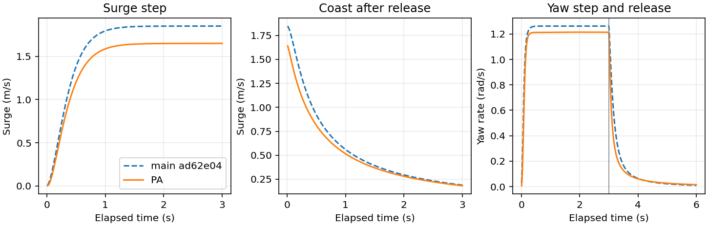

# PA 載具水動力

以 CG 為機體 FRD 原點，速度 ν 為對地速度，νᵣ 為扣除當地水流後的速度。主機每 0.01 s 更新一次。各機型的係數與估算假設集中於 `simulator/qysim/vehicles.py`。

## 方程與估算範圍

- 剛體質量矩陣在 CG 的主軸上為對角矩陣。將流體主軸的附加動能寫成 ½(Tνᵣ)ᵀA(Tνᵣ)，其中 T 把速度移到流體慣性中心，得到 CG 處的完整矩陣 TᵀAT。左右對稱保留零項。X1 暫定流體中心在 CG 上方 15 mm，故前進－俯仰的交叉項為 −0.225 kg·m。Model O 使用論文的對角模型。
- 依線與角動量組成反對稱的科氏矩陣，分別以 ν 和 νᵣ 作用，包含 −vᵣ × pₐ 的 Munk 力矩。洋流加速度從 NED 轉回機體時包含機體旋轉的搬運項。六軸阻尼為 Dᵢ = Lᵢ + Qᵢ |νᵣᵢ|。正浮力在 NED 朝上，浮力在 CB 的力臂提供扶正。
- 半隱式步進將當步的 C 和 D 乘以下一步速度，解一個 6×6 線性系統，再以新速度更新位置與四元數。C 反對稱，D 半正定，因此靜水中移除推力、外載與回復力後，單步離散動能不增加。
- 指令先對應正反轉繫樁力，再以 T ∝ n|n| 換成目標轉速。一階轉速響應使用指數離散化。槳心來流包含機身平移、當地洋流及 ω × r。前進比取軸向相對速度除以 |n|D，正向進流降低推力，逆流增推與四象限風車效應待量測。
- 尾流沿出流方向延伸，依槳盤橫向間距作高斯衰減，依軸距作反比例衰減。另以機身遮蔽比例估算裝機損失。槳心在水面上半個槳徑時推力為零，在水面下一個槳徑時回復全浸值。這些損失均為工程假設；Model O 水池係數已部分包含裝機效應，另加的損失取小值。
- X1 的轉動附加慣量暫取原有效慣量的四分之一，反轉繫樁比暫取 0.90。槳徑依幾何尺度估算，額定轉速、前進比斜率與遮蔽、尾流係數均待同步轉速與推力秤試驗。詳見 [X1 待量測清單](../reference/x1-measurement-checklist.md) 與 [Model O 水池對照](../reference/model-o-calibration.md)。

## 前後對照

基底為 main 的 `ad62e04`。X1 從水深 15 m、靜水、淨浮力歸零、零速度及零轉速開始。前進與偏航分開施加 65% 軸推力指令，3 s 時鬆桿，再積分 3 s。兩組都使用自由六軸運動，省略纜線、碰撞及飛行控制器。速度為機體 FRD 分量。



| 指標 | main | PA |
|---|---:|---:|
| 3 s 前進速度 | 1.852 m/s | 1.651 m/s |
| 鬆桿 3 s 內前進速度分量的積分 | 1.664 m | 1.518 m |
| 3 s 偏航率 | 1.262 rad/s | 1.214 rad/s |

可在 PR 根目錄以同一程式輸出兩版的逐步曲線及 Vehicle.step 耗時。第一次將 PYTHONPATH 指向基底檢出的 simulator 目錄，第二次指向目前目錄。

```bash
PYTHONPATH=/path/to/main/simulator python simulator/tools/vehicle_hydro_bench.py --csv /tmp/main-hydro.csv
PYTHONPATH=simulator python simulator/tools/vehicle_hydro_bench.py --csv /tmp/pa-hydro.csv
```

方程參考 [Fossen, Marine Craft Model](https://www.fossen.biz/html/marineCraftModel.html) 與 [von Benzon 等，2022](https://doi.org/10.3390/jmse10121898)。
